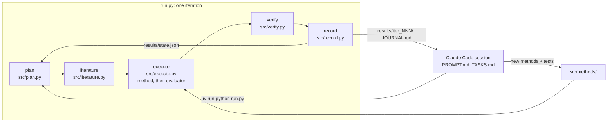
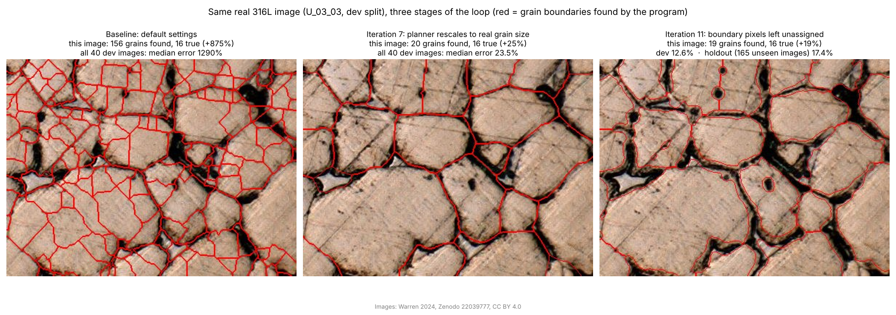
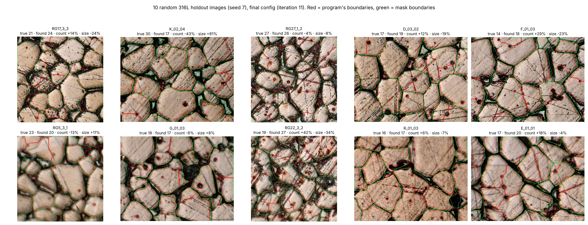
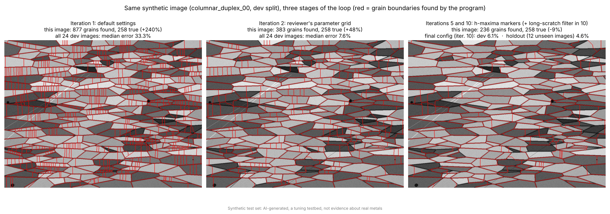

# micrograph-impact-lab

A research loop that tunes a classical grain segmentation pipeline on optical micrographs of metals,
built at the [Claude Impact Lab Berlin 2026](https://github.com/xemantic/claude-impact-lab-2026)
(Claude Community × Foresight Institute).

Team: Ivan Logutov (engineer) and Cesare Garberino (scientist, materials).

**In one paragraph.**
Errors are relative: the larger of the median grain-count error and the median grain-size error over a set of images.

On real 316L stainless steel, the loop brought the dev error from 1290 % (untuned baseline) to **12.6 %**.
That misses the 10 % target: count 11.1 %, size 12.6 %.
On 165 unseen holdout images, run once at the end, the error is **17.4 %**.

On a synthetic testbed (AI-generated, not evidence about real metals), the pooled dev error reached 6.1 %, and 4.6 % on its holdout.
Two of six grain morphologies stay above 10 %.

No controlled noise sweep was done.
Scratches and pores were found only in part on the testbed, and on real images the scratch filter as built made things worse.

## Question

> Can an agent loop tune a classical grain segmentation pipeline so that grain count and mean grain size on optical micrographs match ground truth within 10%,
> and how does accuracy degrade with image noise,
> and can scratches and pores be detected and kept from corrupting the grain measurements?

- **Why it is still open:**
  - Classical segmentation (threshold + watershed) needs hand-tuned parameters per material and image quality.
  - The tuning is manual and rarely reported with error bars against ground truth.
- **Why it matters:** grain size strongly affects the strength of metals.
  The smaller the grains, the higher the yield strength (the Hall–Petch relation),
  and grain size is still often measured by hand on optical micrographs.
- **How a result is checked by computation:** an evaluator compares the pipeline's grains with ground truth.
  - Real 316L stainless steel, against expert grain-boundary masks.
  - Synthetic micrographs, against exact per-grain labels and defect masks.
  - The loop tunes on a dev split; a holdout split is used once, at the end.
- **Design: code measures, Claude tunes.**
  - A scikit-image pipeline segments the grains and measures them.
  - Claude plans the next experiment and chooses its parameters.
  - Claude reviews the metrics and the contour drawings.
  - Claude never estimates a size from pixels.

## The loop

Two loops work together.

- **Inner loop: `run.py`, through the Claude API.** Each iteration leaves one directory of evidence in `results/iter_NNN/`.
- **Outer loop: a Claude Code session following [PROMPT.md](PROMPT.md).** It reads the reviews, writes the methods the planner asks for (tests first), and runs the inner loop again.
  It can also set one iteration's parameters itself (`run.py --params`); such iterations are marked in their `plan.json`.



| Step | What it does | Claude |
|---|---|---|
| plan | picks a falsifiable hypothesis, one of the existing methods and its parameters; every iteration is judged by the fixed project target `max_rel_error <= 0.10` (`target` in config.yaml) | planner |
| literature | searches the web for prior work, once per dataset (`steps.literature: first_only`) | librarian, web search |
| execute | runs the method on the **dev** images; `src/evaluate.py`, the only code that reads ground truth, scores its grains and defects | none |
| verify | checks the target and the method's sanity checks, then asks for a critical review with contour drawings of three dev images attached | reviewer |
| record | writes `summary.json`, updates `results/state.json`, appends to JOURNAL.md | none |

**Metrics** (`src/evaluate.py`):
- `max_rel_error`, the target: the larger of the median count error and the median size error over the dev images.
  - Count: predicted vs true grains, edge grains included.
  - Size: mean equivalent diameter of grains not touching the edge, on both sides.
- `by_family`, synthetic only: the same per grain morphology, with each family's error by noise level.
- `worst_family_rel_error`: the worst family's error.
- For scratches and pores: pixel precision, recall and F1, and the fraction of true defects found.

**Guards against fooling ourselves:**
- `tests/test_leakage.py` fails if a method mentions ground truth, the split or the holdout.
- The split is fixed in [data/splits.json](data/splits.json).
- The planner does not choose the pass threshold.
- `run.py --final` runs once per dataset and refuses a second run.

## Data

The dataset stays outside the repository.
Set `MICROGRAPHS_DIR` to the folder that holds it (it overrides `paths.dataset` in [config.yaml](config.yaml)).
The folder must contain:

```
$MICROGRAPHS_DIR/
├── 02_316L_stainless_with_grain_masks/Grain/{val,test}/{images,masks}/
└── 90_SYNTHETIC_exact_ground_truth/{corrupted,labels_grain,artifact_mask}/, ground_truth_images.csv, ground_truth_grains.csv
```

**316L stainless steel: the real data, where the main claim is measured.**
- 816 optical images, 400×300 RGB, with expert masks (1 = grain interior, 0 = boundary).
  Warren et al. 2024, [Zenodo 10.5281/zenodo.22039777](https://doi.org/10.5281/zenodo.22039777), CC BY 4.0; download it from there.
- Ground-truth grains are the 4-connected components of mask = 1.
  There is no scale bar, so sizes are in pixels.
- Dev = the dataset's `val` folder (40 images); holdout = `test` (165); `train` is not used.
  Two `train` images are in [data/sample/](data/sample/README.md) for the tests.

**Synthetic set: a tuning testbed, not evidence.**
- 48 grayscale images, 1024×768, with exact per-grain labels and defect masks.
- **Provenance:** the scientist generated it on the day with AI prompts and edited it by hand.
  Neither the prompts nor any generator code exist, and its licence is unknown.
  So the images are not redistributed, and no result on them is evidence about real metals.
  The one exception is the figure below, [docs/before_after_synthetic.png](docs/before_after_synthetic.png), published with the scientist's agreement.
  The scientist also agreed to publish the per-image grain counts of the synthetic set (`per_image` in `results/*/execute.json`).
  It is used because its ground truth is exact and it has defect masks.
- Checked against the files (all 36 complete rows):
  - `n_grains` counts all grains, edge-touching ones included.
  - `mean_eq_diameter_um` averages only grains not touching the edge.
  - The evaluator follows both conventions.
- The 12 `magset*` images (other scales, no per-grain rows) are excluded.
  The other 36 are split per family: 24 dev, 12 holdout.
- Defect codes in `artifact_mask/`, checked on 12 dev images:
  - 60: scratches (thin lines, median 418 px long; bright or dark).
  - 120: pores (small, round, very dark).
  - 180 and 240 are not scored; their meaning is unconfirmed.

## How to run

Requires [uv](https://docs.astral.sh/uv/).

```shell
uv sync
uv run pytest                                    # no API calls, no dataset needed
export MICROGRAPHS_DIR=/path/to/hackathon_micrographs
uv run python run.py --dry-run                   # one iteration with canned answers on the dev split, written to results/_dry_run/
uv run python -m src.execute --dataset 316L --out results/baseline/316L   # the method alone on dev, no API
```

A live run calls the Claude API and is billed: about $0.25 per iteration, and about $0.40–0.80 when the literature step runs.
It needs `ANTHROPIC_API_KEY` in the environment, or an `ant auth login` profile.

```shell
uv run python run.py -n 3 --dataset 316L         # three planned iterations on the 316L dev split
uv run python run.py --dataset 316L --params '{"sigma": 4.0, "line_width_px": 15}'   # one iteration with fixed params
uv run python run.py --final --dataset 316L      # once, at the end: the best dev iteration on the holdout split
```

The outer loop runs in [Claude Code](https://claude.com/claude-code):

```
/loop 20m read @PROMPT.md and follow the instructions in it
```

## Results

All numbers come from `results/iter_NNN/execute.json`, `results/baseline/*/execute.json` and `results/final.json`.
For iterations 4–5 the planner had chosen another decision metric, so their entries in `state.json` hold a different number; the tables use `execute.json`.
Each iteration's reviewer verdict is in its `verify.json`; the reasoning behind each step is in [JOURNAL.md](JOURNAL.md).

### 316L stainless steel (real images; 40 dev, 165 holdout)



*Red: grain boundaries found by the program, on one dev image (U_03_03); 16 true grains.
The baseline finds 156, iteration 7 finds 20, iteration 11 finds 19.
Image: Warren et al. 2024, Zenodo 10.5281/zenodo.22039777, CC BY 4.0.*

| Run | What changed | Chosen by | max_rel_error | Count error (bias) | Size error (bias) |
|---|---|---|---|---|---|
| [baseline](results/baseline/316L/execute.json) | default params | — | 1290 % | 1290 % (+1290 %) | 67.8 % (−69.1 %) |
| [6](results/iter_006/) | best synthetic params | planner | 288 % | 288 % (+288 %) | 43.7 % (−43.1 %) |
| [7](results/iter_007/) | every length scaled to ~80 px grains (sigma 4, top-hat 15, h-maxima h 5, min area 1500) | planner | 23.5 % | 23.5 % (+23.5 %) | 11.4 % (+2.5 %) |
| [8](results/iter_008/) | peak markers instead of h-maxima | planner | 28.2 % | 28.2 % (+28.2 %) | 11.2 % (+3.8 %) |
| [11](results/iter_011/) | iteration 7 with `fill_boundaries=false` | **outer loop** (`--params`), on the reviewer's suggestion | **12.6 %** | 11.1 % (+6.5 %) | 12.6 % (−8.9 %) |
| [12](results/iter_012/) | iteration 11 + scratch filter (min length 175 px: iteration 10's 450 px scaled by image width, a guess that did not transfer) | outer loop (`--params`) | 16.7 % | 16.7 % (+16.7 %) | 12.1 % (−2.2 %) |
| [**holdout**](results/final.json) | iteration 11's config, run once | — | **17.4 %** | 17.4 % (+9.1 %) | 16.3 % (−10.7 %) |

The size errors of the baseline and iterations 6–8 were computed before a NaN fix (one dev image has no grain off the edge).
Recomputed without it: 69.2 %, 43.6 %, 10.7 % and 11.0 % (see JOURNAL.md).
`max_rel_error` is unchanged in every case, because count dominates.



*10 random 316L holdout images (seed 7), final config. Green = mask boundaries, red = program. Counts match results/final_316L/execute.json.*

**The final 316L config (iteration 11) was not chosen by the planner.**
The reviewers of iterations 7 and 8 suggested `fill_boundaries=false`, which matches masks that leave boundary pixels out.
The planner had not tried it, so the outer loop ran it with `run.py --params`, as the developer asked.

Other observations:
- Two changes did most of the work.
  - Scaling every length to the real grain size (about 80 px): 288 % → 23.5 %.
  - Leaving boundary pixels unassigned: 23.5 % → 12.6 %.
- The holdout error is 4.8 points higher than dev. Part of the dev improvement may be fit to the 40 dev images, or the test folder may be harder; these data cannot tell which.
- The reviewer of iteration 7 found that predicted grain sizes sit in a narrow band (70–108 px) while true sizes span 52–123 px:
  no single global setting fits both the fine-grained and the coarse-grained images.
- The scratch filter (iteration 12) marked 1,233 false "scratches" in the wide dark boundary bands; 316L has no defect ground truth to measure this against.

### Synthetic testbed (24 dev images, 12 holdout, 6 morphologies)



*Testbed, not evidence: the synthetic images are AI-generated, with no generator code, and say nothing about real metals.*
*Red: grain boundaries found by the program, on one dev image (columnar_duplex_00); 258 true grains.*
*Iteration 1 finds 877 (+240 %), with elongated grains cut into "ladders" by peak markers.*
*Iteration 2 finds 383 (+48 %), after the reviewer's parameter grid.*
*Iterations 5 and 10 find 236 (−9 %), with h-maxima markers.*
*Published with the scientist's agreement.*

| Iteration | What changed | max_rel_error (pooled) | Worst family |
|---|---|---|---|
| [1](results/iter_001/) | defaults | 33.3 % | — (per-family scores not yet computed; columnar_duplex_01 count +282 %) |
| [2](results/iter_002/) | reviewer's grid: wider marker spacing, sigma 2 | 7.6 % | columnar 51.4 % |
| [4](results/iter_004/) | h-maxima markers (new method, written by the outer loop) | 7.9 % | equiaxed 20.4 % |
| [5](results/iter_005/) | h-maxima h 3 | 6.6 % | equiaxed 18.3 % |
| [9](results/iter_009/) | + scratch and pore detection | 7.5 % | columnar 18.3 % |
| [10](results/iter_010/) | + long-scratch detection only | **6.1 %** | elongated 15.0 % |
| [**holdout**](results/final.json) | iteration 10's config, run once | **4.6 %** | 12.8 % |

- **The loop at work.** The reviewer saw from the contour drawings that peak markers cut elongated grains into "ladders".
  The outer loop added h-maxima markers (test first), and the columnar error fell from 51.4 % to 4–6 %.
- **Defects** (iterations 9–10):

  | Iteration | Scratches found (precision) | Pores found (precision) |
  |---|---|---|
  | 9 | 47 % (39 %) | 64 % (17 %) |
  | 10 | 9 % (96 %) | off |

  - Taking defects out of the boundary map helped equiaxed and elongated grains.
  - In iteration 9, the scratch detector also took chains of straight columnar grain boundaries for scratches, and those grains merged.
  - Most false pores are dark triple junctions, where boundaries meet.
- **Noise: no controlled sweep was done.**
  - One observation: in iteration 5, within each morphology (`by_family[f].by_level`), the count error does not rise steadily from corruption level 0.15 to 0.95.
  - There is one image per morphology and level, so this is an observation, not a measurement of how accuracy degrades with noise.
  - The second part of the question is therefore open.

### Where it got stuck

- **316L.** The best configuration misses 10 % on count (11.1 %) and size (12.6 %) on dev, and reaches 17.4 % on the holdout.
  The pipeline has one global scale, but the images range from fine to coarse grains.
  The scratch detector does not transfer to real images: its line map picks up the wide boundary bands.
- **Synthetic.** Equiaxed and elongated grains over-count by 13–15 % in iteration 10, the best run.
  The reviewer says no parameter of the current method separates them, and asks for new methods:
  - a thin-ridge scratch detector;
  - a stricter pore test.
- **The pooled metric can pass while a morphology fails.** This is why `by_family` and `worst_family_rel_error` were added.

### Limitations

- **The tuned parameters are tied to grain scale and image type.**
  The developer ran both final configs unchanged on a new SEM image from the scientist (the image and that run are not in this repository).
  - The 316L config merged neighbouring grains (38 found).
  - The synthetic config followed the boundaries better (113 found).
  - The image has no mask, so there is no error number.

  A new image type needs a new run of the loop with some labelled images.
- **Small dev sets.** The 316L dev set has 40 images. The synthetic dev set has 24, with 4 per morphology and 1 per morphology and noise level.
- **Interior-only size on 316L.** The images are small relative to the grains. Size is measured on grains not touching the edge:
  - one dev image has none, and is left out of the size median;
  - one has only one.
- **Ground truth.** Errors are measured against the published masks; the Zenodo record does not document how they were made.
- **Literature.** The literature step's URLs are search results it retrieved; its text carries no per-claim citations.
- **One method family.** Only classical watershed was tried; no learned segmentation.
- **Hand-fixed iterations.** Iterations 11 and 12 were fixed by the outer loop (`run.py --params`), not chosen by the planner.
- **Bugs found on the way.** Each is recorded in JOURNAL.md next to the result it affected:
  - a NaN in a size median;
  - an iteration lost to a stray parameter;
  - a planner that set its own pass threshold.
- **Cost.** Iterations 1–12 cost about $3.10 in API calls.

## Measure flakes in your own images: the adapt tool (added 2026-11-17)

One command takes a folder of micrographs of any lamellar or flake structure and returns measurements with a report:

```shell
.venv/bin/python -m src.adapt path/to/images/ --name my_set                 # no API calls
.venv/bin/python -m src.adapt path/to/images/ --name my_set --live 2        # + 2 agent rounds with Claude (billed)
.venv/bin/python -m src.adapt path/to/images/ --name my_set --mode phase --um-per-px 0.25
.venv/bin/python -m src.adapt path/to/images/ --name my_set --flake-width 30  # measure the coarse of two scales
```

Results go to `results/flakes/adapt/<name>/`:
- `report.html` / `report.md`: the measurements, how accurate they are, and how far to trust them (a **Confidence** section first);
- `flakes.csv` (every flake) and `image_summaries.csv` (one row per image, with bootstrap 95 % intervals);
- `review/`: each original next to its drawing, for checking by eye;
- `adapt_log.json`: everything the tool did, including the agent's reviews and plans.

**How it adapts to a new kind of image.**
1. *Profile* ([src/methods/profile.py](src/methods/profile.py)): which reading fits the image, and at what scale.
   - The readings:
     - **boundaries**: flakes separated by thin lines, e.g. etched α + β titanium;
     - **phase**: flakes of one phase in a matrix, e.g. bands, colonies, islands;
     - **regions**: flakes told apart only by steps between grey levels, e.g. BSE images of TiAl lamellae. This one is never chosen automatically: the agent or the user picks it.
   - Ambiguous images get the boundary reading, and the agent checks it.
   - It also measures the flake and boundary width, the noise and the colour axis (colour etchings), and finds the region of interest (resin, padding, label boxes).
   - Every pixel setting is scaled to the measured flake width.
   - Images with flakes under 6 px are analysed enlarged.
   - When a second, much coarser scale holds ≥ 30 % of the flake phase, the report names it (`--flake-width`).
2. *Twin* ([src/twin.py](src/twin.py)): code-generated images with exact per-flake truth.
   They are fitted first to the real images' profile (widths, noise, blur, phase fraction), then to what the method measures on them (median flake aspect ratio).
   The twin is **trusted** only if both match: profile within ×1.35, method-measured shape within ×1.5.
3. *Memory* ([src/knowledge.py](src/knowledge.py)): the settings that worked on the most similar trusted image set measured before are a second starting point (pixel settings rescaled).
4. *Search* ([src/search.py](src/search.py)): many configurations evaluated on the twin, in parallel and cached.
   It runs only on a trusted twin; otherwise the scaled defaults are kept.
   A real-image guard then compares the tuned settings with the start settings on the real images (flakes kept, rotation check).
   If the tuned ones are clearly worse there, the start settings stay: the twin cannot see everything.
   The objective is the worst family (alignment × corruption), so an easy family cannot hide a failing one.
5. *Agent* (`--live N`): each round, Claude
   - reviews each real original next to its drawing (and a twin drawing);
   - sees what was learned on the most similar earlier sets;
   - plans the next search, or switches the reading when the outlined regions are not the flakes.
   Without a trusted twin, its parameter changes are applied on the evidence of the drawings and judged by the next review, and the report says so.
6. *Checks*:
   - the chosen settings are scored once on held-out twin images;
   - the real images get the 30° rotation check, reported next to the sampling interval of S;
   - the report's Confidence section states all of this with its limits.
7. *Learning*: each finished set adds a memory entry (`results/flakes/knowledge.jsonl`), and the next similar set starts from it.

**Stress test** (13 sets of very different flake images, no API; one page with the checks, measurements, verdicts by eye and drawings: [results/flakes/stress_test_index.html](results/flakes/stress_test_index.html)):
- 7 of 13 sets get a trusted twin; on 5 of them both the held-out twin images and the real-image rotation check are within tolerance (Ti64, basketweave Ti, colour-etched lamellae, duplex bands, banded islands at the limit).
- On duplex bands the tuned settings improved the real-image rotation check from 0.95 to 0.27.
- The real-image guard rejected the twin-tuned settings on pearlite (rotation 4.3 vs 2.0).
- 6 sets are not twinned well enough (the SEM screenshot, TiAl BSE, needles, Widmanstätten, bainite TEM); their reports say the numbers are unvalidated.
- The rotation check passes on 12 of 13 sets (not on pearlite, where ferrite grains count as flakes).
- The history of the four stress runs, what each one found wrong and what changed, is in [JOURNAL.md](JOURNAL.md) (2026-11-17).

**Live agent loop** (`--live 2`, on the four hardest sets; about $0.27 per set at list prices; on the overview page too):
- On needles, bainite and TiAl, Claude's review found that the automatic profile measured the wrong thing: the eutectic instead of the cementite needles, the ferrite matrix instead of the dark plates, colony packets instead of TiAl lamellae.
  The planner switched the phase or the reading, and the next review confirmed it.
- On the scientist's SEM image it found that the instrument's data bar was being measured as flakes; a detector for data bars now removes it.
- Every second review still asked for more. And since none of these four sets has a trusted twin, how accurate the corrected numbers are is not measured.

**Final holdout exams** (once per dataset, current method and defaults, [results/flakes/final.json](results/flakes/final.json)):
- lamellar_synth, 12 held-out images: worst family 0.60, pooled 0.285 (dev 0.657 / 0.29), flake recall 0.96.
- Ti64, 7 held-out real images: rotation check 0.24 (dev 0.218).

**What it cannot promise.**
- Real images have no ground truth.
  Their accuracy is inferred from the twin only as far as the twin resembles them (stated in each report), and judged in the drawings.
- The generator draws straight laths in colonies, islands of one phase, and touching laths of different grey levels.
  Curved plates, dendrites, needles in a eutectic, or equiaxed grains are not twinned: on such images the twin is not trusted, and the numbers are unvalidated.
- Flakes narrower than ~4–5 px are at the resolution limit (the scientist's SEM screenshot: 3–4 px).
  Orientation and S survive; aspect ratio and length do not. Use full-resolution images.
- Scratch detection on real texture finds about a third of strong scratches (blind test, F-16).
  The measurements are robust to them anyway: a strong scratch moves them by ≤ 0.12 of the tolerance.

## Coarse cell structures (added 2026-11-17, second round 2026-11-18)

A private test on optical micrographs of a coarse, elongated cell structure showed the tool losing to a plain h-maxima watershed (flake F1 0.64 vs 0.74, aspect ratio −22 %, one image 7° off).
These images cannot be shared, so the fixes were developed and checked on code-generated images with exact truth.
Details, numbers and the variants that failed are in [JOURNAL.md](JOURNAL.md) (2026-11-17, "Coarse cell structures", and 2026-11-18, "Coarse cells, second round").

**Second round: a calibration card and a calibrated twin.**
The first round's twin was built from a description and proved too easy: on the private images the first round's tool scored F1 0.56 (full `src.adapt`) against 0.74 for the tuned watershed, read the cell width as 34 px for cells 51-67 px wide, and collapsed S on two soft images.
- *Calibration card* ([src/calibration_card.py](src/calibration_card.py)): statistics of a set of images with masks (cell sizes, S, boundary contrast and its invisible share along and across the cells, noise, dots, pockets, illumination, sharpness, soft areas).
  Only these numbers cross over, never pixels:

  ```shell
  .venv/bin/python -m src.calibration_card --images <dir> --masks <dir> --out card.json [--scale 0.5]
  ```

  The private images' numbers ship as [data/cards/coarse_cells_example.json](data/cards/coarse_cells_example.json).
- *Calibrated twin* ([src/synth_cells.py](src/synth_cells.py); `python -m src.synth_cells --out data/coarse_cells_cal`): a field filled with pebble-like cells, faint beaded boundaries with gaps, inclusions, pockets, scratches, and soft images with a focus gradient, fitted to the card.
  It reproduces the private failures of the old code (F1 0.63 against 0.64, aspect ratio −23 to −26 % against −22 %, width read at ~0.6 ×, S collapse on soft images); with the width forced to 65 px it is harder than the real images (F1 0.37 against 0.64).
- *Use it on your images:*

  ```shell
  .venv/bin/python -m src.adapt <images> --name <set> --calibration card.json   # fast default: 12 configurations
  .venv/bin/python -m src.adapt <images> --name <set> --calibration card.json --thorough   # 30 configurations
  ```

  A set is measured as coarse cells when a card is given or the profile finds cells; the twin is then the calibrated cell family, the search also scores segmentation, and the guard refuses settings that merge cells.
- *Method changes of this round* (cells ≥ 24 px only; laths unchanged): the width from the fundamental spacing of a hysteresis line map (all estimators printed), soft areas found from the width of the boundary lines and left out, boundary detection by hysteresis with a noise floor, and coarse defaults for threshold and watershed seeds.
- *Results on the calibrated twin* (blind set of 12 images, code and params frozen first; JOURNAL 2026-11-18):
  - flake F1 **0.774** (clean family 0.857, scratched 0.804, soft 0.556);
  - median aspect ratio bias −15 %, median S error 0.035, median direction error 1.7° (worst 12°, on a soft image);
  - the old code on the same kind of images: F1 0.63, AR −25 %.
  - **The target (F1 ≥ 0.80, AR within 10 %, S ≤ 0.03, direction ≤ 1.5°) is not met**: partly out-of-focus images are the weak point, and thick scratches near the cell direction (fix 7) are not handled yet.
  - Only the private rerun can say how this transfers to the real images (bar: watershed F1 0.74).

**The first-round twin family** ([src/synth_cells_v1.py](src/synth_cells_v1.py); `python -m src.synth_cells_v1 --out data/coarse_cells`), kept for its tests and results:
- bright cells ~60–70 px wide, aspect ratio 2.4–3.6, rounded ends, stacked end to end in curved rows (S 0.8–0.9), 90–150 per 1100 × 1400 image;
- thin dark boundaries (2–5 px), broken and dotted, the end-to-end ones fainter;
- grey speckled pockets at triple junctions, dark pores inside the cells;
- faint hairline scratches and an occasional thick one, uneven illumination, and in one family an out-of-focus half-plane.

Truth is written as cell ids, scratch maps, and masks in the private test's convention (0 boundary, 1 cell, 2 pocket, 3 ignore).
There are three families (clean, scratched, blurred); dev and holdout images are generated, not committed.

**Scoring** ([src/score_masks.py](src/score_masks.py)), for any method's label PNGs:

```shell
.venv/bin/python -m src.score_masks --labels results/flakes/adapt/<name>/labels --masks <dir of mask PNGs> [--json score.json]
```

It reports:
- flake precision, recall and F1 at IoU 0.5;
- merges, splits and pocket false positives;
- per image, the errors of mean direction, S and median aspect ratio, measured the same way from both label images.

`src.adapt` writes one label PNG per input image at the input's size (0 background, label k = flake k of `flakes.csv`).

**What changed in the method (first round).**
The first two changes act on any image where they apply; the rest only where flakes are ≥ 24 px wide, so the fine-lath behaviour validated on Ti64 is untouched.
1. *Flake width* from the spacing of the boundary lines along the flakes (scan lines across the local direction, peak of the spacing distribution).
   Where it disagrees strongly with the old Otsu-thickness estimate (> 1.6×, smooth blend up to 1.9×) and has a clear peak, it takes over; disagreements are reported.
   On the twin: 30.5 px → 62.4 px (true 55–75); the private images read 31 px.
2. *Pixel parameters capped by the image size*: 20 × a 62 px width asked for scratches longer than the image.
3. *Splits:* pores are filled before the watershed (they were the cut points). Pieces are not merged across a shared border darker than both (faint end-to-end boundaries).
4. *Pockets:* fine speckle without a direction is found, and flakes lying on it are `not_a_flake` (left out of the statistics and the label PNGs).
5. *Scratches:* the line candidates and the tests use a direction field over half a flake width.
   Faint hairlines and thick scratches are looked for, and scratches within 25° of the cells are not (they look like boundaries).
6. *Out-of-focus areas* (sharpness and contrast both low, ≥ 10 % of the image) are left out of the region of interest, and their fraction is reported.

**Results of the first round on its own (uncalibrated) twin** (defaults, no API).
That twin proved too easy: these numbers did not transfer to the private images (F1 0.56 there against 0.74 for the watershed).

| | dev, before | dev, after | blind set 2, before | **blind set 2, after** |
|---|---|---|---|---|
| flake F1 | 0.726 | 0.864 | 0.748 | **0.863** |
| splits / merges | 167 / 93 | 73 / 114 | 173 / 68 | 77 / 99 |
| pockets counted as flakes | 542 | 21 | 427 | 7 |
| median aspect ratio bias | −19 % | −4.0 % | −17.8 % | **−3.6 %** |
| median S error | 0.024 | 0.005 | 0.025 | 0.015 |
| worst direction error | 2.5° | 1.2° | 1.45° | 1.3° |

- *Blind set 2:* 12 images from a fresh OS-entropy seed, generated after the code (`77a86cd85c`) and params were frozen, and run once; the "before" column is the tool at commit `d99b04a`.
- *Blind set 1* (the code before a last regression fix): F1 0.856, aspect ratio −4.5 %.
- *A plain h-maxima watershed* scores F1 0.39–0.63 on blind set 2.
- *Existing targets:* lamellar_synth (worst family 0.657, scratch P/R 0.92/0.82) and the Ti64 rotation check (0.218) are unchanged.
- *Stress sets (13 real-image sets):* with each set's parameters held fixed, 11 sets give identical results and 2 differ slightly ([scripts/stress_same_params.py](scripts/stress_same_params.py)).
  Run as a whole, the adapt tool now fails the rotation check on 2 sets (ti_basketweave, purple_flakes_L10) and passes it on pearlite.
  This comes from the search's history (knowledge memory, search cache), not from the method; see JOURNAL and TASKS A-14.

**Limits.**
- The first twin was a model of a description, not of the images, and was too easy; the calibrated twin matches the card's numbers but is still a model.
  Only the private rerun can say whether the tool now beats a watershed tuned on the real images (`src.calibration_card`, then `src.adapt --calibration`, then `src.score_masks`; TASKS C-8).
- *Blurred images remain the weak point.*
  The out-of-focus detector is conservative: it flags none of the 47 real images at hand, and misses some blur.
  On the blurred family the aspect ratio is still −12 % (blind set 2) to −23 % (blind set 1), the same failure the private test showed.
- Scratches within ~25° of the local cell direction are not found (geometry cannot tell them from boundaries); the faintest bright hairlines are missed.
- The rules for coarse flakes switch on at 24 px; a structure near that width gets either behaviour.
- *A public check without truth* ([scripts/public_cells_check.py](scripts/public_cells_check.py)): three optical images of coarse elongated cells in SLM AlSi10Mg.
  Source: Zhang et al. 2023, *Materials* 16(3) 1222, Fig. 6 f, g, i, [doi:10.3390/ma16031222](https://doi.org/10.3390/ma16031222), CC BY 4.0.
  - At their published size (cells ~20–25 px), nothing changes; enlarged ×3, little changes ([drawing](results/flakes/cells/public_E21/before_vs_after.jpg)).
  - The check shows a different limit: wide *pale* boundary bands between two-tone cells fit neither reading, and on two of the three images about half the cells are left out (TASKS C-6).
  - It is not evidence for or against the fixes above.

## Flakes: shape and alignment of laths (added 2026-11-16)

A second task on the same loop, for lamellar microstructures such as Ti-6Al-4V:
measure each flake (lath) and how the flakes of an image are aligned,
while keeping grain (colony) boundaries and keeping polishing scratches from cutting or merging flakes.
The question is `flakes.question` in [config.yaml](config.yaml).

**What is measured** ([src/methods/flakes.py](src/methods/flakes.py), statistics in [src/axial.py](src/axial.py)).
Angles are in degrees in [0, 180), from the image x axis, counterclockwise as displayed.
- Per flake: orientation, length and width (axes of the same-moment ellipse), aspect ratio, area, solidity,
  misalignment to the image mean direction, whether it touches the edge or is crossed by a scratch.
- Per image: mean direction (axial mean), order parameter S (2D nematic, 0 isotropic, 1 parallel),
  mean and median misalignment, circular spread, fraction within 15°,
  **local S** (alignment inside 160 px tiles, i.e. within colonies),
  an independent S from the image structure tensor, median and mean aspect ratio, length, width, counts, scratches.
- Drawn grey and left out of the statistics:
  - branched regions (skeleton with three or more long arms; a bent lath is kept);
  - round flakes (aspect ratio < 1.5);
  - flakes taken for grain-boundary α (more than 4× the median length and more than 25° off their neighbours; caught only in part).

**How** (all classical, scikit-image):
region of interest (drops dark mounting resin and an SEM data bar) →
boundary polarity (dark for etched optical, bright for backscattered SEM; detected automatically) →
background flattening → scratch detection and inpainting →
Sato ridge filter for the thin boundaries → gaps closed along the local lath direction →
h-maxima watershed, then pieces merged back when their neck is nearly as wide as the flake.

**Scratches vs grain boundaries.** A straight thin line is taken as a scratch only if all of these hold:
- it crosses the local lath direction by ≥ 12°;
- the laths on its two sides point the same way;
- it is darker (or brighter) than both of its sides;
- the image on its two sides is correlated along the laths.

The first two reject colony boundaries between differently oriented colonies, the last one rejects boundaries where the laths end.
Scratch pixels are then filled from the image along the lath direction, so a boundary crossed by the scratch is continued through it.

**Two datasets** (splits in [data/splits.json](data/splits.json); loop state in `results/flakes/`):
- `lamellar_synth`: 36 code-generated images ([src/synth_lamellar.py](src/synth_lamellar.py), seed 0; 24 dev, 12 holdout),
  12 families = alignment (random, weak, moderate, strong) × corruption (clean, scratched, harsh),
  one image per family with inverted (SEM-like) contrast.
  Exact truth by construction: every flake's orientation, its shape, the scratch pixels, and whether each scratch crosses the laths.
  Unlike the AI-generated grain set, it can be regenerated by anyone. It is still a testbed, not evidence about real metals.
- `Ti64`: the 20 lamellar optical images (`Ti64_20`–`Ti64_39`) of [Zenodo 5714384](https://zenodo.org/records/5714384), CC BY 4.0; 13 dev, 7 holdout.
  `Ti64_0`–`Ti64_19` are bimodal (equiaxed primary α) and not used.
  **There is no ground truth.** The target there is self-consistency:
  the central disk of each image is measured as it is and turned by 30° (resampled);
  the direction must turn by 30°, S and aspect ratio must not change ([src/consistency.py](src/consistency.py)).
  A 90° turn is not used: every pixel operation commutes with it exactly, so it would pass trivially.
  Passing is necessary, not sufficient: a consistently wrong segmentation passes too.
  Whether the flakes are right on real images is judged only by the reviewer reading the drawings.

**Targets** (fixed in config.yaml; the tolerances are the scientist's call and are open to change):
- `lamellar_synth`: `worst_tolerance_ratio <= 1`, the worst of these errors divided by its tolerance:
  - mean direction 5°;
  - S 0.05;
  - mean misalignment 5°;
  - median aspect ratio 15 %;
  - per-flake orientation 5° (flakes matched at IoU ≥ 0.5).
- `Ti64`: `worst_consistency_ratio <= 1`, with tolerances of 3° for direction, 0.03 for S and 5 % for aspect ratio.

**Baseline, default parameters, no API** (`results/flakes/baseline/*/execute.json`):

| Dev set | Main metric | Details |
|---|---|---|
| [lamellar_synth](results/flakes/baseline/lamellar_synth/execute.json), 24 images | worst_tolerance_ratio **0.35** (worst family 1.03, weak_harsh) | direction 0.28°, S 0.008, misalignment 0.42°, aspect ratio 5.2 % (biased low), flake orientation 1.47°; flakes found 93.6 % (IoU ≥ 0.5); scratches: precision 97.7 %, recall 69.9 % of crossing scratches, 5.5 % of scratches running along the laths |
| [Ti64](results/flakes/baseline/Ti64/execute.json), 13 images | worst_consistency_ratio **0.40** | 30° turn: direction off by 0.49°, S by 0.011, aspect ratio by 2.0 %; measured: median S 0.54, local S 0.83, mean misalignment 25.1°, aspect ratio 2.92, ~1200 flakes per image, 0 scratches found |
| [lamellar_synth, after the outer-loop fixes](results/flakes/baseline_v2/lamellar_synth/execute.json) | worst_tolerance_ratio **0.29** (worst family **0.82**, strong_harsh) | direction 0.30°, S 0.010, misalignment 0.44°, aspect ratio 3.8 % (biased low), flake orientation 1.45°; flakes found 95.3 %, precision 93.6 %; 94 % of the flakes used for shape match a true flake, 4 % are fragments |
| [Ti64, after the fixes](results/flakes/baseline_v2/Ti64/execute.json) | worst_consistency_ratio **0.67** | 30° turn: direction 0.76°, S 0.020, aspect ratio 2.1 %; measured: median S 0.54, local S 0.81, aspect ratio 2.56, ~1140 flakes per image |
| [lamellar_synth, long laths kept (current)](results/flakes/baseline_v3/lamellar_synth/execute.json) | worst_tolerance_ratio **0.29** (worst family **0.61**) | aspect ratio −1.4 %, direction 0.26°, S 0.012; flakes found 95.3 %, precision 93.4 % |
| [Ti64, long laths kept (current)](results/flakes/baseline_v3/Ti64/execute.json) | worst_consistency_ratio **0.16** | 30° turn: direction 0.46°, S 0.005, aspect ratio 0.7 %; measured: median S 0.55, local S 0.81, aspect ratio 2.80, ~1370 flakes per image |

On Ti64 the flakes are aligned within colonies (local S ≈ 0.83), but the colonies are not aligned with each other (S ≈ 0.54).
The structure-tensor S differs from the flake S by 0.14 (median): the two weight the image differently, so treat it as a cross-check, not an error.

**Not done yet, and known limits:**
- **Live loop, so far 3 iterations on lamellar_synth** ([results/flakes/](results/flakes/), JOURNAL.md 2026-11-16).
  Best: iteration 3, worst_tolerance_ratio 0.319, worst family 0.935 (weak_harsh, aspect ratio −14 %).
  The reviewer rejected all three, because the planner's own predictions failed:
  neither the watershed seed height nor a more sensitive scratch detector fixes the short flakes in the harsh families.
  Not yet run live on Ti64. The literature step is off (the scientist found it not useful).
  After these iterations the outer loop found the real cause (fragments, not scratches) and changed the method.
  On the new method (iterations 4–7): best synthetic worst family **0.712** (iteration 5).
  Ti64 passed rotation consistency (0.52), but the reviewer and a check by eye agreed that long laths were left out of the statistics.
  The cause was solidity: real laths are bent, and a bent lath has low solidity.
  A skeleton-based branch test now keeps them (Ti64 grey area 30 % → 4 %, JOURNAL F-12).
- **Aspect ratio is the weak spot.** Each flake that is found is measured within a few percent.
  The image median is biased low (−12 % in strong_harsh) because about 10 % of the flakes in noisy images are fragments of a lath.
  Direction- and shape-aware merging of pieces (JOURNAL 2026-11-16) brought the worst family from 1.03 to 0.82.
- **Scratches on real images: measurements robust, detection weak.**
  In a blind test, fake scratches were pasted at random onto the Ti64 dev images (positions hidden from the method; params fixed beforehand; [results](results/flakes/scratched_test/)).
  - Strong scratches moved the direction by 0.27°, S by 0.003 and the aspect ratio by 0.8 %.
  - Detection found only 1 % (faint) and 23 % (strong) of the crossing scratches, at 95–99 % precision.
  - Without scratch handling the shifts were about a third larger and still small.
  - After improving detection on a separate, visible development set, a second blind test (fresh positions, params frozen first) found **30 %** of strong crossing scratches at 95 % precision.
    The development set had suggested 51 %.
    Strong scratches then moved the measurements by 0.12 of the tolerance, against 0.28 without scratch handling.
- **Scratches parallel to the laths** (within ~12°) cannot be told from lath boundaries by geometry, and are not found.
  The evaluator scores them apart (`scratch_recall_parallel`).
- **Low-resolution images.** On a 576×433 SEM screenshot, laths are 2–4 px wide and the β between them is broken into dots.
  The per-flake segmentation then fails (most of the area is grey).
  The image-level structure-tensor numbers are still usable. Use full-resolution originals.
- **Unresolved regions.** Smeared or over-etched areas and grain-boundary α layers come out as grey, unused regions.
  They are not counted, and they are not identified as such either.
- **Ti64 accuracy is unmeasured.** It has no flake masks; a few hand-annotated images would turn the consistency check into an accuracy check.

**Without `uv`** (as on the scientist's machine), a plain virtual environment works too; replace `uv run python` by `.venv/bin/python`:

```shell
python3 -m venv .venv
.venv/bin/pip install numpy scipy scikit-image pillow pandas pyyaml matplotlib anthropic pytest
```

**Measure your own images** (no API, no loop):

```shell
uv run python -m src.measure path/to/*.png --out measurements/run1
uv run python -m src.measure img.tif --params '{"crop_bottom_px": 60, "um_per_px": 0.14}' --out measurements/run2
uv run python -m src.measure img.png --from-iteration 3 --out measurements/run3   # params tuned by the loop
```

This writes `flakes.csv` (one row per flake), `image_summaries.csv` (one row per image), `scratches.csv`,
and a colour drawing per image: flakes coloured by orientation (key in the corner), unused flakes grey, scratches white, mean direction as an arrow.

**Run the loop on flakes:**

```shell
uv run python -m src.synth_lamellar --out data/lamellar_synth        # optional: also generated on first use
uv run python -m src.execute --dataset lamellar_synth --out results/flakes/baseline/lamellar_synth   # no API
uv run python run.py --dry-run --dataset lamellar_synth             # whole loop, canned answers
uv run python run.py -n 3 --dataset lamellar_synth                  # live: planner, librarian, reviewer
uv run python run.py -n 2 --dataset Ti64                            # live, on the real images
uv run python run.py --final --dataset lamellar_synth               # once, at the end
```

## Repository

| Path | What it is |
|---|---|
| [config.yaml](config.yaml) | the question, the target, models, limits and paths |
| [run.py](run.py) | the single entry point of the inner loop (`--dry-run`, `--dataset`, `--params`, `--final`) |
| [src/measure.py](src/measure.py) | flake measurements on any images, outside the loop |
| [src/synth_lamellar.py](src/synth_lamellar.py) | the code-generated lamellar test set with exact per-flake truth |
| [src/](src/) | one module per step; `src/methods/` with the methods the planner can choose; `src/evaluate.py`, the only reader of ground truth; `src/splits.py` |
| [data/splits.json](data/splits.json) | the fixed dev/holdout split |
| [tests/](tests/) | tests, written before the code they test, on a Voronoi micrograph built in code |
| [data/sample/](data/sample/README.md) | two 316L images with masks and one Ti64 image, for the tests |
| [docs/](docs/) | figures |
| [results/](results/README.md) | every iteration: plan, literature, metrics, review, cost |
| [PROMPT.md](PROMPT.md) | the standing instruction for the outer loop |
| [TASKS.md](TASKS.md) | the task queue |
| [JOURNAL.md](JOURNAL.md) | every result, decision and exchange, in order |
| [SUBMISSION.md](SUBMISSION.md) | the text of the lab submission issue |
| [CLAUDE.md](CLAUDE.md) | context, rules and lessons for Claude Code |

## Licence

Code is licensed under the [Apache License 2.0](LICENSE),
and text under [CC BY 4.0](LICENSE-CC-BY-4.0),
the default of the Claude Impact Lab.
Data keeps the licence of its source, listed in [data/sample/](data/sample/README.md);
the 316L images in [docs/](docs/) are from Warren et al. 2024 (CC BY 4.0);
the drawings in [results/flakes/cells/public_E21/](results/flakes/cells/public_E21/) are made from Zhang et al. 2023, *Materials* 16(3) 1222, Fig. 6 ([doi:10.3390/ma16031222](https://doi.org/10.3390/ma16031222), CC BY 4.0), enlarged with segmentation lines drawn on them.
