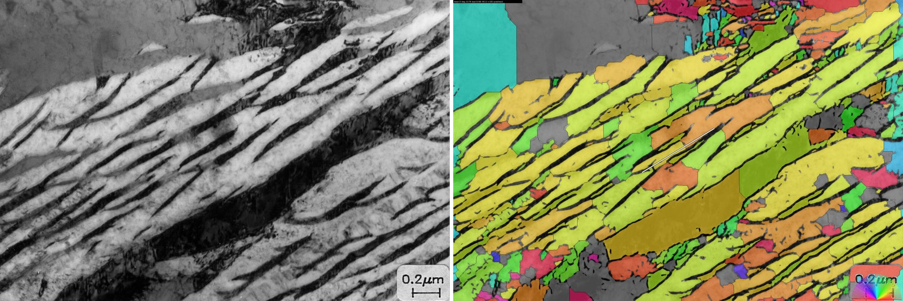
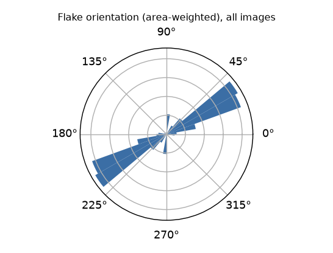
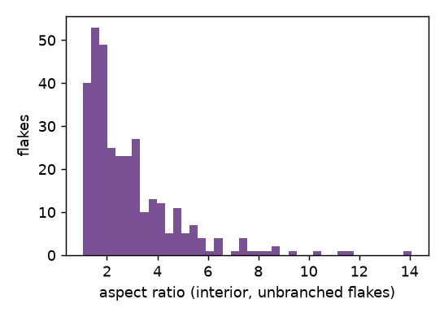

# Flake measurements: bainite_L06

1 images; reading: **boundaries** (ambiguous profile; boundary reading by default (the agent review checks it)); flake width 23.41 px; code version 2d70afd967.

## Confidence

- **Twin not usable** for this image set (it does not resemble the images closely enough, or flakes cannot be found on it at this size): the accuracy below is not evidence about these images, and no search was run on it; the scaled default settings were used. Treat the numbers as unvalidated; check them in the drawings.
- Twin accuracy (held-out twin images, exact truth): worst family ratio 2.62, pooled 1.67 (<= 1 means within the tolerances of config.yaml); dev 2.19: a gap shows how much the search fitted the dev twin images.
- The twin resembles the real images only roughly (worst profile mismatch x2.00; flake aspect ratio and width as measured by the method differ by up to x1.15); the twin accuracy carries over only as far as that, and only for structures the generator draws (straight laths in colonies).
- Rotation check on the real images (central disk turned by 30 deg and measured again): worst ratio 0.68 (passes); S changes by 0.0141, the direction by 2.0356 deg, the median aspect ratio by 0.0033 (relative); for comparison, the 95 % interval of S from the finite number of flakes is +/-0.128.
- **Two scales**: 35% of the bright phase is in structures about 91 px wide, 4x the typical flake width used here (23.4 px). The settings fit the fine structures; the coarse ones may be split, merged or left out, and the statistics mix the two populations. If the coarse ones are the flakes you mean, rerun with --flake-width 91.
- The image profile was ambiguous between a boundary network and phase islands: check in the drawings that the outlined regions are the flakes you mean; rerun with --mode phase otherwise.
- Lengths are in pixels (no --um-per-px given).

## Set summary

| | median | min | max |
|---|---|---|---|
| order parameter S | 0.784 | 0.784 | 0.784 |
| local S (within colonies) | 0.895 | 0.895 | 0.895 |
| mean misalignment (deg) | 13.9 | 13.9 | 13.9 |
| median aspect ratio | 2.29 | 2.29 | 2.29 |
| median length (px) | 84.7 | 84.7 | 84.7 |
| median width (px) | 35.5 | 35.5 | 35.5 |
| flakes used per image | 330 | 330 | 330 |

Mean directions differ per image (axial; see the table): a set-level mean direction is only meaningful when the images were taken in the same specimen frame.

## Per image

| image | mean dir (deg) | S [95 % CI] | local S | misalignment (deg) | AR [95 % CI] | flakes | scratches |
|---|---|---|---|---|---|---|---|
| L06__rank063__085_Bainit_Gefuge_von_80_Si_13__CC-BY-SA-3.0 | 31.3 | 0.784 [0.63, 0.887] | 0.895 | 13.9 | 2.29 [2.09, 2.52] | 330 | 0 |

## How accurate is it (twin images with exact truth)

Twin: 18 code-generated images fitted to this set (realism ok: False; worst profile mismatch x2.00).

| twin images | params | mean direction err (deg) | S err | misalignment err (deg) | AR err | flake orientation err (deg) | flakes found | worst family ratio |
|---|---|---|---|---|---|---|---|---|
| dev | start | 1.56 | 0.055 | 2.11 | 0.145 | 6.5 | 0.753 | 1.68 |
| holdout | start | 1.65 | 0.0593 | 2.84 | 0.137 | 6.83 | 0.743 | 3.05 |
| dev | chosen | 0.203 | 0.0609 | 2.73 | 0.2 | 6.4 | 0.715 | 2.19 |
| holdout | chosen | 0.983 | 0.0792 | 3.96 | 0.251 | 6.93 | 0.715 | 2.62 |

Search: 3 new configurations evaluated (8 incl. cached); objective 2.008 at the start, 2.520 chosen.
Warm start: ti_basketweave_ma19010080 (distance 0.81), pearlite_L02 (distance 1.06).

## Real images: rotation check

Central disk measured as is and turned by 30 deg: direction off by 2.0356 deg, S by 0.0141, aspect ratio by 0.0033 (worst ratio to tolerance 0.6785333333333333; <= 1 passes). Necessary, not sufficient.

## Drawings (left: original, right: flakes coloured by orientation; grey = not used)

## Files

- `flakes.csv`: every flake (orientation, length, width, aspect ratio, misalignment, flags)
- `image_summaries.csv`: one row per image, with bootstrap intervals
- `params.json`: the params used
- `adapt_log.json`: profile, twin, search trials, reviews
