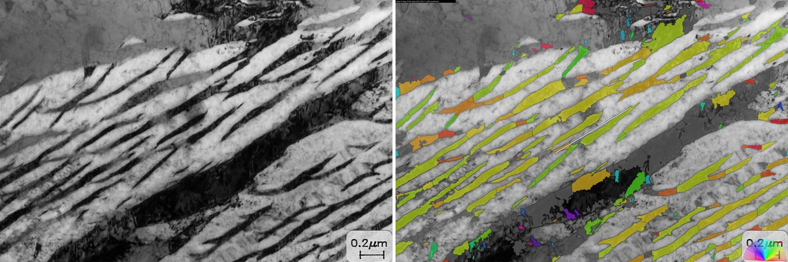
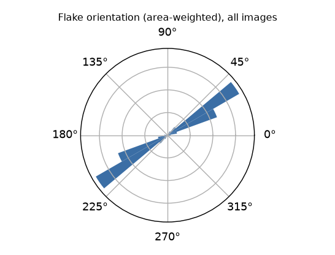
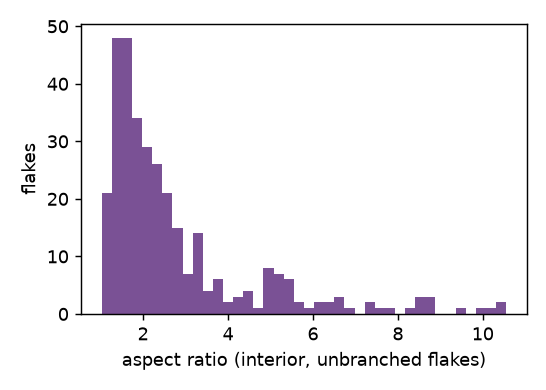

# Flake measurements: bainite_L06_live

1 images; reading: **phase** (switched by the agent after review 1: The real image is a TEM bright-field micrograph of bainite (0.2 µm bar). It shows bright ferrite between discrete dark lenticular plates at roughly 30°. The plates vary in width, taper and stop part-way, so they are not continuous thin boundary lines. That makes the boundary reading a poor fit: the ); flake width 23.41 px; code version 2d70afd967.

## Confidence

- **Within tolerances** on held-out twin images, and consistent under rotation on the real images.
- Twin accuracy (held-out twin images, exact truth): worst family ratio 0.91, pooled 0.46 (<= 1 means within the tolerances of config.yaml); dev 0.51: a gap shows how much the search fitted the dev twin images.
- The twin resembles the real images (worst profile mismatch x1.11; flake aspect ratio and width as measured by the method differ by up to x1.24); the twin accuracy carries over only as far as that, and only for structures the generator draws (straight laths in colonies).
- Rotation check on the real images (central disk turned by 30 deg and measured again): worst ratio 0.64 (passes); S changes by 0.016, the direction by 0.04 deg, the median aspect ratio by 3.2 %; for comparison, the 95 % interval of S from the finite number of flakes is +/-0.031.
- **Two scales**: 35% of the bright phase is in structures about 91 px wide, 4x the typical flake width used here (23.4 px). The settings fit the fine structures; the coarse ones may be split, merged or left out, and the statistics mix the two populations. If the coarse ones are the flakes you mean, rerun with --flake-width 91 --mode phase --flake-phase bright.
- Last agent review of the real drawings: reject, reading correct: yes.
- Lengths are in pixels (no --um-per-px given).
- Agent stage: 4 Claude calls, 30431 input / 8358 output tokens (about $0.29 at claude-opus-5-5 list prices).

## Set summary

| | median | min | max |
|---|---|---|---|
| order parameter S | 0.897 | 0.897 | 0.897 |
| local S (within colonies) | 0.93 | 0.93 | 0.93 |
| mean misalignment (deg) | 8.35 | 8.35 | 8.35 |
| median aspect ratio | 2.11 | 2.11 | 2.11 |
| median length (px) | 59.3 | 59.3 | 59.3 |
| median width (px) | 28.2 | 28.2 | 28.2 |
| flakes used per image | 200 | 200 | 200 |

Mean directions differ per image (axial; see the table): a set-level mean direction is only meaningful when the images were taken in the same specimen frame.

## Per image

| image | mean dir (deg) | S [95 % CI] | local S | misalignment (deg) | AR [95 % CI] | flakes | scratches |
|---|---|---|---|---|---|---|---|
| L06__rank063__085_Bainit_Gefuge_von_80_Si_13__CC-BY-SA-3.0 | 31.3 | 0.897 [0.862, 0.924] | 0.93 | 8.35 | 2.11 [2, 2.23] | 200 | 0 |

## How accurate is it (twin images with exact truth)

Twin: 18 code-generated images fitted to this set (realism ok: True; worst profile mismatch x1.11).

| twin images | params | mean direction err (deg) | S err | misalignment err (deg) | AR err | flake orientation err (deg) | flakes found | worst family ratio |
|---|---|---|---|---|---|---|---|---|
| dev | start | 0.396 | 0.0246 | 1.29 | 0.0603 | 2.68 | 0.919 | 1.09 |
| holdout | start | 0.789 | 0.0331 | 1.86 | 0.064 | 2.76 | 0.916 | 1.65 |
| dev | chosen | 0.588 | 0.0127 | 0.636 | 0.0202 | 2.2 | 0.798 | 0.507 |
| holdout | chosen | 0.885 | 0.0163 | 0.884 | 0.0183 | 2.3 | 0.8 | 0.906 |

Search: 20 new configurations evaluated (38 incl. cached); objective 1.228 at the start, 0.617 chosen.
Warm start: ti_basketweave_ma19010080 (distance 0.81), pearlite_L02 (distance 1.06).

## Real images: rotation check

Central disk measured as is and turned by 30 deg: direction off by 0.04 deg, S by 0.016, aspect ratio by 0.032 (relative) (worst ratio to tolerance 0.64; <= 1 passes). Necessary, not sufficient.

## Agent reviews of the real drawings

- Round 1: **reject**, reading correct: no. The real image is a TEM bright-field micrograph of bainite (0.2 µm bar). It shows bright ferrite between discrete dark lenticular plates at roughly 30°. The plates vary in width, taper and stop part-way, so they are not continuous thin boundary lines. That makes the boundary reading a poor fit: the bright regions are a connected matrix, not closed flakes. I judge the phase reading, with the dark plates as flakes in a bright matrix, more appropriate (confidence about 55–60%). History supports switching: bainite_L06, at distance 0.0, already failed with the boundary reading (rotation check 0.68).

What the drawing shows on the real image:
(a) Bright laths merge wherever a dark plate ends. Several yellow and orange fills run across two or three neighbouring laths.
(b) The large dark band in the centre-right is filled olive and counted as one big flake, so a matrix-like dark region enters the statistics.
(c) Green patches sit across the laths at a different orientation colour. Laths are cut crosswise into fragments, which explains the median aspect ratio of 2.29. The visible laths look to be about 5–10 times longer than wide.
(d) In the cluttered top-centre region, many small red, magenta, blue and green fragments are coloured and counted.
(e) In the featureless top-left area the large regions are mostly grey, but the teal block is coloured and therefore used.

The colony-level mean direction looks plausible: the arrow follows the laths and the dominant yellow colour fits about 30°. Per-flake aspect ratio and the flake count (330) are not supported by the drawing. S = 0.78 is probably pulled down by the spurious fragments.

The twin does not help here. It is untrusted and looks like the phase reading (bright rods in a dark speckled matrix), not this image. Its scores are poor: flake precision 0.54, recall 0.71, aspect-ratio bias -20%, worst family ratio 2.19. Its scratch_recall is 0 and its header shows 0 scratches, although several bright scratches clearly cut the rods; in the drawing these scratch lines split rods and merge pieces across them. The real image shows no polishing scratches, so scratch handling cannot be judged on it.
- Round 2: **reject**, reading correct: yes. Reading: the dark lenticular plates in bright ferrite are what a metallographer would measure. Most coloured fills lie on those plates, which run at about 30°, and the bright ferrite stays unfilled. So the phase reading with the dark phase is right (about 75% confident). One inconsistency should be checked: the two-scale report labels the flake phase 'bright' (area share 0.35), which conflicts with the stated dark-phase reading.

Where the drawing fails on the real image:
(1) Plates are cut along their length. Many long yellow and green plates are split by cross-cuts into 2–4 segments, and short orange or red stubs sit at the plate tips. This is why the median aspect ratio is 2.08, while visible plates have length-to-width ratios of roughly 8–15. The reported AR is therefore not supported.
(2) Non-plate dark material is taken as flakes. The broad dark band at lower centre is filled with large blocky green, yellow and purple patches. The dark, mottled region along the top edge (dislocation contrast and the upper grain) is broken into dozens of small irregular, multicoloured blobs that are coloured, so they are counted. They should be grey (excluded) or left unsegmented. These blobs add random orientations, so the order parameter S = 0.80 is probably biased low, and the 304 'used' flakes are inflated.
(3) A false scratch: a white scratch line is drawn in the centre, parallel to the plates. A TEM foil has no polishing scratches, so this is a false positive. It may also be cutting or merging plates where it lies.
(4) The mean direction (about 30°) and the colony-level colouring look right.

Twin: it scores well, but its plates are uniform rounded rods in tidy colonies. It has no tapered lenticular plates, no mottled dislocation-contrast regions and no wide dark bands, so its good AR error (2.6%) does not carry over to this image. Its scratch recall on crossings is 0.31, so scratch handling is weak anyway.

Confidence that the measured AR and the flake count are wrong: high. Confidence that the direction is right: moderate-high.

## Drawings (left: original, right: flakes coloured by orientation; grey = not used)

## Files

- `flakes.csv`: every flake (orientation, length, width, aspect ratio, misalignment, flags)
- `image_summaries.csv`: one row per image, with bootstrap intervals
- `params.json`: the params used
- `adapt_log.json`: profile, twin, search trials, reviews
