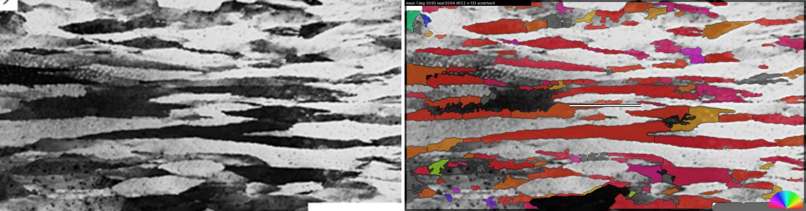
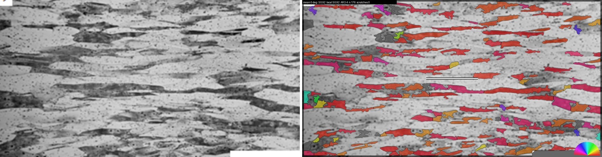
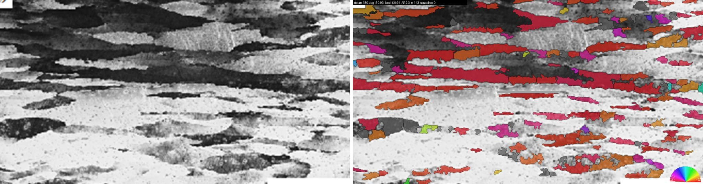
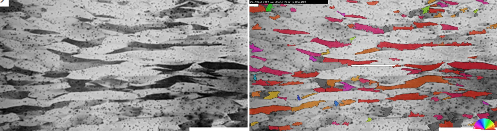
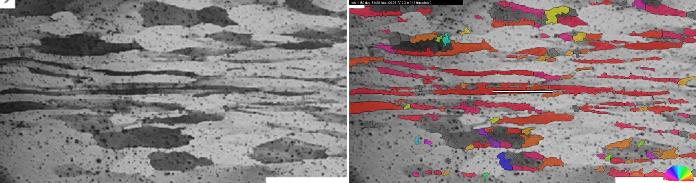
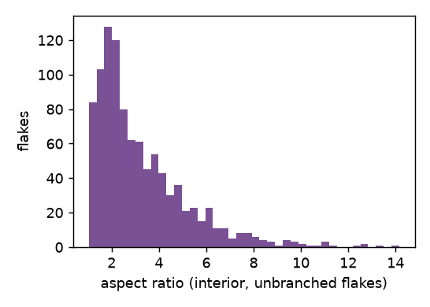

# Flake measurements: banded_islands_ma17081847

7 images; reading: **phase** (minority phase is separate blobs about as thick as the matrix); flake width 13.42 px; code version 2d70afd967.

## Confidence

- **Within tolerances** on held-out twin images, and consistent under rotation on the real images.
- Twin accuracy (held-out twin images, exact truth): worst family ratio 1.00, pooled 0.37 (<= 1 means within the tolerances of config.yaml); dev 0.37: a gap shows how much the search fitted the dev twin images.
- The twin resembles the real images (worst profile mismatch x1.14; flake aspect ratio and width as measured by the method differ by up to x1.33); the twin accuracy carries over only as far as that, and only for structures the generator draws (straight laths in colonies).
- Rotation check on the real images (central disk turned by 30 deg and measured again): worst ratio 0.47 (passes); S changes by 0.0141, the direction by 0.395 deg, the median aspect ratio by 0.0207 (relative); for comparison, the 95 % interval of S from the finite number of flakes is +/-0.033.
- **Two scales**: 46% of the dark phase is in structures about 58 px wide, 4x the typical flake width used here (13.4 px). The settings fit the fine structures; the coarse ones may be split, merged or left out, and the statistics mix the two populations. If the coarse ones are the flakes you mean, rerun with --flake-width 58 --mode phase --flake-phase dark.
- Lengths are in pixels (no --um-per-px given).

## Set summary

| | median | min | max |
|---|---|---|---|
| order parameter S | 0.916 | 0.831 | 0.94 |
| local S (within colonies) | 0.926 | 0.852 | 0.943 |
| mean misalignment (deg) | 8.17 | 7.05 | 12.4 |
| median aspect ratio | 2.73 | 2.27 | 3.39 |
| median length (px) | 50.1 | 43.2 | 55.6 |
| median width (px) | 19.1 | 17.4 | 21.7 |
| flakes used per image | 142 | 116 | 176 |

Mean directions differ per image (axial; see the table): a set-level mean direction is only meaningful when the images were taken in the same specimen frame.

## Per image

| image | mean dir (deg) | S [95 % CI] | local S | misalignment (deg) | AR [95 % CI] | flakes | scratches |
|---|---|---|---|---|---|---|---|
| L03__10.3390_ma17081847_g009_p6 | 0.763 | 0.931 [0.89, 0.96] | 0.937 | 7.17 | 3.24 [2.62, 3.71] | 133 | 0 |
| L07__10.3390_ma17081847_g009_p2 | 0.421 | 0.915 [0.88, 0.945] | 0.925 | 8.17 | 3.39 [3.08, 3.74] | 176 | 0 |
| L11__10.3390_ma17081847_g009_p7 | 180 | 0.929 [0.904, 0.948] | 0.935 | 7.66 | 2.27 [2.03, 2.56] | 143 | 0 |
| L14__10.3390_ma17081847_g009_p3 | 0.282 | 0.916 [0.883, 0.941] | 0.926 | 8.64 | 2.8 [2.4, 3.31] | 116 | 0 |
| L16__10.3390_ma17081847_g010_p8 | 180 | 0.904 [0.852, 0.941] | 0.914 | 8.51 | 2.34 [2.13, 2.65] | 142 | 0 |
| L17__10.3390_ma17081847_g010_p7 | 180 | 0.94 [0.914, 0.959] | 0.943 | 7.05 | 2.45 [2.16, 2.62] | 128 | 0 |
| L19__10.3390_ma17081847_g009_p1 | 1.34 | 0.831 [0.759, 0.892] | 0.852 | 12.4 | 2.73 [2.34, 2.98] | 174 | 0 |

## How accurate is it (twin images with exact truth)

Twin: 18 code-generated images fitted to this set (realism ok: True; worst profile mismatch x1.14).

| twin images | params | mean direction err (deg) | S err | misalignment err (deg) | AR err | flake orientation err (deg) | flakes found | worst family ratio |
|---|---|---|---|---|---|---|---|---|
| dev | start | 0.545 | 0.00769 | 0.606 | 0.169 | 1.9 | 0.931 | 1.33 |
| holdout | start | 0.605 | 0.00995 | 0.494 | 0.182 | 2.05 | 0.94 | 1.29 |
| dev | chosen | 0.495 | 0.00683 | 0.532 | 0.029 | 1.69 | 0.73 | 0.368 |
| holdout | chosen | 0.643 | 0.00475 | 0.493 | 0.0255 | 1.83 | 0.742 | 0.999 |

Search: 20 new configurations evaluated (71 incl. cached); objective 1.609 at the start, 0.452 chosen.
Warm start: ti64_dev (distance 5.92).

## Real images: rotation check

Central disk measured as is and turned by 30 deg: direction off by 0.395 deg, S by 0.0141, aspect ratio by 0.0207 (worst ratio to tolerance 0.47000000000000003; <= 1 passes). Necessary, not sufficient.

## Drawings (left: original, right: flakes coloured by orientation; grey = not used)

## Files

- `flakes.csv`: every flake (orientation, length, width, aspect ratio, misalignment, flags)
- `image_summaries.csv`: one row per image, with bootstrap intervals
- `params.json`: the params used
- `adapt_log.json`: profile, twin, search trials, reviews
