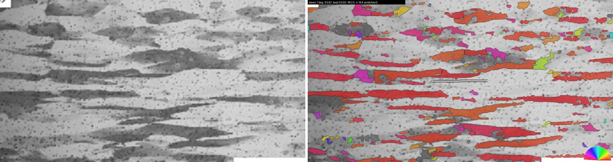
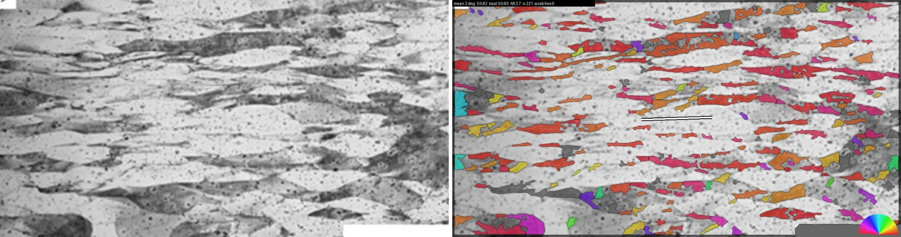
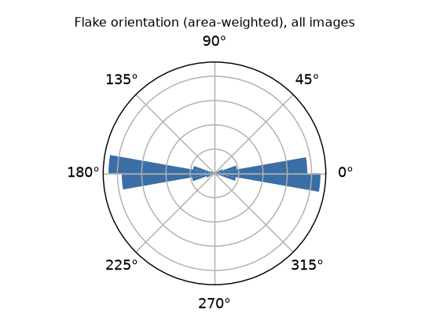

# Flake measurements: banded_islands_ma17081847

7 images; reading: **phase** (minority phase is separate blobs about as thick as the matrix); flake width 13.42 px; code version 77a86cd85c.

## Confidence

- **Within tolerances** on held-out twin images, and consistent under rotation on the real images.
- Twin accuracy (held-out twin images, exact truth): worst family ratio 0.49, pooled 0.38 (<= 1 means within the tolerances of config.yaml); dev 0.40: a gap shows how much the search fitted the dev twin images.
- The twin resembles the real images (worst profile mismatch x1.14; flake aspect ratio and width as measured by the method differ by up to x1.33); the twin accuracy carries over only as far as that, and only for structures the generator draws (straight laths in colonies).
- Rotation check on the real images (central disk turned by 30 deg and measured again): worst ratio 0.45 (passes); S changes by 0.009, the direction by 0.66 deg, the median aspect ratio by 2.2 %; for comparison, the 95 % interval of S from the finite number of flakes is +/-0.041.
- **Two scales**: 46% of the dark phase is in structures about 58 px wide, 4x the typical flake width used here (13.4 px). The settings fit the fine structures; the coarse ones may be split, merged or left out, and the statistics mix the two populations. If the coarse ones are the flakes you mean, rerun with --flake-width 58 --mode phase --flake-phase dark.
- Lengths are in pixels (no --um-per-px given).

## Set summary

| | median | min | max |
|---|---|---|---|
| order parameter S | 0.905 | 0.819 | 0.923 |
| local S (within colonies) | 0.925 | 0.833 | 0.93 |
| mean misalignment (deg) | 8.48 | 7.57 | 13.2 |
| median aspect ratio | 2.74 | 2.32 | 3.58 |
| median length (px) | 38.8 | 31.4 | 47.1 |
| median width (px) | 13.7 | 12.5 | 16 |
| flakes used per image | 164 | 136 | 221 |

Mean directions differ per image (axial; see the table): a set-level mean direction is only meaningful when the images were taken in the same specimen frame.

## Per image

| image | mean dir (deg) | S [95 % CI] | local S | misalignment (deg) | AR [95 % CI] | flakes | scratches |
|---|---|---|---|---|---|---|---|
| L03__10.3390_ma17081847_g009_p6 | 0.308 | 0.918 [0.871, 0.955] | 0.926 | 7.59 | 3.58 [3.08, 4.13] | 136 | 0 |
| L07__10.3390_ma17081847_g009_p2 | 180 | 0.893 [0.836, 0.93] | 0.897 | 9.19 | 3.4 [3.13, 3.75] | 213 | 0 |
| L11__10.3390_ma17081847_g009_p7 | 0.116 | 0.916 [0.873, 0.948] | 0.928 | 8.3 | 2.68 [2.35, 3.07] | 153 | 0 |
| L14__10.3390_ma17081847_g009_p3 | 1.14 | 0.905 [0.875, 0.936] | 0.925 | 9.2 | 2.83 [2.5, 3.14] | 151 | 0 |
| L16__10.3390_ma17081847_g010_p8 | 179 | 0.893 [0.847, 0.929] | 0.903 | 8.48 | 2.32 [2.03, 2.54] | 176 | 0 |
| L17__10.3390_ma17081847_g010_p7 | 0.684 | 0.923 [0.892, 0.947] | 0.93 | 7.57 | 2.5 [2.34, 2.66] | 164 | 0 |
| L19__10.3390_ma17081847_g009_p1 | 2.12 | 0.819 [0.748, 0.88] | 0.833 | 13.2 | 2.74 [2.54, 2.92] | 221 | 0 |

## How accurate is it (twin images with exact truth)

Twin: 18 code-generated images fitted to this set (realism ok: True; worst profile mismatch x1.14).

| twin images | params | mean direction err (deg) | S err | misalignment err (deg) | AR err | flake orientation err (deg) | flakes found | worst family ratio |
|---|---|---|---|---|---|---|---|---|
| dev | start | 0.545 | 0.00742 | 0.597 | 0.16 | 1.9 | 0.929 | 1.17 |
| holdout | start | 0.629 | 0.0092 | 0.545 | 0.179 | 2.06 | 0.938 | 1.23 |
| dev | chosen | 0.579 | 0.00507 | 0.475 | 0.0294 | 1.78 | 0.858 | 0.399 |
| holdout | chosen | 0.642 | 0.00629 | 0.373 | 0.0388 | 1.91 | 0.86 | 0.487 |

Search: 20 new configurations evaluated (30 incl. cached); objective 1.435 at the start, 0.488 chosen.
Warm start: ti64_dev (distance 5.92).

## Real images: rotation check

Central disk measured as is and turned by 30 deg: direction off by 0.66 deg, S by 0.009, aspect ratio by 0.022 (relative) (worst ratio to tolerance 0.45; <= 1 passes). Necessary, not sufficient.

## Drawings (left: original, right: flakes coloured by orientation; grey = not used)

## Files

- `flakes.csv`: every flake (orientation, length, width, aspect ratio, misalignment, flags)
- `image_summaries.csv`: one row per image, with bootstrap intervals
- `params.json`: the params used
- `adapt_log.json`: profile, twin, search trials, reviews
