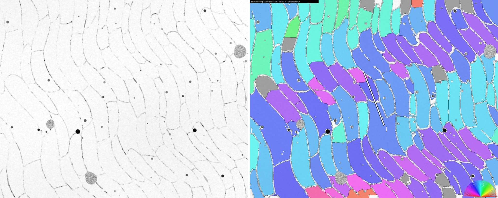
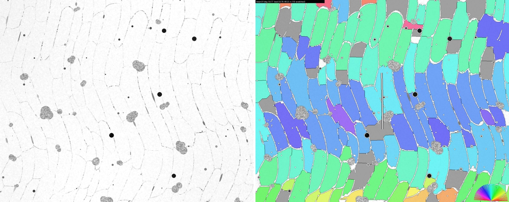
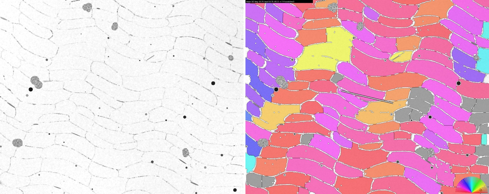
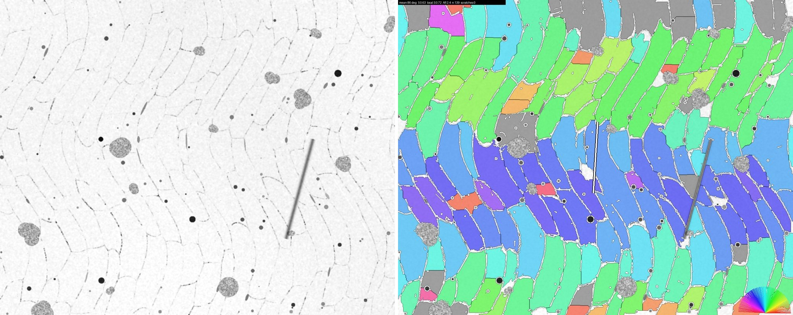
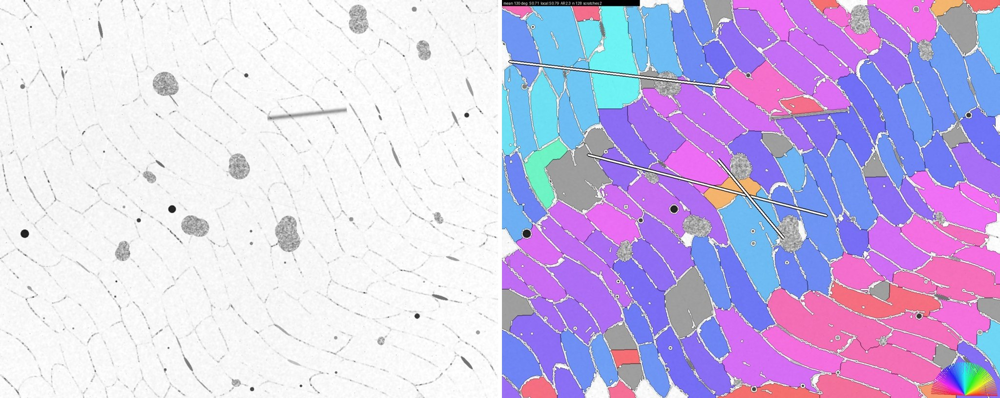
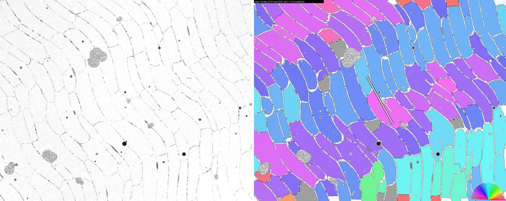
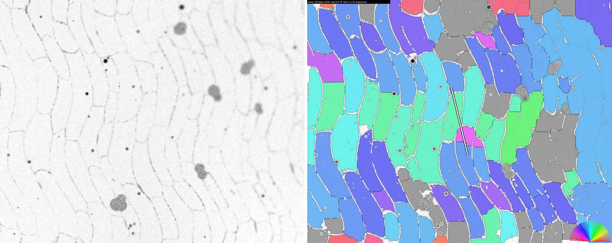
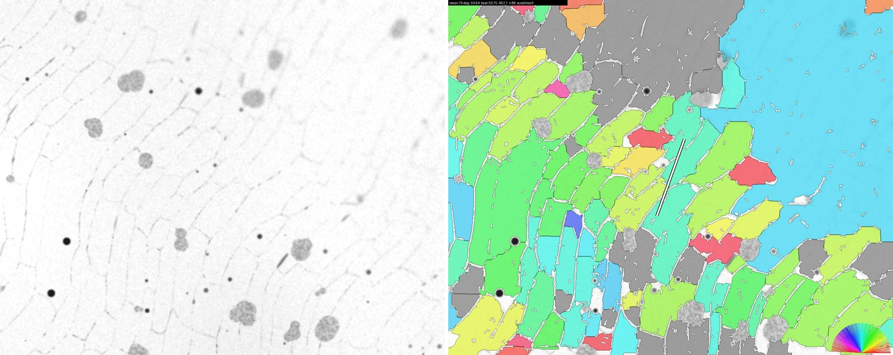
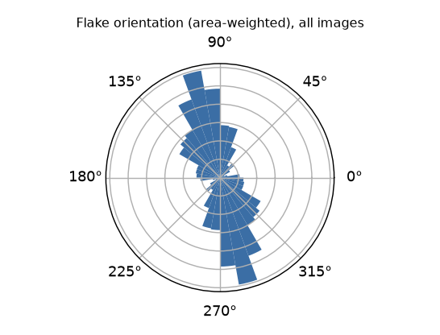
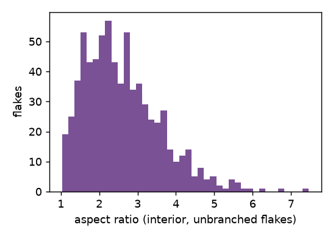

# Flake measurements: cal_sim_fast

8 images; reading: **boundaries** (ambiguous profile; boundary reading by default (the agent review checks it)); flake width 68.5 px; code version cd3472549e.

## Confidence

- **Low confidence**: on the held-out twin images the errors exceed the tolerances more than twice (worst family ratio below).
- Twin accuracy (held-out twin images, exact truth): worst family ratio 3.59, pooled 1.76 (<= 1 means within the tolerances of config.yaml); dev 1.66: a gap shows how much the search fitted the dev twin images.
- The twin is the calibrated coarse-cell family (src/synth_cells.py: cells with faint beaded boundaries, pockets, inclusions, scratches and soft regions), fitted to the calibration card (worst card mismatch x1.00); the twin accuracy carries over only as far as the twin resembles these images.
- Rotation check on the real images (central disk turned by 30 deg and measured again): worst ratio 0.65 (passes); S changes by 0.020, the direction by 0.57 deg, the median aspect ratio by 0.8 %; for comparison, the 95 % interval of S from the finite number of flakes is +/-0.057.
- The image profile was ambiguous between a boundary network and phase islands: check in the drawings that the outlined regions are the flakes you mean; rerun with --mode phase otherwise.
- Lengths are in pixels (no --um-per-px given).

## Set summary

| | median | min | max |
|---|---|---|---|
| order parameter S | 0.76 | 0.627 | 0.8 |
| local S (within colonies) | 0.779 | 0.721 | 0.828 |
| mean misalignment (deg) | 17.6 | 14.4 | 23.4 |
| median aspect ratio | 2.42 | 2.07 | 2.75 |
| median length (px) | 183 | 138 | 198 |
| median width (px) | 71.6 | 64.1 | 79.9 |
| flakes used per image | 116 | 76 | 139 |

Mean directions differ per image (axial; see the table): a set-level mean direction is only meaningful when the images were taken in the same specimen frame.

## Per image

| image | mean dir (deg) | S [95 % CI] | local S | misalignment (deg) | AR [95 % CI] | flakes | scratches |
|---|---|---|---|---|---|---|---|
| sim_0 | 111 | 0.8 [0.755, 0.841] | 0.828 | 15.7 | 2.67 [2.39, 2.89] | 113 | 0 |
| sim_1 | 90.8 | 0.771 [0.729, 0.819] | 0.777 | 17.3 | 2.47 [2.21, 2.69] | 119 | 0 |
| sim_2 | 167 | 0.761 [0.674, 0.823] | 0.782 | 16.9 | 2.54 [2.3, 2.9] | 114 | 0 |
| sim_3 | 86.4 | 0.627 [0.575, 0.685] | 0.721 | 23.4 | 2.38 [2.18, 2.59] | 139 | 0 |
| sim_4 | 130 | 0.714 [0.655, 0.772] | 0.791 | 19.2 | 2.34 [2.17, 2.73] | 128 | 2 |
| sim_5 | 119 | 0.76 [0.712, 0.81] | 0.808 | 17.9 | 2.75 [2.59, 3.01] | 122 | 0 |
| sim_6 | 104 | 0.799 [0.725, 0.871] | 0.756 | 14.4 | 2.28 [2.12, 2.76] | 76 | 0 |
| sim_7 | 70.2 | 0.636 [0.595, 0.766] | 0.748 | 23.2 | 2.07 [1.82, 2.25] | 86 | 0 |

## How accurate is it (twin images with exact truth)

Twin: 6 code-generated images fitted to this set (realism ok: True; worst profile mismatch x1.00).

| twin images | params | mean direction err (deg) | S err | misalignment err (deg) | AR err | flake orientation err (deg) | flakes found | worst family ratio |
|---|---|---|---|---|---|---|---|---|
| dev | start | 0.368 | 0.0459 | 2.12 | 0.335 | 0.95 | 0.802 | 2.54 |
| holdout | start | 0.598 | 0.0599 | 3.03 | 0.278 | 1.51 | 0.798 | 2.86 |
| dev | chosen | 0.865 | 0.0416 | 2.06 | 0.247 | 0.943 | 0.779 | 1.66 |
| holdout | chosen | 1.45 | 0.0769 | 3.19 | 0.264 | 1.06 | 0.801 | 3.59 |

Search: 12 new configurations evaluated (18 incl. cached); objective 3.103 at the start, 2.075 chosen.
Warm start: none (no similar image set in the memory).

## Real images: rotation check

Central disk measured as is and turned by 30 deg: direction off by 0.57 deg, S by 0.020, aspect ratio by 0.008 (relative) (worst ratio to tolerance 0.65; <= 1 passes). Necessary, not sufficient.

## Drawings (left: original, right: flakes coloured by orientation; grey = not used)

## Files

- `flakes.csv`: every flake (orientation, length, width, aspect ratio, misalignment, flags)
- `image_summaries.csv`: one row per image, with bootstrap intervals
- `params.json`: the params used
- `adapt_log.json`: profile, twin, search trials, reviews
