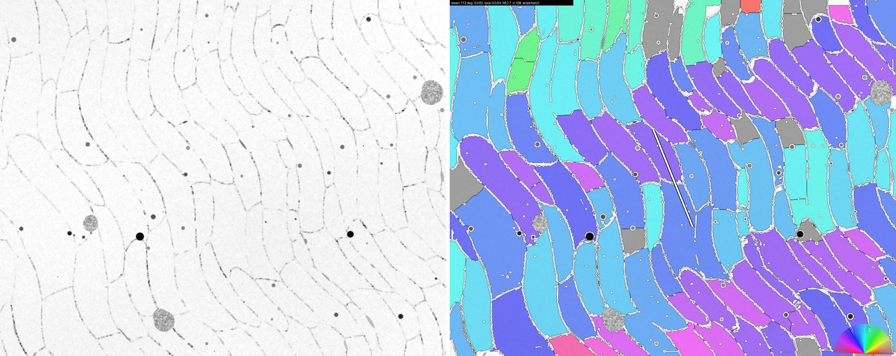
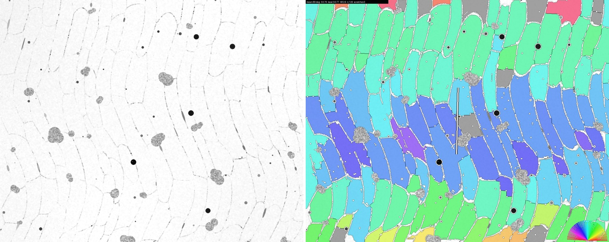
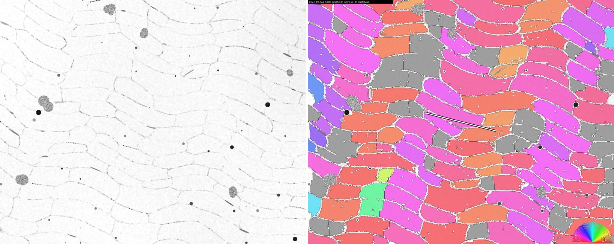
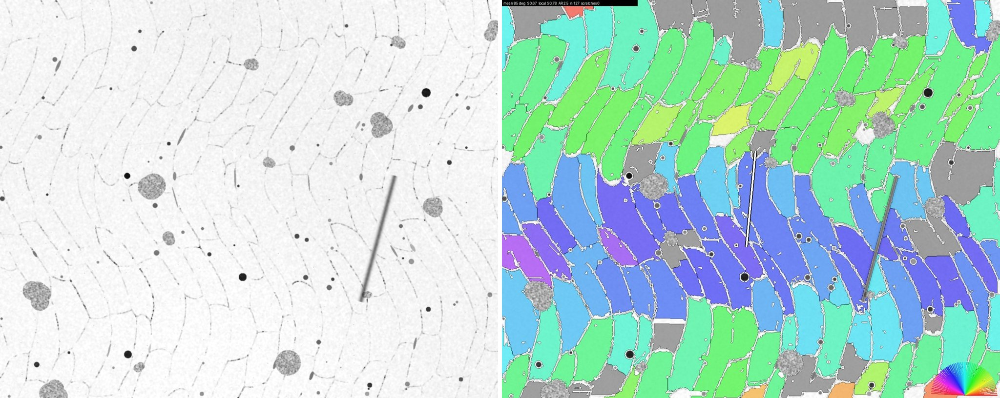
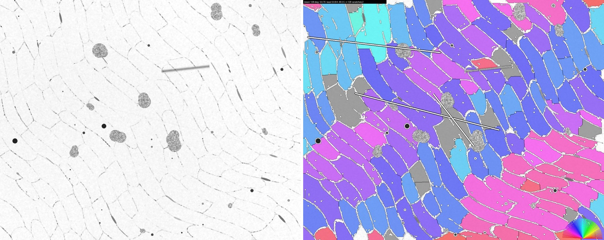
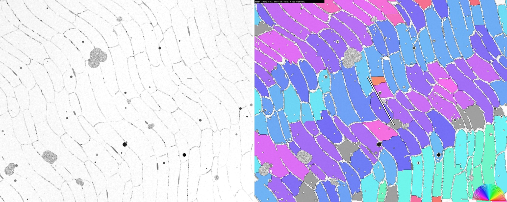
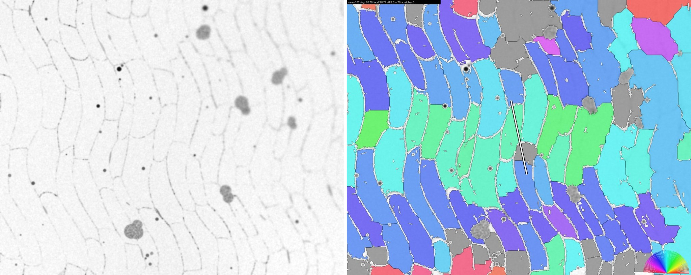
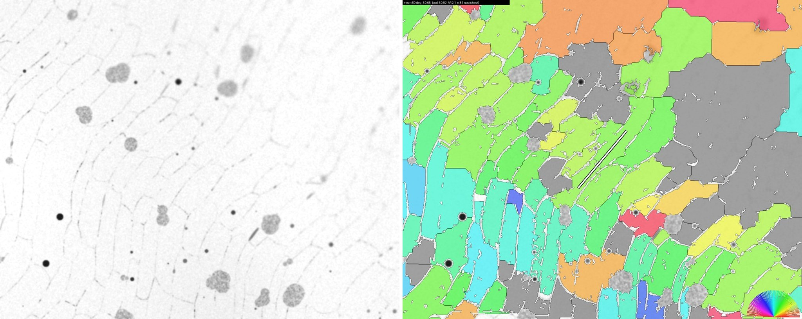
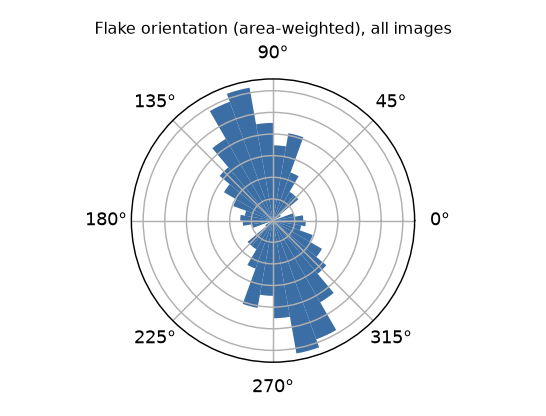
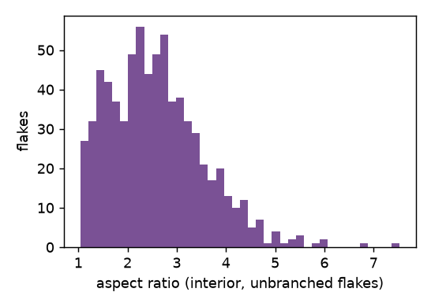

# Flake measurements: cal_sim_thorough

8 images; reading: **boundaries** (ambiguous profile; boundary reading by default (the agent review checks it)); flake width 68.5 px; code version cd3472549e.

## Confidence

- **Low confidence**: on the held-out twin images the errors exceed the tolerances more than twice (worst family ratio below).
- Twin accuracy (held-out twin images, exact truth): worst family ratio 4.56, pooled 1.81 (<= 1 means within the tolerances of config.yaml); dev 3.38: a gap shows how much the search fitted the dev twin images.
- The twin is the calibrated coarse-cell family (src/synth_cells.py: cells with faint beaded boundaries, pockets, inclusions, scratches and soft regions), fitted to the calibration card (worst card mismatch x1.00); the twin accuracy carries over only as far as the twin resembles these images.
- Rotation check on the real images (central disk turned by 30 deg and measured again): worst ratio 0.36 (passes); S changes by 0.008, the direction by 0.29 deg, the median aspect ratio by 1.8 %; for comparison, the 95 % interval of S from the finite number of flakes is +/-0.052.
- The settings tuned on the twin were **not used**: on the real images they gave a worse rotation check (flakes used 87 vs 126, rotation check 1.2769999999999997 vs 0.356 with the start settings), so the start settings were kept: the twin did not capture what made the difference.
- The image profile was ambiguous between a boundary network and phase islands: check in the drawings that the outlined regions are the flakes you mean; rerun with --mode phase otherwise.
- Lengths are in pixels (no --um-per-px given).

## Set summary

| | median | min | max |
|---|---|---|---|
| order parameter S | 0.764 | 0.655 | 0.816 |
| local S (within colonies) | 0.822 | 0.765 | 0.838 |
| mean misalignment (deg) | 17.2 | 15 | 21.6 |
| median aspect ratio | 2.48 | 2.14 | 2.75 |
| median length (px) | 181 | 157 | 213 |
| median width (px) | 70.8 | 66.8 | 83.4 |
| flakes used per image | 120 | 79 | 128 |

Mean directions differ per image (axial; see the table): a set-level mean direction is only meaningful when the images were taken in the same specimen frame.

## Per image

| image | mean dir (deg) | S [95 % CI] | local S | misalignment (deg) | AR [95 % CI] | flakes | scratches |
|---|---|---|---|---|---|---|---|
| sim_0 | 112 | 0.816 [0.78, 0.851] | 0.837 | 15 | 2.75 [2.61, 2.95] | 108 | 0 |
| sim_1 | 88.7 | 0.764 [0.705, 0.812] | 0.769 | 17.7 | 2.64 [2.44, 2.81] | 126 | 0 |
| sim_2 | 166 | 0.815 [0.756, 0.859] | 0.828 | 15.2 | 2.27 [2.12, 2.49] | 115 | 0 |
| sim_3 | 84.7 | 0.67 [0.626, 0.723] | 0.78 | 21.6 | 2.47 [2.33, 2.69] | 127 | 0 |
| sim_4 | 128 | 0.763 [0.711, 0.815] | 0.838 | 16.8 | 2.49 [2.13, 2.68] | 128 | 2 |
| sim_5 | 118 | 0.766 [0.712, 0.816] | 0.827 | 17.5 | 2.69 [2.38, 2.87] | 126 | 0 |
| sim_6 | 102 | 0.764 [0.685, 0.833] | 0.765 | 16.9 | 2.3 [2.14, 2.75] | 79 | 0 |
| sim_7 | 49.7 | 0.655 [0.548, 0.765] | 0.817 | 20.1 | 2.14 [1.88, 2.45] | 81 | 0 |

## How accurate is it (twin images with exact truth)

Twin: 9 code-generated images fitted to this set (realism ok: True; worst profile mismatch x1.00).

| twin images | params | mean direction err (deg) | S err | misalignment err (deg) | AR err | flake orientation err (deg) | flakes found | worst family ratio |
|---|---|---|---|---|---|---|---|---|
| dev | start | 0.593 | 0.0537 | 2.62 | 0.262 | 1.37 | 0.791 | 3.38 |
| holdout | start | 0.97 | 0.0525 | 1.85 | 0.271 | 1.1 | 0.792 | 4.56 |
| dev | chosen | 0.593 | 0.0537 | 2.62 | 0.262 | 1.37 | 0.791 | 3.38 |
| holdout | chosen | 0.97 | 0.0525 | 1.85 | 0.271 | 1.1 | 0.792 | 4.56 |

Search: 30 new configurations evaluated (38 incl. cached); objective 3.821 at the start, 3.821 chosen.
Warm start: none (no similar image set in the memory).

## Real images: rotation check

Central disk measured as is and turned by 30 deg: direction off by 0.29 deg, S by 0.008, aspect ratio by 0.018 (relative) (worst ratio to tolerance 0.36; <= 1 passes). Necessary, not sufficient.

## Drawings (left: original, right: flakes coloured by orientation; grey = not used)

## Files

- `flakes.csv`: every flake (orientation, length, width, aspect ratio, misalignment, flags)
- `image_summaries.csv`: one row per image, with bootstrap intervals
- `params.json`: the params used
- `adapt_log.json`: profile, twin, search trials, reviews
