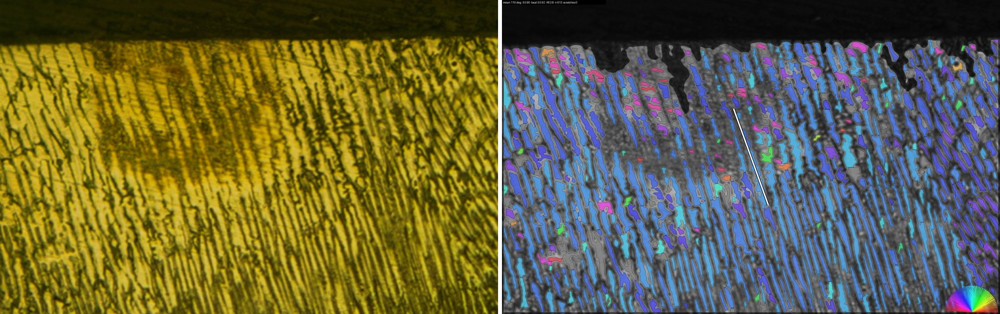
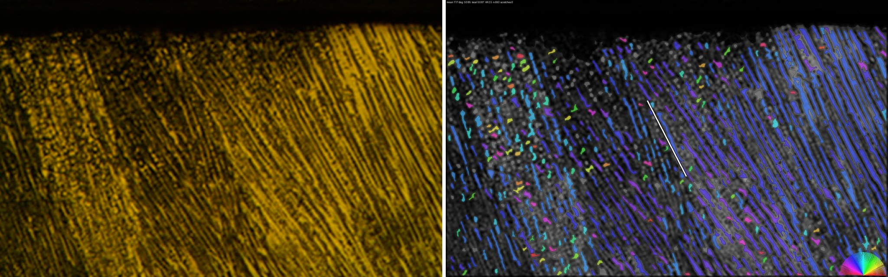
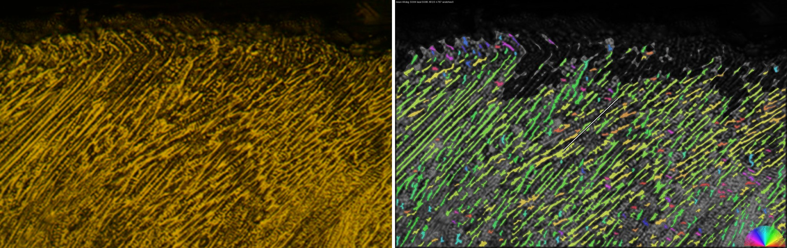
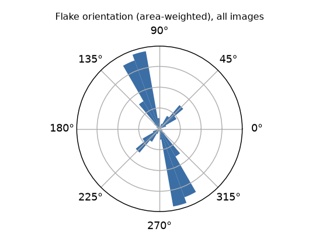
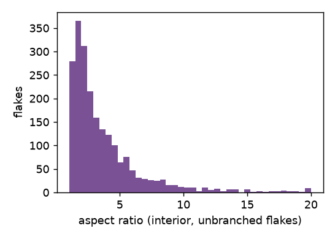

# Flake measurements: colour_lamellar_ma16020804

3 images; reading: **phase** (minority phase is separate blobs about as thick as the matrix); flake width 4.47 px; code version 2d70afd967.

## Confidence

- **Within tolerances** on held-out twin images, and consistent under rotation on the real images.
- Twin accuracy (held-out twin images, exact truth): worst family ratio 0.43, pooled 0.40 (<= 1 means within the tolerances of config.yaml); dev 0.45: a gap shows how much the search fitted the dev twin images.
- The twin resembles the real images (worst profile mismatch x1.14; flake aspect ratio and width as measured by the method differ by up to x1.05); the twin accuracy carries over only as far as that, and only for structures the generator draws (straight laths in colonies).
- Rotation check on the real images (central disk turned by 30 deg and measured again): worst ratio 0.27 (passes); S changes by 0.0067, the direction by 0.8043 deg, the median aspect ratio by 0.0104 (relative); for comparison, the 95 % interval of S from the finite number of flakes is +/-0.022.
- Flakes are only ~4.5 px wide (the profiler over-reads small widths by ~1 px): the images were analysed at 3x size. Near and below ~4-5 px the boundaries are at the resolution limit: orientation and S hold best, aspect ratios and lengths least. Use higher-resolution images if you can.
- Lengths are in pixels (no --um-per-px given).

## Set summary

| | median | min | max |
|---|---|---|---|
| order parameter S | 0.854 | 0.836 | 0.905 |
| local S (within colonies) | 0.872 | 0.863 | 0.922 |
| mean misalignment (deg) | 10.5 | 8.31 | 12 |
| median aspect ratio | 2.81 | 2.49 | 2.88 |
| median length (px) | 12.8 | 11.9 | 16.7 |
| median width (px) | 4.76 | 4.62 | 5.79 |
| flakes used per image | 693 | 613 | 767 |

Mean directions differ per image (axial; see the table): a set-level mean direction is only meaningful when the images were taken in the same specimen frame.

## Per image

| image | mean dir (deg) | S [95 % CI] | local S | misalignment (deg) | AR [95 % CI] | flakes | scratches |
|---|---|---|---|---|---|---|---|
| L09__10.3390_ma16020804_g005_p3 | 110 | 0.905 [0.887, 0.924] | 0.922 | 8.31 | 2.81 [2.56, 3.04] | 613 | 0 |
| L12__10.3390_ma16020804_g002_p3 | 117 | 0.854 [0.829, 0.877] | 0.872 | 10.5 | 2.49 [2.38, 2.61] | 693 | 0 |
| L13__10.3390_ma16020804_g002_p9 | 43.7 | 0.836 [0.815, 0.859] | 0.863 | 12 | 2.88 [2.78, 3.08] | 767 | 0 |

## How accurate is it (twin images with exact truth)

Twin: 18 code-generated images fitted to this set (realism ok: True; worst profile mismatch x1.14).

| twin images | params | mean direction err (deg) | S err | misalignment err (deg) | AR err | flake orientation err (deg) | flakes found | worst family ratio |
|---|---|---|---|---|---|---|---|---|
| dev | start | 0.826 | 0.0121 | 1.07 | 0.125 | 2.22 | 0.979 | 0.856 |
| holdout | start | 0.291 | 0.0112 | 0.404 | 0.121 | 2.12 | 0.983 | 0.975 |
| dev | chosen | 0.651 | 0.011 | 1.09 | 0.022 | 2.04 | 0.829 | 0.454 |
| holdout | chosen | 0.315 | 0.00759 | 0.274 | 0.028 | 1.99 | 0.823 | 0.426 |

Search: 20 new configurations evaluated (72 incl. cached); objective 1.064 at the start, 0.556 chosen.
Warm start: banded_islands_ma17081847 (distance 0.25), ti_basketweave_ma19010080 (distance 5.67).

## Real images: rotation check

Central disk measured as is and turned by 30 deg: direction off by 0.8043 deg, S by 0.0067, aspect ratio by 0.0104 (worst ratio to tolerance 0.2681; <= 1 passes). Necessary, not sufficient.

## Drawings (left: original, right: flakes coloured by orientation; grey = not used)

## Files

- `flakes.csv`: every flake (orientation, length, width, aspect ratio, misalignment, flags)
- `image_summaries.csv`: one row per image, with bootstrap intervals
- `params.json`: the params used
- `adapt_log.json`: profile, twin, search trials, reviews
