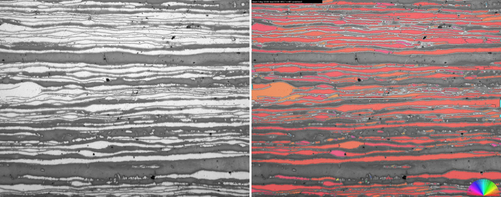
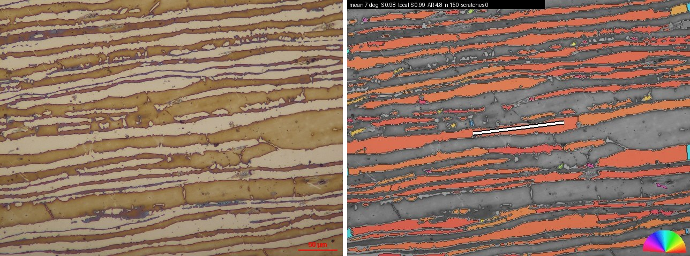
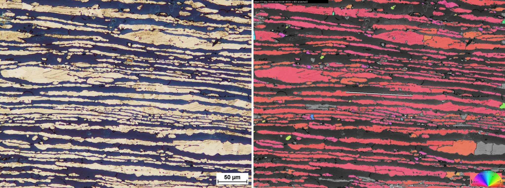
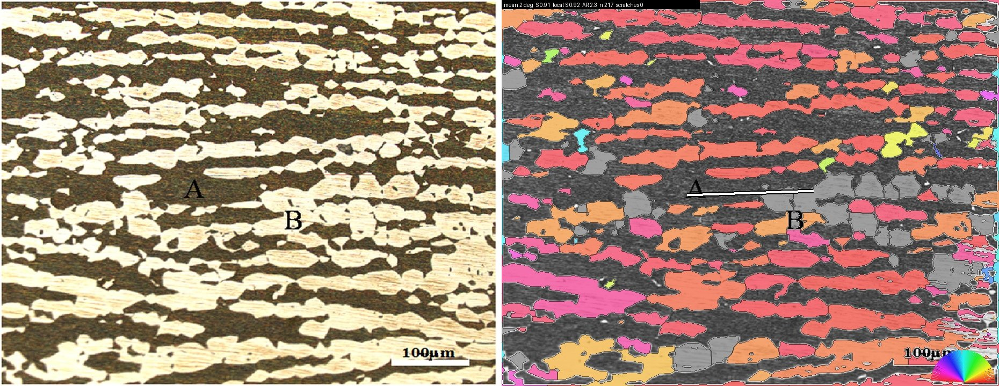
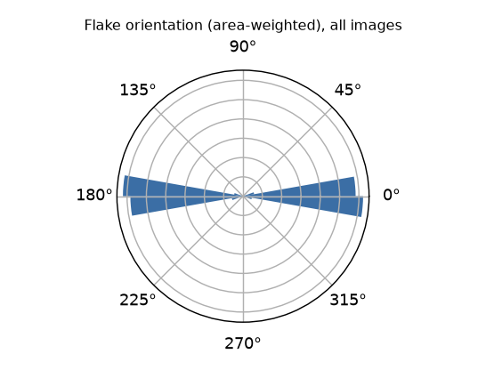
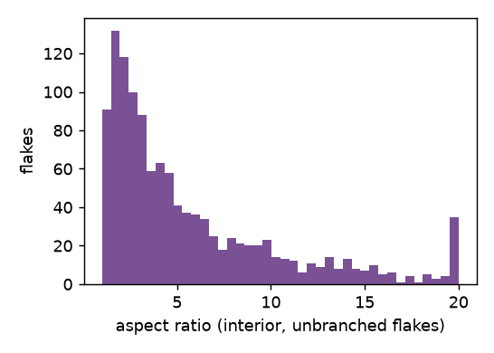

# Flake measurements: duplex_bands_mixed

4 images; reading: **phase** (minority phase is separate blobs about as thick as the matrix); flake width 10.385 px; code version 77a86cd85c.

## Confidence

- **Within tolerances** on held-out twin images, and consistent under rotation on the real images.
- Twin accuracy (held-out twin images, exact truth): worst family ratio 0.38, pooled 0.34 (<= 1 means within the tolerances of config.yaml); dev 0.39: a gap shows how much the search fitted the dev twin images.
- The twin resembles the real images (worst profile mismatch x1.24; flake aspect ratio and width as measured by the method differ by up to x1.02); the twin accuracy carries over only as far as that, and only for structures the generator draws (straight laths in colonies).
- Rotation check on the real images (central disk turned by 30 deg and measured again): worst ratio 0.27 (passes); S changes by 0.000, the direction by 0.22 deg, the median aspect ratio by 1.4 %; for comparison, the 95 % interval of S from the finite number of flakes is +/-0.009.
- Lengths are in pixels (no --um-per-px given).

## Set summary

| | median | min | max |
|---|---|---|---|
| order parameter S | 0.983 | 0.91 | 0.989 |
| local S (within colonies) | 0.984 | 0.923 | 0.992 |
| mean misalignment (deg) | 2.99 | 2.41 | 8.9 |
| median aspect ratio | 4.22 | 2.27 | 5.69 |
| median length (px) | 40.2 | 26.9 | 43 |
| median width (px) | 9.41 | 6.48 | 19.1 |
| flakes used per image | 338 | 150 | 481 |

Mean directions differ per image (axial; see the table): a set-level mean direction is only meaningful when the images were taken in the same specimen frame.

## Per image

| image | mean dir (deg) | S [95 % CI] | local S | misalignment (deg) | AR [95 % CI] | flakes | scratches |
|---|---|---|---|---|---|---|---|
| L01__rank076__MB_DSSx100-3 | 0.808 | 0.989 [0.985, 0.993] | 0.992 | 2.56 | 5.69 [4.91, 6.25] | 481 | 0 |
| L04__rank007__MB_DSSx200-4 | 6.92 | 0.985 [0.973, 0.993] | 0.985 | 2.41 | 4.81 [3.99, 5.59] | 150 | 0 |
| L05__rank005__MBX200+ech | 177 | 0.981 [0.973, 0.987] | 0.983 | 3.42 | 3.63 [3.31, 4.04] | 459 | 0 |
| L24__rank027__102_Microstructure_of_2707_Hyper_Duplex_Stainless_Steel__CC-BY-4.0 | 2.13 | 0.91 [0.88, 0.935] | 0.923 | 8.9 | 2.27 [2.09, 2.53] | 217 | 0 |

## How accurate is it (twin images with exact truth)

Twin: 18 code-generated images fitted to this set (realism ok: True; worst profile mismatch x1.24).

| twin images | params | mean direction err (deg) | S err | misalignment err (deg) | AR err | flake orientation err (deg) | flakes found | worst family ratio |
|---|---|---|---|---|---|---|---|---|
| dev | start | 0.213 | 0.0095 | 0.52 | 0.0532 | 1.76 | 0.991 | 0.436 |
| holdout | start | 0.433 | 0.0114 | 0.543 | 0.0453 | 1.72 | 0.988 | 0.438 |
| dev | chosen | 0.252 | 0.00792 | 0.484 | 0.0209 | 1.68 | 0.963 | 0.387 |
| holdout | chosen | 0.251 | 0.00907 | 0.394 | 0.0334 | 1.7 | 0.968 | 0.378 |

Search: 20 new configurations evaluated (31 incl. cached); objective 0.525 at the start, 0.471 chosen.
Warm start: colour_lamellar_ma16020804 (distance 0.32), banded_islands_ma17081847 (distance 0.46).

## Real images: rotation check

Central disk measured as is and turned by 30 deg: direction off by 0.22 deg, S by 0.000, aspect ratio by 0.014 (relative) (worst ratio to tolerance 0.27; <= 1 passes). Necessary, not sufficient.

## Drawings (left: original, right: flakes coloured by orientation; grey = not used)

## Files

- `flakes.csv`: every flake (orientation, length, width, aspect ratio, misalignment, flags)
- `image_summaries.csv`: one row per image, with bootstrap intervals
- `params.json`: the params used
- `adapt_log.json`: profile, twin, search trials, reviews
