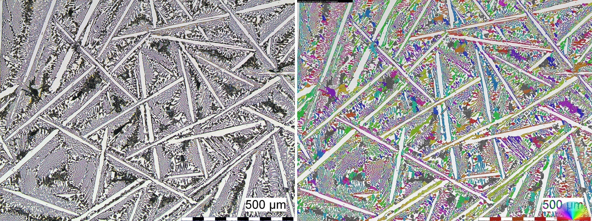
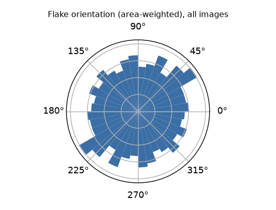
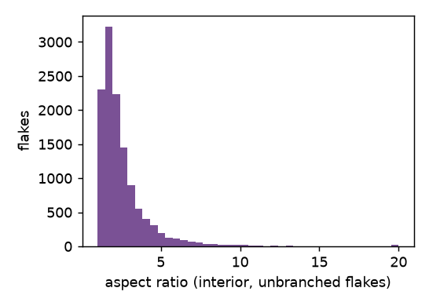

# Flake measurements: needles_L23

1 images; reading: **phase** (minority phase is separate blobs about as thick as the matrix); flake width 4.0 px; code version 2d70afd967.

## Confidence

- **Twin not usable** for this image set (it does not resemble the images closely enough, or flakes cannot be found on it at this size): the accuracy below is not evidence about these images, and no search was run on it; the scaled default settings were used. Treat the numbers as unvalidated; check them in the drawings.
- Twin accuracy (held-out twin images, exact truth): worst family ratio 4.20, pooled 2.62 (<= 1 means within the tolerances of config.yaml); dev 3.50: a gap shows how much the search fitted the dev twin images.
- The twin resembles the real images only roughly (worst profile mismatch x1.41; flake aspect ratio and width as measured by the method differ by up to x1.32); the twin accuracy carries over only as far as that, and only for structures the generator draws (straight laths in colonies).
- Rotation check on the real images (central disk turned by 30 deg and measured again): worst ratio 0.7 (passes); S changes by 0.0211, the direction by None deg, the median aspect ratio by 0.0056 (relative); for comparison, the 95 % interval of S from the finite number of flakes is +/-0.026. At S below ~0.3 the mean direction is weakly defined and moves easily.
- Lengths are in pixels (no --um-per-px given).

## Set summary

| | median | min | max |
|---|---|---|---|
| order parameter S | 0.035 | 0.035 | 0.035 |
| local S (within colonies) | 0.335 | 0.335 | 0.335 |
| mean misalignment (deg) | 43.8 | 43.8 | 43.8 |
| median aspect ratio | 2.06 | 2.06 | 2.06 |
| median length (px) | 13.2 | 13.2 | 13.2 |
| median width (px) | 5.84 | 5.84 | 5.84 |
| flakes used per image | 1e+04 | 1e+04 | 1e+04 |

Mean directions differ per image (axial; see the table): a set-level mean direction is only meaningful when the images were taken in the same specimen frame.

## Per image

| image | mean dir (deg) | S [95 % CI] | local S | misalignment (deg) | AR [95 % CI] | flakes | scratches |
|---|---|---|---|---|---|---|---|
| L23__rank003__066_Primaerzementit__CC-BY-SA-3.0 | 48.3 | 0.035 [0.0121, 0.0644] | 0.335 | 43.8 | 2.06 [2.04, 2.08] | 10015 | 0 |

## How accurate is it (twin images with exact truth)

Twin: 18 code-generated images fitted to this set (realism ok: False; worst profile mismatch x1.41).

| twin images | params | mean direction err (deg) | S err | misalignment err (deg) | AR err | flake orientation err (deg) | flakes found | worst family ratio |
|---|---|---|---|---|---|---|---|---|
| dev | start | 2.84 | 0.0437 | 2.55 | 0.412 | 1.78 | 0.982 | 3.5 |
| holdout | start | 4.78 | 0.0221 | 1.95 | 0.393 | 1.85 | 0.982 | 4.2 |
| dev | chosen | 2.84 | 0.0437 | 2.55 | 0.412 | 1.78 | 0.982 | 3.5 |
| holdout | chosen | 4.78 | 0.0221 | 1.95 | 0.393 | 1.85 | 0.982 | 4.2 |

Search: 3 new configurations evaluated (8 incl. cached); objective 4.191 at the start, 4.191 chosen.
Warm start: duplex_bands_mixed (distance 1.55), colour_lamellar_ma16020804 (distance 1.76).

## Real images: rotation check

Central disk measured as is and turned by 30 deg: direction off by None deg, S by 0.0211, aspect ratio by 0.0056 (worst ratio to tolerance 0.7033333333333334; <= 1 passes). Necessary, not sufficient.

## Drawings (left: original, right: flakes coloured by orientation; grey = not used)

## Files

- `flakes.csv`: every flake (orientation, length, width, aspect ratio, misalignment, flags)
- `image_summaries.csv`: one row per image, with bootstrap intervals
- `params.json`: the params used
- `adapt_log.json`: profile, twin, search trials, reviews
