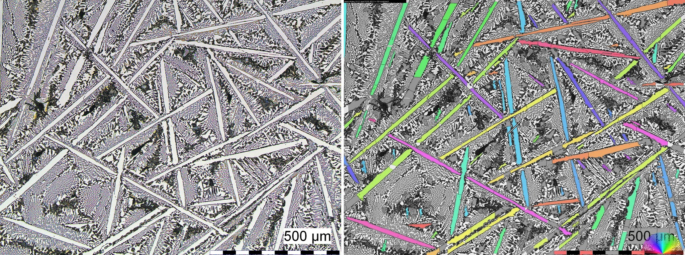
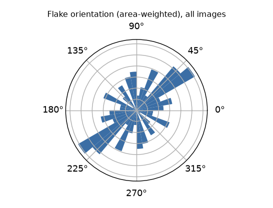
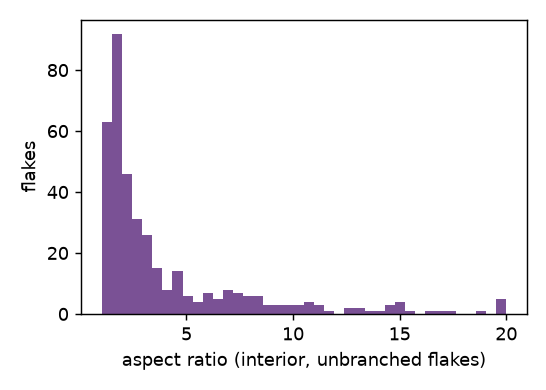

# Flake measurements: needles_L23_live

1 images; reading: **phase** (minority phase is separate blobs about as thick as the matrix); flake width 4.0 px; code version 2d70afd967.

## Confidence

- **Twin not usable** for this image set (it does not resemble the images closely enough, or flakes cannot be found on it at this size): the accuracy below is not evidence about these images, and no search was run on it; the settings were changed by the agent from its reading of the drawings (not scored against any truth). Treat the numbers as unvalidated; check them in the drawings.
- Twin accuracy (held-out twin images, exact truth): worst family ratio 15.39, pooled 5.08 (<= 1 means within the tolerances of config.yaml); dev 10.53: a gap shows how much the search fitted the dev twin images.
- The twin resembles the real images only roughly (worst profile mismatch x1.41; flake aspect ratio and width as measured by the method differ by up to x1.32); the twin accuracy carries over only as far as that, and only for structures the generator draws (straight laths in colonies).
- Rotation check on the real images (central disk turned by 30 deg and measured again): worst ratio 0.4 (passes); S changes by 0.012, the direction by n/a (S < 0.3: no defined direction), the median aspect ratio by 1.1 %; for comparison, the 95 % interval of S from the finite number of flakes is +/-0.121. At S below ~0.3 the mean direction is weakly defined and moves easily.
- Last agent review of the real drawings: reject, reading correct: yes.
- Lengths are in pixels (no --um-per-px given).
- Agent stage: 4 Claude calls, 24737 input / 8042 output tokens (about $0.26 at claude-opus-5-5 list prices).

## Set summary

| | median | min | max |
|---|---|---|---|
| order parameter S | 0.208 | 0.208 | 0.208 |
| mean misalignment (deg) | 37 | 37 | 37 |
| median aspect ratio | 2.34 | 2.34 | 2.34 |
| median length (px) | 57.3 | 57.3 | 57.3 |
| median width (px) | 24.4 | 24.4 | 24.4 |
| flakes used per image | 159 | 159 | 159 |

Mean directions differ per image (axial; see the table): a set-level mean direction is only meaningful when the images were taken in the same specimen frame.

## Per image

| image | mean dir (deg) | S [95 % CI] | local S | misalignment (deg) | AR [95 % CI] | flakes | scratches |
|---|---|---|---|---|---|---|---|
| L23__rank003__066_Primaerzementit__CC-BY-SA-3.0 | 44.1 | 0.208 [0.108, 0.35] | – | 37 | 2.34 [2.15, 2.6] | 159 | 0 |

## How accurate is it (twin images with exact truth)

Twin: 18 code-generated images fitted to this set (realism ok: False; worst profile mismatch x1.41).

| twin images | params | mean direction err (deg) | S err | misalignment err (deg) | AR err | flake orientation err (deg) | flakes found | worst family ratio |
|---|---|---|---|---|---|---|---|---|
| dev | start | 2.84 | 0.0437 | 2.55 | 0.412 | 1.78 | 0.982 | 3.5 |
| holdout | start | 4.78 | 0.0221 | 1.95 | 0.393 | 1.85 | 0.982 | 4.2 |
| dev | chosen | 6.24 | 0.0961 | 5.27 | 0.572 | – | 0 | 10.5 |
| holdout | chosen | 9.98 | 0.254 | 11.1 | 0.553 | – | 0 | 15.4 |

Search: 3 new configurations evaluated (10 incl. cached); objective 4.191 at the start, 11.487 chosen.
Warm start: duplex_bands_mixed (distance 1.55), colour_lamellar_ma16020804 (distance 1.76).

## Real images: rotation check

Central disk measured as is and turned by 30 deg: direction off by n/a deg, S by 0.012, aspect ratio by 0.011 (relative) (worst ratio to tolerance 0.40; <= 1 passes). Necessary, not sufficient.

## Agent reviews of the real drawings

- Round 1: **reject**, reading correct: no. Reading: the phase reading is the right family, but the wrong phase was chosen. The micrograph is labelled primary cementite (white cast iron). What a metallographer measures are the long, straight, bright primary-cementite plates. They run up to roughly 1 mm, are tens of µm thick, and cross each other at many angles. In the drawing those plates are left white and unmeasured. The coloured 'flakes' are something else: dark pearlite and ledeburite islands and dots in the eutectic background, plus dark etch and pull-out patches. Some of those patches are shown in grey, and some are wrongly coloured as large irregular purple, orange and olive blobs. So all 10,015 'flakes' and the summary numbers describe the wrong objects. S = 0.035, AR 2.06 and coverage 0.345 are numbers for the eutectic texture, not for the plates. An S near 0 might even be roughly true for the plates, but it was not measured on them, so it cannot be claimed. Failures seen: (a) Matrix and eutectic islands are taken as flakes, everywhere. (b) The real flakes are missed completely. (c) Large dark etch stains are counted as flakes. (d) Scratches: one short line near the centre is marked as a scratch. I cannot confirm it is a real scratch; it looks like part of a plate edge. Twin: it is untrusted and does not resemble this image (short dark dashes in grey colonies versus long bright crossing plates). Its own scores are also poor: flake precision 0.03, crossing-scratch recall 0.05, aspect-ratio bias -41%, worst family 3.5× tolerance. It gives no support to any number. The closest earlier set (needles_L23, distance 0.0, same reading) failed: holdout 4.2×, rotation check 0.70. Confidence that the reading is wrong: high, about 90%. Confidence that no number in this run is usable: high.
- Round 2: **reject**, reading correct: yes. Phase reading is correct for this image: the long bright primary-cementite needles in the ledeburite matrix are the flakes. The coloured regions in the drawing do lie on those bright needles. That contradicts the stated 'flakes are the dark phase', so the polarity setting needs checking.

The drawings do not support the numbers:
(1) Long needles are cut along their length into several pieces, and the pieces sometimes get different colours. This happens mostly where needles cross each other, e.g. top-right orange/purple needles and the centre yellow/magenta pair.
(2) Many clearly visible needles stay grey, so they are not used. Coverage is only 0.19, and several near-horizontal needles in the left half are missing.
(3) Many small coloured specks in the eutectic/ledeburite regions are matrix lamellae taken as flakes. They make up much of n=359 and pull the median aspect ratio down to 2.1, whereas the visible needles have aspect ratios of roughly 15–50. The aspect-ratio figure is wrong by about an order of magnitude.
S=0.21 (near-random needle network) is plausible, but its value is uncertain given the contamination. No scratches are visible, and none were reported. Colony/grain boundaries are not the issue here; crossings between needles are.

The twin is useless as evidence. Its short-dash colonies do not resemble crossing needles. Flake recall is 0, its drawing shows dashes merged into large grey blobs, and it is untrusted.

The closest prior set, needles_L23 (distance 0, same reading), also failed: rotation check 0.70, holdout worst family 4.2. Repeating that configuration will not succeed.

Confidence: high that this should be rejected; moderate on the exact causes.

## Drawings (left: original, right: flakes coloured by orientation; grey = not used)

## Files

- `flakes.csv`: every flake (orientation, length, width, aspect ratio, misalignment, flags)
- `image_summaries.csv`: one row per image, with bootstrap intervals
- `params.json`: the params used
- `adapt_log.json`: profile, twin, search trials, reviews
