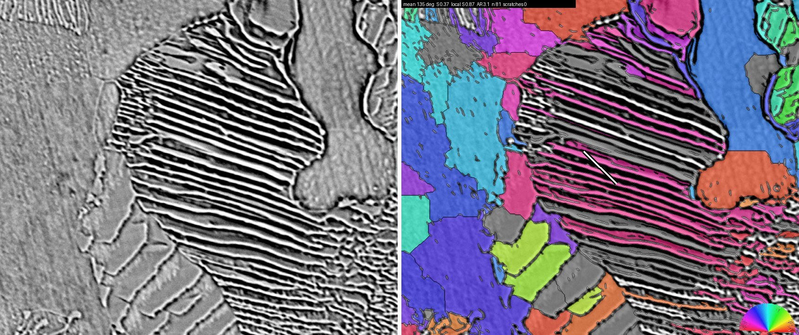
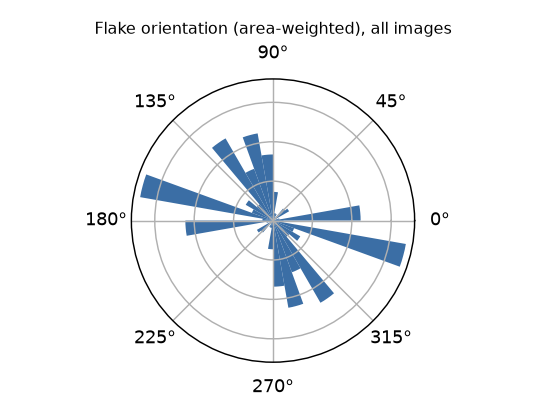
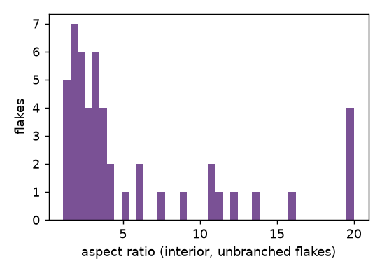

# Flake measurements: pearlite_L02

1 images; reading: **boundaries** (ambiguous profile; boundary reading by default (the agent review checks it)); flake width 10.0 px; code version 77a86cd85c.

## Confidence

- Twin accuracy (held-out twin images, exact truth): worst family ratio 1.23, pooled 0.66 (<= 1 means within the tolerances of config.yaml); dev 0.68: a gap shows how much the search fitted the dev twin images.
- The twin resembles the real images (worst profile mismatch x1.14; flake aspect ratio and width as measured by the method differ by up to x1.15); the twin accuracy carries over only as far as that, and only for structures the generator draws (straight laths in colonies).
- Rotation check on the real images (central disk turned by 30 deg and measured again): worst ratio 0.49 (passes); S changes by 0.015, the direction by n/a (S < 0.3: no defined direction), the median aspect ratio by 2.2 %; for comparison, the 95 % interval of S from the finite number of flakes is +/-0.182.
- The settings tuned on the twin were **not used**: on the real images they gave a worse rotation check (flakes used 92 vs 81, rotation check 4.503333333333334 vs 0.49333333333333335 with the start settings), so the start settings were kept: the twin did not capture what made the difference.
- **Two scales**: 53% of the bright phase is in structures about 45 px wide, 4x the typical flake width used here (10.0 px). The settings fit the fine structures; the coarse ones may be split, merged or left out, and the statistics mix the two populations. If the coarse ones are the flakes you mean, rerun with --flake-width 45.
- The image profile was ambiguous between a boundary network and phase islands: check in the drawings that the outlined regions are the flakes you mean; rerun with --mode phase otherwise.
- Lengths are in pixels (no --um-per-px given).

## Set summary

| | median | min | max |
|---|---|---|---|
| order parameter S | 0.374 | 0.374 | 0.374 |
| local S (within colonies) | 0.866 | 0.866 | 0.866 |
| mean misalignment (deg) | 32.6 | 32.6 | 32.6 |
| median aspect ratio | 3.12 | 3.12 | 3.12 |
| median length (px) | 99 | 99 | 99 |
| median width (px) | 24.1 | 24.1 | 24.1 |
| flakes used per image | 81 | 81 | 81 |

Mean directions differ per image (axial; see the table): a set-level mean direction is only meaningful when the images were taken in the same specimen frame.

## Per image

| image | mean dir (deg) | S [95 % CI] | local S | misalignment (deg) | AR [95 % CI] | flakes | scratches |
|---|---|---|---|---|---|---|---|
| L02__10.3390_ma18204798_g006_p4 | 135 | 0.374 [0.218, 0.582] | 0.866 | 32.6 | 3.12 [2.5, 3.76] | 81 | 0 |

## How accurate is it (twin images with exact truth)

Twin: 18 code-generated images fitted to this set (realism ok: True; worst profile mismatch x1.14).

| twin images | params | mean direction err (deg) | S err | misalignment err (deg) | AR err | flake orientation err (deg) | flakes found | worst family ratio |
|---|---|---|---|---|---|---|---|---|
| dev | start | 0.45 | 0.0158 | 1.16 | 0.0681 | 1.89 | 0.665 | 0.676 |
| holdout | start | 0.493 | 0.0329 | 1.75 | 0.0814 | 1.83 | 0.67 | 1.23 |
| dev | chosen | 0.45 | 0.0158 | 1.16 | 0.0681 | 1.89 | 0.665 | 0.676 |
| holdout | chosen | 0.493 | 0.0329 | 1.75 | 0.0814 | 1.83 | 0.67 | 1.23 |

Search: 20 new configurations evaluated (31 incl. cached); objective 0.789 at the start, 0.789 chosen.
Warm start: ti_basketweave_ma19010080 (distance 0.46), ti64_dev (distance 0.51).

## Real images: rotation check

Central disk measured as is and turned by 30 deg: direction off by n/a deg, S by 0.015, aspect ratio by 0.022 (relative) (worst ratio to tolerance 0.49; <= 1 passes). Necessary, not sufficient.

## Drawings (left: original, right: flakes coloured by orientation; grey = not used)

## Files

- `flakes.csv`: every flake (orientation, length, width, aspect ratio, misalignment, flags)
- `image_summaries.csv`: one row per image, with bootstrap intervals
- `params.json`: the params used
- `adapt_log.json`: profile, twin, search trials, reviews
