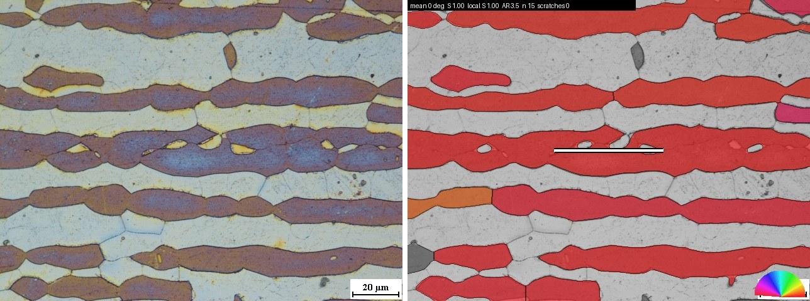

# Flake measurements: purple_flakes_L10

1 images; reading: **phase** (minority phase is separate blobs about as thick as the matrix); flake width 30.07 px; code version 77a86cd85c.

## Confidence

- Twin accuracy (held-out twin images, exact truth): worst family ratio 1.51, pooled 0.60 (<= 1 means within the tolerances of config.yaml); dev 0.80: a gap shows how much the search fitted the dev twin images.
- The twin resembles the real images (worst profile mismatch x1.25; flake aspect ratio and width as measured by the method differ by up to x1.12); the twin accuracy carries over only as far as that, and only for structures the generator draws (straight laths in colonies).
- Rotation check on the real images (central disk turned by 30 deg and measured again): worst ratio 2.13 (FAILS); S changes by 0.021, the direction by 2.21 deg, the median aspect ratio by 10.6 %; for comparison, the 95 % interval of S from the finite number of flakes is +/-0.004.
- Lengths are in pixels (no --um-per-px given).

## Set summary

| | median | min | max |
|---|---|---|---|
| order parameter S | 0.997 | 0.997 | 0.997 |
| local S (within colonies) | 0.997 | 0.997 | 0.997 |
| mean misalignment (deg) | 1.39 | 1.39 | 1.39 |
| median aspect ratio | 3.46 | 3.46 | 3.46 |
| median length (px) | 131 | 131 | 131 |
| median width (px) | 38 | 38 | 38 |
| flakes used per image | 15 | 15 | 15 |

Mean directions differ per image (axial; see the table): a set-level mean direction is only meaningful when the images were taken in the same specimen frame.

## Per image

| image | mean dir (deg) | S [95 % CI] | local S | misalignment (deg) | AR [95 % CI] | flakes | scratches |
|---|---|---|---|---|---|---|---|
| L10__rank046__40MIN-G500-00 | 0.0076 | 0.997 [0.992, 0.999] | 0.997 | 1.39 | 3.46 [3.21, 3.72] | 15 | 0 |

## How accurate is it (twin images with exact truth)

Twin: 18 code-generated images fitted to this set (realism ok: True; worst profile mismatch x1.25).

| twin images | params | mean direction err (deg) | S err | misalignment err (deg) | AR err | flake orientation err (deg) | flakes found | worst family ratio |
|---|---|---|---|---|---|---|---|---|
| dev | start | 1.44 | 0.023 | 1.08 | 0.0636 | 2.96 | 0.797 | 0.903 |
| holdout | start | 1.04 | 0.019 | 0.868 | 0.0753 | 2.67 | 0.845 | 1.78 |
| dev | chosen | 1.38 | 0.0201 | 0.969 | 0.0588 | 2.81 | 0.771 | 0.798 |
| holdout | chosen | 0.662 | 0.0302 | 1.4 | 0.0454 | 2.45 | 0.801 | 1.51 |

Search: 20 new configurations evaluated (30 incl. cached); objective 1.051 at the start, 0.939 chosen.
Warm start: banded_islands_ma17081847 (distance 0.92), colour_lamellar_ma16020804 (distance 1.00).

## Real images: rotation check

Central disk measured as is and turned by 30 deg: direction off by 2.21 deg, S by 0.021, aspect ratio by 0.106 (relative) (worst ratio to tolerance 2.13; <= 1 passes). Necessary, not sufficient.

## Drawings (left: original, right: flakes coloured by orientation; grey = not used)

## Files

- `flakes.csv`: every flake (orientation, length, width, aspect ratio, misalignment, flags)
- `image_summaries.csv`: one row per image, with bootstrap intervals
- `params.json`: the params used
- `adapt_log.json`: profile, twin, search trials, reviews
