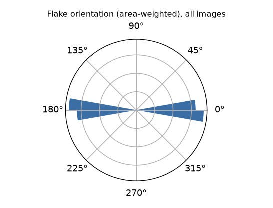
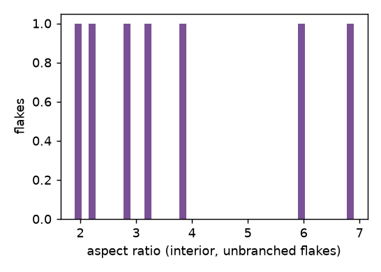

# Flake measurements: purple_flakes_L10

1 images; reading: **phase** (minority phase is separate blobs about as thick as the matrix); flake width 30.07 px; code version 2d70afd967.

## Confidence

- Twin accuracy (held-out twin images, exact truth): worst family ratio 1.90, pooled 1.07 (<= 1 means within the tolerances of config.yaml); dev 1.00: a gap shows how much the search fitted the dev twin images.
- The twin resembles the real images (worst profile mismatch x1.25; flake aspect ratio and width as measured by the method differ by up to x1.12); the twin accuracy carries over only as far as that, and only for structures the generator draws (straight laths in colonies).
- Rotation check on the real images (central disk turned by 30 deg and measured again): worst ratio 0.06 (passes); S changes by 0.0005, the direction by 0.0544 deg, the median aspect ratio by 0.0032 (relative); for comparison, the 95 % interval of S from the finite number of flakes is +/-0.022.
- Lengths are in pixels (no --um-per-px given).

## Set summary

| | median | min | max |
|---|---|---|---|
| order parameter S | 0.988 | 0.988 | 0.988 |
| local S (within colonies) | 0.988 | 0.988 | 0.988 |
| mean misalignment (deg) | 1.79 | 1.79 | 1.79 |
| median aspect ratio | 3.21 | 3.21 | 3.21 |
| median length (px) | 132 | 132 | 132 |
| median width (px) | 35.1 | 35.1 | 35.1 |
| flakes used per image | 19 | 19 | 19 |

Mean directions differ per image (axial; see the table): a set-level mean direction is only meaningful when the images were taken in the same specimen frame.

## Per image

| image | mean dir (deg) | S [95 % CI] | local S | misalignment (deg) | AR [95 % CI] | flakes | scratches |
|---|---|---|---|---|---|---|---|
| L10__rank046__40MIN-G500-00 | 180 | 0.988 [0.955, 0.998] | 0.988 | 1.79 | 3.21 [2.25, 5.97] | 19 | 0 |

## How accurate is it (twin images with exact truth)

Twin: 18 code-generated images fitted to this set (realism ok: True; worst profile mismatch x1.25).

| twin images | params | mean direction err (deg) | S err | misalignment err (deg) | AR err | flake orientation err (deg) | flakes found | worst family ratio |
|---|---|---|---|---|---|---|---|---|
| dev | start | 1.54 | 0.0299 | 1.21 | 0.0652 | 3.33 | 0.874 | 1.32 |
| holdout | start | 1.07 | 0.0307 | 1.23 | 0.0701 | 3.13 | 0.882 | 1.95 |
| dev | chosen | 1.7 | 0.0356 | 1.53 | 0.0744 | 2.93 | 0.78 | 1 |
| holdout | chosen | 0.971 | 0.0533 | 2.13 | 0.0383 | 2.71 | 0.82 | 1.9 |

Search: 20 new configurations evaluated (31 incl. cached); objective 1.482 at the start, 1.182 chosen.
Warm start: banded_islands_ma17081847 (distance 0.92), colour_lamellar_ma16020804 (distance 1.00).

## Real images: rotation check

Central disk measured as is and turned by 30 deg: direction off by 0.0544 deg, S by 0.0005, aspect ratio by 0.0032 (worst ratio to tolerance 0.064; <= 1 passes). Necessary, not sufficient.

## Drawings (left: original, right: flakes coloured by orientation; grey = not used)

## Files

- `flakes.csv`: every flake (orientation, length, width, aspect ratio, misalignment, flags)
- `image_summaries.csv`: one row per image, with bootstrap intervals
- `params.json`: the params used
- `adapt_log.json`: profile, twin, search trials, reviews
