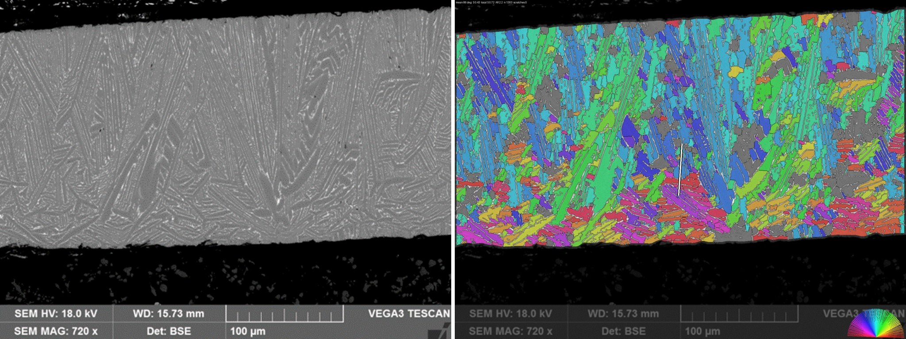
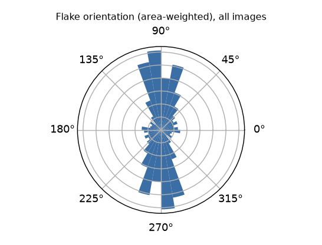
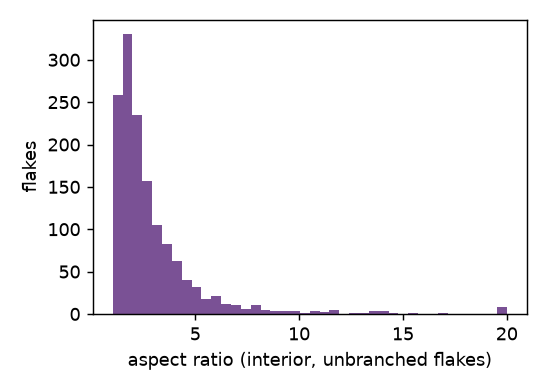

# Flake measurements: sem_user

1 images; reading: **boundaries** (ambiguous profile; boundary reading by default (the agent review checks it)); flake width 4.0 px; code version 77a86cd85c.

## Confidence

- **Twin not usable** for this image set (it does not resemble the images closely enough, or flakes cannot be found on it at this size): the accuracy below is not evidence about these images, and no search was run on it; the scaled default settings were used. Treat the numbers as unvalidated; check them in the drawings.
- Twin accuracy (held-out twin images, exact truth): worst family ratio 10.50, pooled 7.25 (<= 1 means within the tolerances of config.yaml); dev 8.30: a gap shows how much the search fitted the dev twin images.
- The twin resembles the real images only roughly (worst profile mismatch x1.52; flake aspect ratio and width as measured by the method differ by up to x1.22); the twin accuracy carries over only as far as that, and only for structures the generator draws (straight laths in colonies).
- Rotation check on the real images (central disk turned by 30 deg and measured again): worst ratio 0.45 (passes); S changes by 0.006, the direction by 1.36 deg, the median aspect ratio by 1.1 %; for comparison, the 95 % interval of S from the finite number of flakes is +/-0.055.
- Flakes are only ~4.0 px wide (the profiler over-reads small widths by ~1 px): the images were analysed at 3x size. Near and below ~4-5 px the boundaries are at the resolution limit: orientation and S hold best, aspect ratios and lengths least. Use higher-resolution images if you can.
- The image profile was ambiguous between a boundary network and phase islands: check in the drawings that the outlined regions are the flakes you mean; rerun with --mode phase otherwise.
- Lengths are in pixels (no --um-per-px given).

## Set summary

| | median | min | max |
|---|---|---|---|
| order parameter S | 0.426 | 0.426 | 0.426 |
| local S (within colonies) | 0.717 | 0.717 | 0.717 |
| mean misalignment (deg) | 29.7 | 29.7 | 29.7 |
| median aspect ratio | 2.19 | 2.19 | 2.19 |
| median length (px) | 11.3 | 11.3 | 11.3 |
| median width (px) | 4.66 | 4.66 | 4.66 |
| flakes used per image | 1.3e+03 | 1.3e+03 | 1.3e+03 |

Mean directions differ per image (axial; see the table): a set-level mean direction is only meaningful when the images were taken in the same specimen frame.

## Per image

| image | mean dir (deg) | S [95 % CI] | local S | misalignment (deg) | AR [95 % CI] | flakes | scratches |
|---|---|---|---|---|---|---|---|
| sem_bse | 86.2 | 0.426 [0.371, 0.48] | 0.717 | 29.7 | 2.19 [2.13, 2.25] | 1303 | 0 |

## How accurate is it (twin images with exact truth)

Twin: 18 code-generated images fitted to this set (realism ok: False; worst profile mismatch x1.52).

| twin images | params | mean direction err (deg) | S err | misalignment err (deg) | AR err | flake orientation err (deg) | flakes found | worst family ratio |
|---|---|---|---|---|---|---|---|---|
| dev | start | 1.39 | 0.201 | 8.5 | 0.549 | 2.55 | 0.367 | 8.3 |
| holdout | start | 1.93 | 0.363 | 14.6 | 0.535 | 2.66 | 0.331 | 10.5 |
| dev | chosen | 1.39 | 0.201 | 8.5 | 0.549 | 2.55 | 0.367 | 8.3 |
| holdout | chosen | 1.93 | 0.363 | 14.6 | 0.535 | 2.66 | 0.331 | 10.5 |

Search: 0 new configurations evaluated (6 incl. cached); objective 9.301 at the start, 9.301 chosen.
Warm start: none (no similar image set in the memory).

## Real images: rotation check

Central disk measured as is and turned by 30 deg: direction off by 1.36 deg, S by 0.006, aspect ratio by 0.011 (relative) (worst ratio to tolerance 0.45; <= 1 passes). Necessary, not sufficient.

## Drawings (left: original, right: flakes coloured by orientation; grey = not used)

## Files

- `flakes.csv`: every flake (orientation, length, width, aspect ratio, misalignment, flags)
- `image_summaries.csv`: one row per image, with bootstrap intervals
- `params.json`: the params used
- `adapt_log.json`: profile, twin, search trials, reviews
