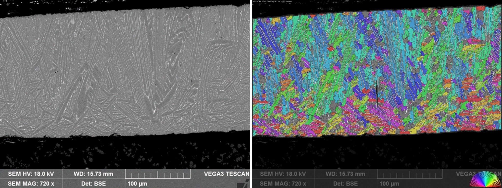
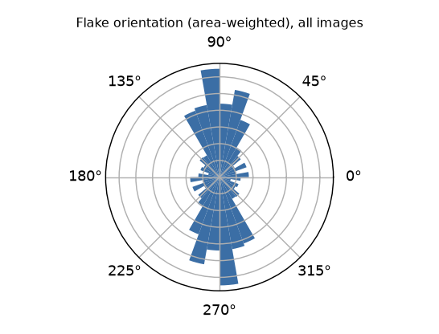
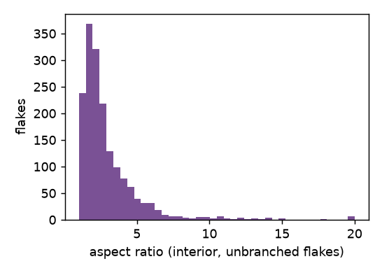

# Flake measurements: sem_user_live

1 images; reading: **boundaries** (ambiguous profile; boundary reading by default (the agent review checks it)); flake width 4.0 px; code version ee7e0ea300.

## Confidence

- **Twin not usable** for this image set (it does not resemble the images closely enough, or flakes cannot be found on it at this size): the accuracy below is not evidence about these images, and no search was run on it; the settings were changed by the agent from its reading of the drawings (not scored against any truth). Treat the numbers as unvalidated; check them in the drawings.
- Twin accuracy (held-out twin images, exact truth): worst family ratio 9.57, pooled 7.07 (<= 1 means within the tolerances of config.yaml); dev 8.13: a gap shows how much the search fitted the dev twin images.
- The twin resembles the real images only roughly (worst profile mismatch x1.80; flake aspect ratio and width as measured by the method differ by up to x1.24); the twin accuracy carries over only as far as that, and only for structures the generator draws (straight laths in colonies).
- Rotation check on the real images (central disk turned by 30 deg and measured again): worst ratio 0.97 (passes); S changes by 0.029, the direction by 1.35 deg, the median aspect ratio by 1.0 %; for comparison, the 95 % interval of S from the finite number of flakes is +/-0.045.
- Flakes are only ~4.0 px wide (the profiler over-reads small widths by ~1 px): the images were analysed at 3x size. Near and below ~4-5 px the boundaries are at the resolution limit: orientation and S hold best, aspect ratios and lengths least. Use higher-resolution images if you can.
- The image profile was ambiguous between a boundary network and phase islands: check in the drawings that the outlined regions are the flakes you mean; rerun with --mode phase otherwise.
- Last agent review of the real drawings: reject, reading correct: yes.
- Lengths are in pixels (no --um-per-px given).
- Agent stage: 4 Claude calls, 24937 input / 8273 output tokens (about $0.27 at claude-opus-5-5 list prices).

## Set summary

| | median | min | max |
|---|---|---|---|
| order parameter S | 0.407 | 0.407 | 0.407 |
| local S (within colonies) | 0.67 | 0.67 | 0.67 |
| mean misalignment (deg) | 30.3 | 30.3 | 30.3 |
| median aspect ratio | 2.29 | 2.29 | 2.29 |
| median length (px) | 11.8 | 11.8 | 11.8 |
| median width (px) | 4.78 | 4.78 | 4.78 |
| flakes used per image | 1.59e+03 | 1.59e+03 | 1.59e+03 |

Mean directions differ per image (axial; see the table): a set-level mean direction is only meaningful when the images were taken in the same specimen frame.

## Per image

| image | mean dir (deg) | S [95 % CI] | local S | misalignment (deg) | AR [95 % CI] | flakes | scratches |
|---|---|---|---|---|---|---|---|
| sem_bse | 89 | 0.407 [0.361, 0.452] | 0.67 | 30.3 | 2.29 [2.25, 2.35] | 1591 | 0 |

## How accurate is it (twin images with exact truth)

Twin: 18 code-generated images fitted to this set (realism ok: False; worst profile mismatch x1.80).

| twin images | params | mean direction err (deg) | S err | misalignment err (deg) | AR err | flake orientation err (deg) | flakes found | worst family ratio |
|---|---|---|---|---|---|---|---|---|
| dev | start | 1.51 | 0.126 | 6.38 | 0.466 | 2.32 | 0.303 | 5.47 |
| holdout | start | 2.45 | 0.23 | 10.6 | 0.452 | 2.62 | 0.271 | 7.95 |
| dev | chosen | 0.816 | 0.238 | 9.87 | 0.58 | 3.65 | 0.147 | 8.13 |
| holdout | chosen | 1.91 | 0.353 | 13.6 | 0.589 | 4.13 | 0.132 | 9.57 |

Search: 3 new configurations evaluated (10 incl. cached); objective 6.246 at the start, 9.321 chosen.
Warm start: pearlite_L02 (distance 0.38), ti64_dev (distance 0.51).

## Real images: rotation check

Central disk measured as is and turned by 30 deg: direction off by 1.35 deg, S by 0.029, aspect ratio by 0.010 (relative) (worst ratio to tolerance 0.97; <= 1 passes). Necessary, not sufficient.

## Agent reviews of the real drawings

- Round 1: **reject**, reading correct: yes. Reading: the real image is a BSE micrograph of Ti-6Al-4V. It shows dark alpha laths separated by thin bright beta ribs, arranged in columnar prior-beta grains with basketweave and colony regions. Flakes between thin lines is therefore the right reading, with moderate confidence (~70%). The phase reading would give nearly the same objects. The problem is how well the reading is executed.

Failures on the real image:
(1) Merging across boundaries. In the upper half, single large blue, cyan and green regions span many parallel laths and even cross colony boundaries. Examples are the large green band running diagonally through the centre and the cyan blocks at the top centre.
(2) Cutting along length. In the lower third, the laths are cut into short stubby fragments (red, magenta and orange blobs). The median AR of 2.19 is implausibly low for Ti-64 alpha laths. This matches the twin's aspect-ratio bias of -51%.
(3) Grey/unused regions are numerous and coverage is 0.69, so many genuine laths are discarded.
(4) A scratch is reported at about x=1175, y=250-340. No scratch is visible in the micrograph there; it appears to be a lath edge detected as a scratch (false positive).
(5) Colony boundaries: the V-shaped prior-beta columns are visible in the micrograph. The colour map follows them only roughly, and merged regions bleed across them.
The global S=0.43 may be roughly right for a mixed basketweave, but per-flake AR and misalignment are not supported by the drawing.

Twin: the twin is untrusted, since a single uniform field of parallel lamellae does not resemble the columnar basketweave. Even on the twin the method fails:
- The true diagonal scratch (~40°) is not marked. Instead, two scratches are drawn parallel to the flake direction (~117°), i.e. along lamellae. This fits scratch recall_crossing of 0.29.
- The lamellae are broken at the bright dots into short pieces: flake recall 0.46, precision 0.33, AR bias -0.51.

Previous runs on the same set also failed (rotation check 0.45, holdout worst family 7.5). The evidence does not support the measured numbers.
- Round 2: **reject**, reading correct: yes. Reading: in this BSE image of Ti-6Al-4V the alpha laths are the mid-grey bands and the beta is the thin bright ribs between them. The boundary reading (flakes between thin lines) therefore outlines roughly the right objects, and the coarse colour field follows the colonies: blue/cyan near-vertical laths in the upper V-shaped colonies, orange/red/magenta near-horizontal laths in the finer lower band. Confidence in the reading is moderate (~65%); a phase reading with bright beta as the matrix would outline nearly the same laths. The numbers are not supported, for four reasons. (1) The laths are cut along their length. The upper colonies hold laths hundreds of px long and a few px wide, yet the median aspect ratio is 2.1, and the drawing shows long laths broken into short segments. The twin confirms this as a systematic bias: aspect-ratio bias -0.58, flake recall 0.22, flake precision 0.10, and the twin drawing shows each lamella chopped into short blobs (AR 1.7). (2) Coverage is only 0.66. Many grey (unused) regions sit inside clean colonies, especially in the lower fine band, so S=0.41 and the local S come from a biased subset. I cannot judge from the drawing whether 0.41 is right; it is plausible for a multi-colony field but not verified. (3) Scratches: the real image shows no visible scratch and none is drawn; the vertical white line at about x=1175 is the mean-direction arrow (88°), not a scratch. On the twin, the obvious diagonal bright scratch was missed (scratches 0, crossing recall 0.0), so scratch handling is untested at best. (4) The twin is untrusted: it is a periodic single-orientation pattern with beads and does not resemble this multi-colony basketweave structure. Its worst family tolerance ratio of about 8 says the method fails even on easy synthetic data, but it cannot certify the real image. The prior identical set (sem_user) also failed, with a rotation check of 0.45. Colony boundaries do appear as colour changes, but given the fragmentation the per-flake orientation, misalignment and aspect ratio cannot be trusted. The evidence does not support any of the measured numbers within tolerance.

## Drawings (left: original, right: flakes coloured by orientation; grey = not used)

## Files

- `flakes.csv`: every flake (orientation, length, width, aspect ratio, misalignment, flags)
- `image_summaries.csv`: one row per image, with bootstrap intervals
- `params.json`: the params used
- `adapt_log.json`: profile, twin, search trials, reviews
