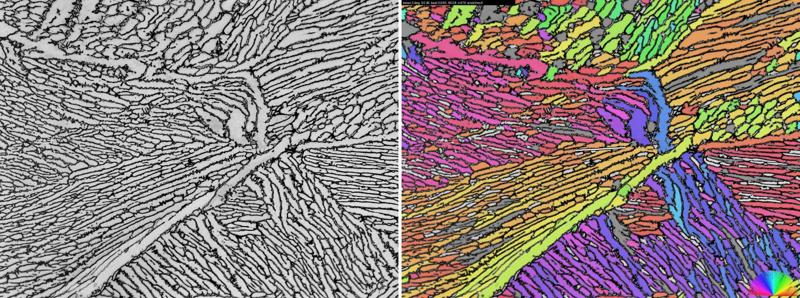
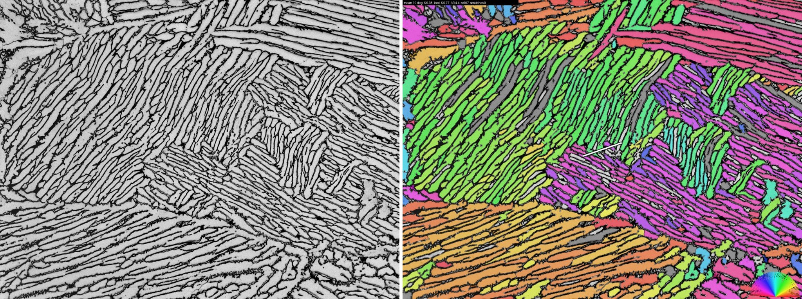
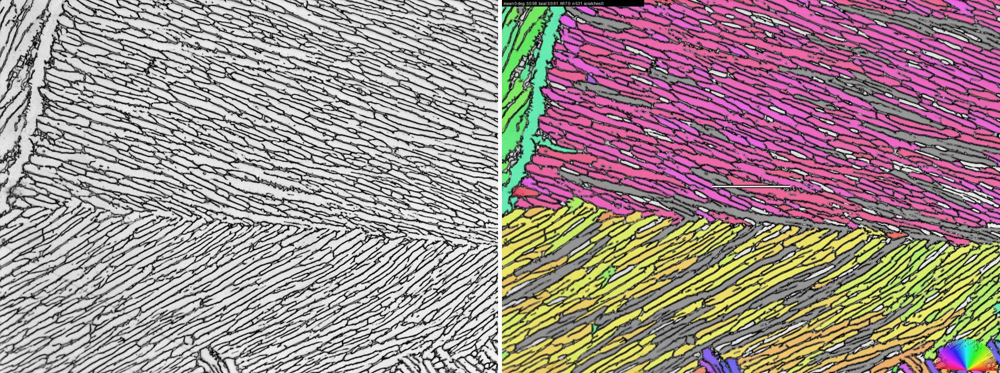
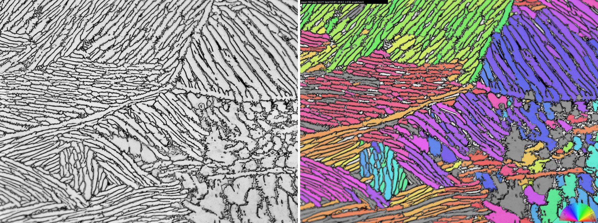
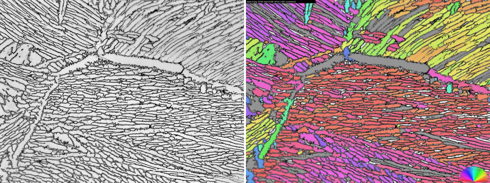
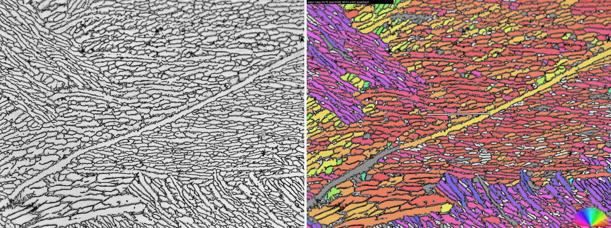
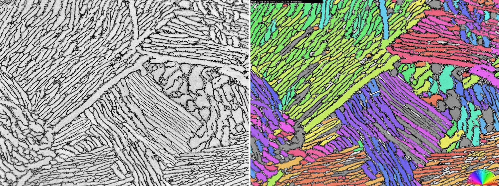
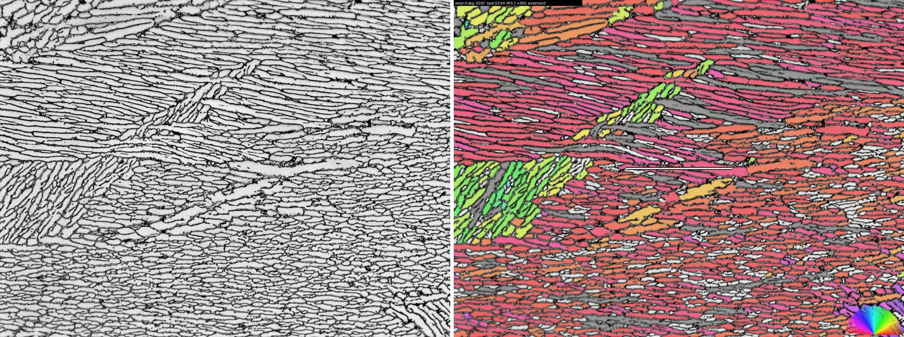
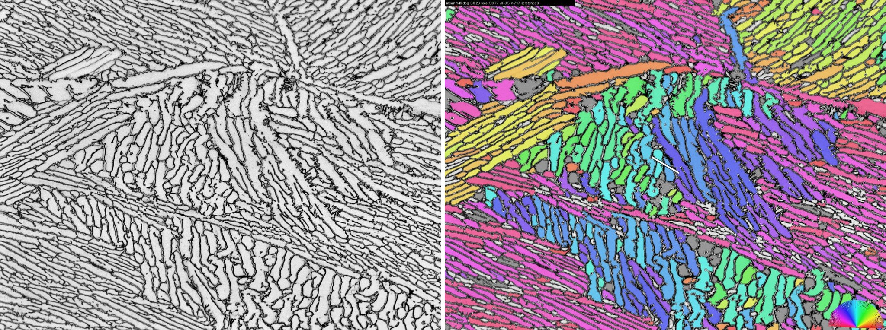
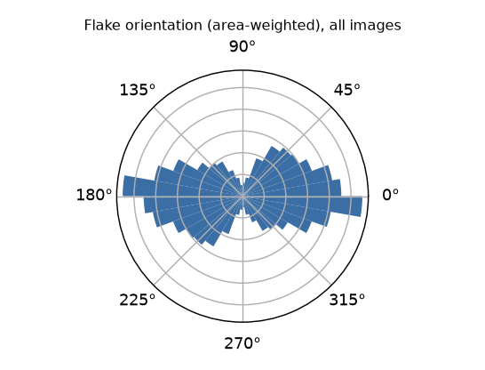

# Flake measurements: ti64_dev

13 images; reading: **boundaries** (minority phase is a connected thin network); flake width 10.0 px; code version 2d70afd967.

## Confidence

- **Within tolerances** on held-out twin images, and consistent under rotation on the real images.
- Twin accuracy (held-out twin images, exact truth): worst family ratio 0.49, pooled 0.37 (<= 1 means within the tolerances of config.yaml); dev 0.40: a gap shows how much the search fitted the dev twin images.
- The twin resembles the real images (worst profile mismatch x1.06; flake aspect ratio and width as measured by the method differ by up to x1.16); the twin accuracy carries over only as far as that, and only for structures the generator draws (straight laths in colonies).
- Rotation check on the real images (central disk turned by 30 deg and measured again): worst ratio 0.44 (passes); S changes by 0.00645, the direction by 0.5537 deg, the median aspect ratio by 0.02205 (relative); for comparison, the 95 % interval of S from the finite number of flakes is +/-0.055.
- Lengths are in pixels (no --um-per-px given).

## Set summary

| | median | min | max |
|---|---|---|---|
| order parameter S | 0.574 | 0.157 | 0.871 |
| local S (within colonies) | 0.841 | 0.746 | 0.936 |
| mean misalignment (deg) | 24.7 | 10.2 | 39.7 |
| median aspect ratio | 3.94 | 3.36 | 6.96 |
| median length (px) | 65.5 | 50.8 | 102 |
| median width (px) | 15.7 | 12.4 | 18.1 |
| flakes used per image | 644 | 516 | 932 |

Mean directions differ per image (axial; see the table): a set-level mean direction is only meaningful when the images were taken in the same specimen frame.

## Per image

| image | mean dir (deg) | S [95 % CI] | local S | misalignment (deg) | AR [95 % CI] | flakes | scratches |
|---|---|---|---|---|---|---|---|
| Ti64_21 | 3.13 | 0.459 [0.396, 0.521] | 0.83 | 28.5 | 3.79 [3.5, 4.04] | 679 | 0 |
| Ti64_22 | 18.8 | 0.379 [0.334, 0.425] | 0.77 | 30.9 | 4.43 [4.13, 4.74] | 607 | 0 |
| Ti64_23 | 135 | 0.575 [0.517, 0.628] | 0.844 | 23.5 | 3.45 [3.25, 3.68] | 799 | 0 |
| Ti64_24 | 15.3 | 0.574 [0.488, 0.645] | 0.841 | 24.4 | 3.8 [3.6, 4.07] | 644 | 0 |
| Ti64_28 | 0.217 | 0.579 [0.485, 0.648] | 0.907 | 26.1 | 6.96 [6.47, 7.28] | 531 | 0 |
| Ti64_29 | 44.9 | 0.543 [0.494, 0.599] | 0.871 | 24.7 | 6.46 [5.86, 6.92] | 522 | 0 |
| Ti64_32 | 160 | 0.206 [0.152, 0.288] | 0.806 | 37.8 | 4.24 [3.87, 4.54] | 516 | 0 |
| Ti64_33 | 0.274 | 0.641 [0.59, 0.688] | 0.861 | 21.1 | 3.94 [3.69, 4.32] | 691 | 0 |
| Ti64_34 | 0.759 | 0.764 [0.738, 0.788] | 0.889 | 15.9 | 3.36 [3.22, 3.56] | 932 | 0 |
| Ti64_36 | 21.8 | 0.157 [0.0708, 0.245] | 0.746 | 39.7 | 3.6 [3.39, 3.81] | 574 | 0 |
| Ti64_37 | 0.371 | 0.871 [0.85, 0.889] | 0.936 | 10.2 | 5.2 [4.85, 5.38] | 805 | 0 |
| Ti64_38 | 149 | 0.264 [0.203, 0.325] | 0.765 | 34.5 | 3.46 [3.21, 3.68] | 717 | 0 |
| Ti64_39 | 19.1 | 0.597 [0.546, 0.643] | 0.824 | 22.4 | 4.05 [3.65, 4.44] | 608 | 1 |

## How accurate is it (twin images with exact truth)

Twin: 18 code-generated images fitted to this set (realism ok: True; worst profile mismatch x1.06).

| twin images | params | mean direction err (deg) | S err | misalignment err (deg) | AR err | flake orientation err (deg) | flakes found | worst family ratio |
|---|---|---|---|---|---|---|---|---|
| dev | start | 0.456 | 0.0378 | 1.69 | 0.0488 | 2.37 | 0.98 | 0.936 |
| holdout | start | 0.468 | 0.0313 | 1.61 | 0.0466 | 2.32 | 0.976 | 1.16 |
| dev | chosen | 0.244 | 0.00874 | 0.476 | 0.0496 | 1.85 | 0.826 | 0.4 |
| holdout | chosen | 0.353 | 0.013 | 0.467 | 0.0357 | 1.86 | 0.833 | 0.49 |

Search: 30 new configurations evaluated (132 incl. cached); objective 1.125 at the start, 0.492 chosen.
Warm start: none (no similar image set in the memory).

## Real images: rotation check

Central disk measured as is and turned by 30 deg: direction off by 0.5537 deg, S by 0.00645, aspect ratio by 0.02205 (worst ratio to tolerance 0.441; <= 1 passes). Necessary, not sufficient.

## Drawings (left: original, right: flakes coloured by orientation; grey = not used)

## Files

- `flakes.csv`: every flake (orientation, length, width, aspect ratio, misalignment, flags)
- `image_summaries.csv`: one row per image, with bootstrap intervals
- `params.json`: the params used
- `adapt_log.json`: profile, twin, search trials, reviews
