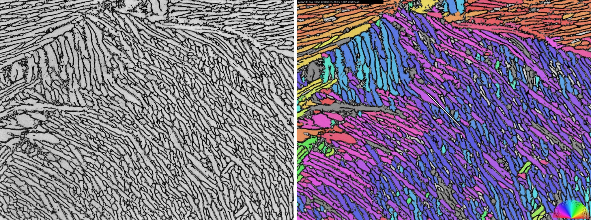
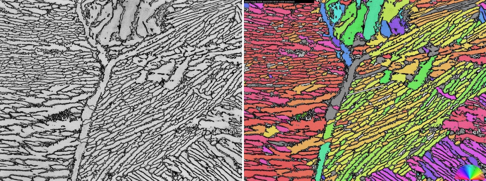
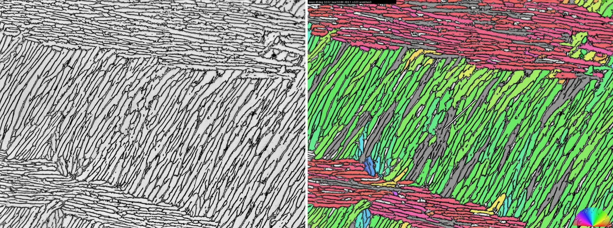
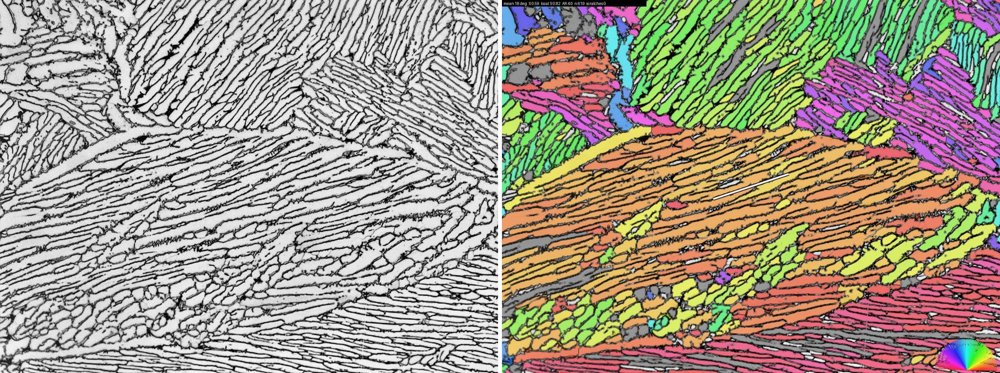
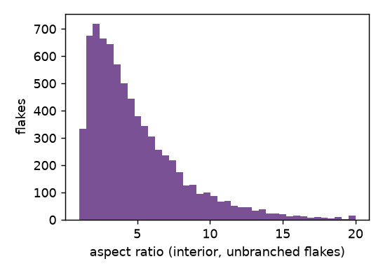

# Flake measurements: ti64_dev

13 images; reading: **boundaries** (minority phase is a connected thin network); flake width 10.0 px; code version 77a86cd85c.

## Confidence

- **Within tolerances** on held-out twin images, and consistent under rotation on the real images.
- Twin accuracy (held-out twin images, exact truth): worst family ratio 0.51, pooled 0.40 (<= 1 means within the tolerances of config.yaml); dev 0.43: a gap shows how much the search fitted the dev twin images.
- The twin resembles the real images (worst profile mismatch x1.06; flake aspect ratio and width as measured by the method differ by up to x1.16); the twin accuracy carries over only as far as that, and only for structures the generator draws (straight laths in colonies).
- Rotation check on the real images (central disk turned by 30 deg and measured again): worst ratio 0.19 (passes); S changes by 0.003, the direction by 0.54 deg, the median aspect ratio by 0.9 %; for comparison, the 95 % interval of S from the finite number of flakes is +/-0.055.
- Lengths are in pixels (no --um-per-px given).

## Set summary

| | median | min | max |
|---|---|---|---|
| order parameter S | 0.578 | 0.15 | 0.866 |
| local S (within colonies) | 0.841 | 0.781 | 0.934 |
| mean misalignment (deg) | 25.3 | 10.4 | 39.8 |
| median aspect ratio | 3.79 | 3.35 | 6.7 |
| median length (px) | 66.2 | 54 | 104 |
| median width (px) | 16.2 | 13.2 | 18.6 |
| flakes used per image | 639 | 507 | 925 |

Mean directions differ per image (axial; see the table): a set-level mean direction is only meaningful when the images were taken in the same specimen frame.

## Per image

| image | mean dir (deg) | S [95 % CI] | local S | misalignment (deg) | AR [95 % CI] | flakes | scratches |
|---|---|---|---|---|---|---|---|
| Ti64_21 | 3.28 | 0.473 [0.407, 0.526] | 0.828 | 27.9 | 3.79 [3.52, 4] | 705 | 0 |
| Ti64_22 | 18.7 | 0.374 [0.319, 0.433] | 0.786 | 31.1 | 4.47 [4.1, 4.72] | 608 | 0 |
| Ti64_23 | 135 | 0.578 [0.525, 0.633] | 0.853 | 23.4 | 3.48 [3.25, 3.66] | 787 | 0 |
| Ti64_24 | 14.5 | 0.579 [0.503, 0.641] | 0.841 | 24.5 | 3.62 [3.41, 3.89] | 639 | 0 |
| Ti64_28 | 180 | 0.599 [0.544, 0.654] | 0.903 | 25.3 | 6.7 [6.28, 7.08] | 559 | 0 |
| Ti64_29 | 43.1 | 0.517 [0.471, 0.568] | 0.858 | 26.3 | 6.05 [5.61, 6.58] | 523 | 0 |
| Ti64_32 | 159 | 0.211 [0.143, 0.294] | 0.784 | 37.7 | 4.12 [3.74, 4.46] | 507 | 0 |
| Ti64_33 | 180 | 0.645 [0.606, 0.689] | 0.871 | 21.1 | 3.78 [3.53, 4.07] | 694 | 0 |
| Ti64_34 | 0.265 | 0.764 [0.735, 0.793] | 0.892 | 16 | 3.37 [3.2, 3.5] | 925 | 0 |
| Ti64_36 | 18.3 | 0.15 [0.0779, 0.256] | 0.8 | 39.8 | 3.46 [3.31, 3.76] | 578 | 0 |
| Ti64_37 | 0.501 | 0.866 [0.84, 0.888] | 0.934 | 10.4 | 4.99 [4.65, 5.25] | 854 | 0 |
| Ti64_38 | 151 | 0.286 [0.233, 0.355] | 0.781 | 33.4 | 3.35 [3.11, 3.56] | 734 | 0 |
| Ti64_39 | 18.3 | 0.587 [0.531, 0.637] | 0.819 | 22.7 | 3.97 [3.68, 4.28] | 619 | 0 |

## How accurate is it (twin images with exact truth)

Twin: 18 code-generated images fitted to this set (realism ok: True; worst profile mismatch x1.06).

| twin images | params | mean direction err (deg) | S err | misalignment err (deg) | AR err | flake orientation err (deg) | flakes found | worst family ratio |
|---|---|---|---|---|---|---|---|---|
| dev | start | 0.456 | 0.0378 | 1.69 | 0.0488 | 2.37 | 0.98 | 0.936 |
| holdout | start | 0.468 | 0.0313 | 1.61 | 0.0466 | 2.32 | 0.976 | 1.16 |
| dev | chosen | 0.199 | 0.0125 | 0.622 | 0.0153 | 2.01 | 0.876 | 0.43 |
| holdout | chosen | 0.268 | 0.0123 | 0.385 | 0.0141 | 2.02 | 0.882 | 0.509 |

Search: 30 new configurations evaluated (39 incl. cached); objective 1.125 at the start, 0.530 chosen.
Warm start: none (no similar image set in the memory).

## Real images: rotation check

Central disk measured as is and turned by 30 deg: direction off by 0.54 deg, S by 0.003, aspect ratio by 0.009 (relative) (worst ratio to tolerance 0.19; <= 1 passes). Necessary, not sufficient.

## Drawings (left: original, right: flakes coloured by orientation; grey = not used)

## Files

- `flakes.csv`: every flake (orientation, length, width, aspect ratio, misalignment, flags)
- `image_summaries.csv`: one row per image, with bootstrap intervals
- `params.json`: the params used
- `adapt_log.json`: profile, twin, search trials, reviews
