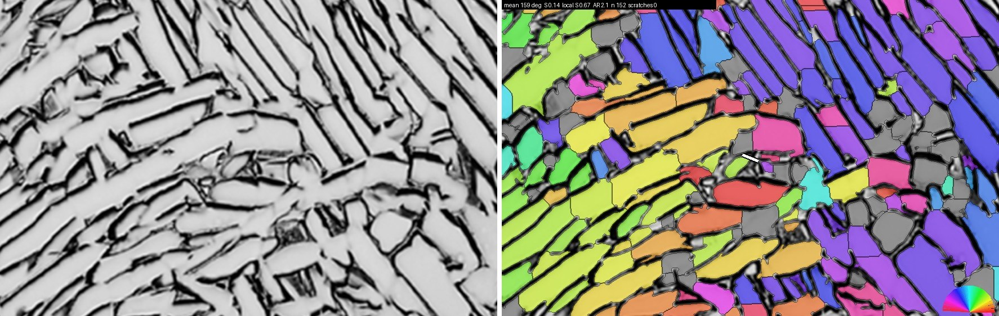
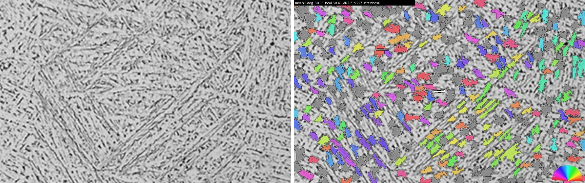

# Flake measurements: ti_basketweave_ma19010080

4 images; reading: **boundaries** (ambiguous profile; boundary reading by default (the agent review checks it)); flake width 15.22 px; code version 2d70afd967.

## Confidence

- **Within tolerances** on held-out twin images, and consistent under rotation on the real images.
- Twin accuracy (held-out twin images, exact truth): worst family ratio 0.60, pooled 0.41 (<= 1 means within the tolerances of config.yaml); dev 0.47: a gap shows how much the search fitted the dev twin images.
- The twin resembles the real images (worst profile mismatch x1.25; flake aspect ratio and width as measured by the method differ by up to x1.14); the twin accuracy carries over only as far as that, and only for structures the generator draws (straight laths in colonies).
- Rotation check on the real images (central disk turned by 30 deg and measured again): worst ratio 0.88 (passes); S changes by 0.026250000000000002, the direction by None deg, the median aspect ratio by 0.026850000000000002 (relative); for comparison, the 95 % interval of S from the finite number of flakes is +/-0.101. At S below ~0.3 the mean direction is weakly defined and moves easily.
- The image profile was ambiguous between a boundary network and phase islands: check in the drawings that the outlined regions are the flakes you mean; rerun with --mode phase otherwise.
- Lengths are in pixels (no --um-per-px given).

## Set summary

| | median | min | max |
|---|---|---|---|
| order parameter S | 0.187 | 0.0763 | 0.278 |
| local S (within colonies) | 0.472 | 0.408 | 0.672 |
| mean misalignment (deg) | 38.3 | 34.7 | 42.3 |
| median aspect ratio | 1.7 | 1.64 | 2.11 |
| median length (px) | 44.1 | 32.8 | 59.3 |
| median width (px) | 25.4 | 18.8 | 30.2 |
| flakes used per image | 197 | 152 | 268 |

Mean directions differ per image (axial; see the table): a set-level mean direction is only meaningful when the images were taken in the same specimen frame.

## Per image

| image | mean dir (deg) | S [95 % CI] | local S | misalignment (deg) | AR [95 % CI] | flakes | scratches |
|---|---|---|---|---|---|---|---|
| L08__10.3390_ma19010080_g003_p10 | 159 | 0.137 [0.0816, 0.293] | 0.672 | 40.3 | 2.11 [1.89, 2.31] | 152 | 0 |
| L20__10.3390_ma19010080_g003_p9 | 167 | 0.278 [0.177, 0.4] | 0.493 | 34.7 | 1.64 [1.54, 1.7] | 167 | 0 |
| L21__10.3390_ma19010080_g003_p7 | 35.1 | 0.238 [0.143, 0.334] | 0.45 | 36.2 | 1.71 [1.64, 1.8] | 268 | 0 |
| L22__10.3390_ma19010080_g003_p5 | 6.4 | 0.0763 [0.0141, 0.179] | 0.408 | 42.3 | 1.69 [1.64, 1.73] | 227 | 0 |

## How accurate is it (twin images with exact truth)

Twin: 18 code-generated images fitted to this set (realism ok: True; worst profile mismatch x1.25).

| twin images | params | mean direction err (deg) | S err | misalignment err (deg) | AR err | flake orientation err (deg) | flakes found | worst family ratio |
|---|---|---|---|---|---|---|---|---|
| dev | start | 0.281 | 0.0266 | 1.68 | 0.0301 | 2.43 | 0.786 | 0.929 |
| holdout | start | 0.548 | 0.0207 | 1.47 | 0.0204 | 2.41 | 0.792 | 0.835 |
| dev | chosen | 0.22 | 0.0138 | 0.73 | 0.0324 | 2.08 | 0.749 | 0.473 |
| holdout | chosen | 0.253 | 0.0162 | 0.775 | 0.0282 | 2.07 | 0.772 | 0.597 |

Search: 20 new configurations evaluated (31 incl. cached); objective 1.062 at the start, 0.577 chosen.
Warm start: ti64_dev (distance 0.74), banded_islands_ma17081847 (distance 5.64).

## Real images: rotation check

Central disk measured as is and turned by 30 deg: direction off by None deg, S by 0.026250000000000002, aspect ratio by 0.026850000000000002 (worst ratio to tolerance 0.8750000000000001; <= 1 passes). Necessary, not sufficient.

## Drawings (left: original, right: flakes coloured by orientation; grey = not used)

## Files

- `flakes.csv`: every flake (orientation, length, width, aspect ratio, misalignment, flags)
- `image_summaries.csv`: one row per image, with bootstrap intervals
- `params.json`: the params used
- `adapt_log.json`: profile, twin, search trials, reviews
