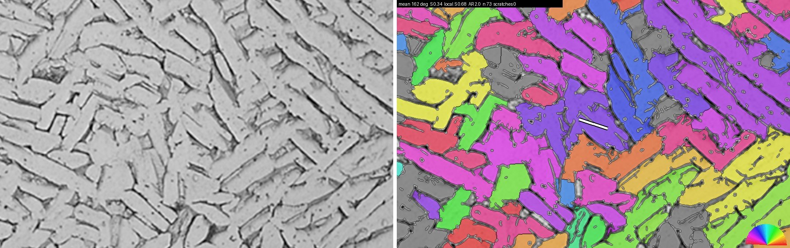
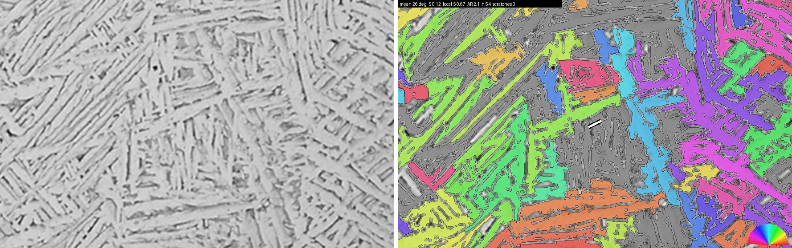
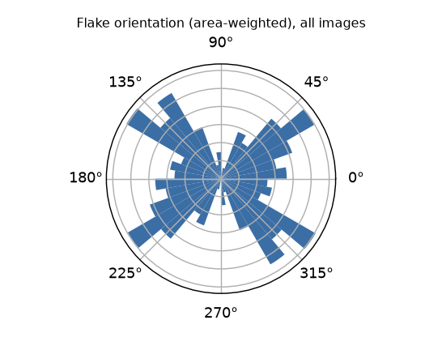
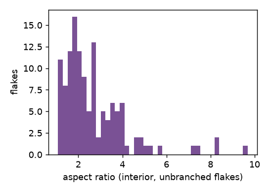

# Flake measurements: ti_basketweave_ma19010080

4 images; reading: **boundaries** (ambiguous profile; boundary reading by default (the agent review checks it)); flake width 15.22 px; code version 77a86cd85c.

## Confidence

- Twin accuracy (held-out twin images, exact truth): worst family ratio 1.11, pooled 0.48 (<= 1 means within the tolerances of config.yaml); dev 0.98: a gap shows how much the search fitted the dev twin images.
- The twin resembles the real images (worst profile mismatch x1.25; flake aspect ratio and width as measured by the method differ by up to x1.14); the twin accuracy carries over only as far as that, and only for structures the generator draws (straight laths in colonies).
- Rotation check on the real images (central disk turned by 30 deg and measured again): worst ratio 2.14 (FAILS); S changes by 0.064, the direction by 0.62 deg, the median aspect ratio by 9.1 %; for comparison, the 95 % interval of S from the finite number of flakes is +/-0.167. At S below ~0.3 the mean direction is weakly defined and moves easily.
- The settings tuned on the twin were **not used**: on the real images they gave a worse rotation check (flakes used 61 vs 64, rotation check 3.8995166666666665 vs 2.14 with the start settings), so the start settings were kept: the twin did not capture what made the difference.
- The image profile was ambiguous between a boundary network and phase islands: check in the drawings that the outlined regions are the flakes you mean; rerun with --mode phase otherwise.
- Lengths are in pixels (no --um-per-px given).

## Set summary

| | median | min | max |
|---|---|---|---|
| order parameter S | 0.234 | 0.116 | 0.423 |
| local S (within colonies) | 0.676 | 0.665 | 0.83 |
| mean misalignment (deg) | 36.8 | 30.1 | 40.9 |
| median aspect ratio | 2.04 | 1.97 | 3.01 |
| median length (px) | 129 | 116 | 172 |
| median width (px) | 55.3 | 44.4 | 64 |
| flakes used per image | 63.5 | 36 | 78 |

Mean directions differ per image (axial; see the table): a set-level mean direction is only meaningful when the images were taken in the same specimen frame.

## Per image

| image | mean dir (deg) | S [95 % CI] | local S | misalignment (deg) | AR [95 % CI] | flakes | scratches |
|---|---|---|---|---|---|---|---|
| L08__10.3390_ma19010080_g003_p10 | 172 | 0.131 [0.0711, 0.362] | 0.83 | 40.7 | 3.01 [2.3, 3.53] | 78 | 0 |
| L20__10.3390_ma19010080_g003_p9 | 162 | 0.337 [0.2, 0.506] | 0.676 | 32.8 | 1.97 [1.77, 2.6] | 73 | 0 |
| L21__10.3390_ma19010080_g003_p7 | 25.7 | 0.116 [0.0315, 0.393] | 0.665 | 40.9 | 2.08 [1.81, 2.69] | 54 | 0 |
| L22__10.3390_ma19010080_g003_p5 | 12.6 | 0.423 [0.25, 0.642] | – | 30.1 | 2.01 [1.65, 2.73] | 36 | 0 |

## How accurate is it (twin images with exact truth)

Twin: 18 code-generated images fitted to this set (realism ok: True; worst profile mismatch x1.25).

| twin images | params | mean direction err (deg) | S err | misalignment err (deg) | AR err | flake orientation err (deg) | flakes found | worst family ratio |
|---|---|---|---|---|---|---|---|---|
| dev | start | 0.746 | 0.0328 | 1.94 | 0.0178 | 2.41 | 0.642 | 0.98 |
| holdout | start | 0.37 | 0.0203 | 1.44 | 0.0128 | 2.38 | 0.653 | 1.11 |
| dev | chosen | 0.746 | 0.0328 | 1.94 | 0.0178 | 2.41 | 0.642 | 0.98 |
| holdout | chosen | 0.37 | 0.0203 | 1.44 | 0.0128 | 2.38 | 0.653 | 1.11 |

Search: 20 new configurations evaluated (31 incl. cached); objective 1.144 at the start, 1.144 chosen.
Warm start: ti64_dev (distance 0.74), banded_islands_ma17081847 (distance 5.64).

## Real images: rotation check

Central disk measured as is and turned by 30 deg: direction off by 0.62 deg, S by 0.064, aspect ratio by 0.091 (relative) (worst ratio to tolerance 2.14; <= 1 passes). Necessary, not sufficient.

## Drawings (left: original, right: flakes coloured by orientation; grey = not used)

## Files

- `flakes.csv`: every flake (orientation, length, width, aspect ratio, misalignment, flags)
- `image_summaries.csv`: one row per image, with bootstrap intervals
- `params.json`: the params used
- `adapt_log.json`: profile, twin, search trials, reviews
