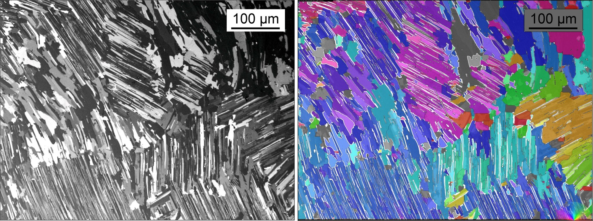
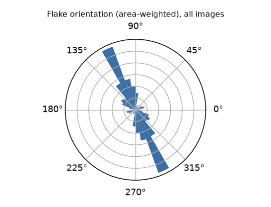
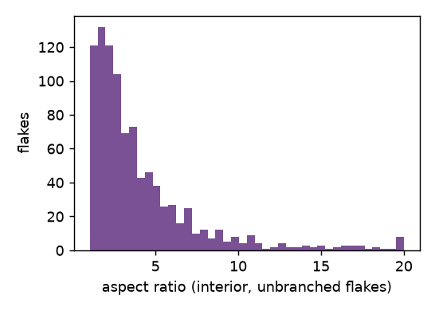

# Flake measurements: tial_lamellar_L26

1 images; reading: **boundaries** (ambiguous profile; boundary reading by default (the agent review checks it)); flake width 18.44 px; code version 77a86cd85c.

## Confidence

- **Twin not usable** for this image set (it does not resemble the images closely enough, or flakes cannot be found on it at this size): the accuracy below is not evidence about these images, and no search was run on it; the scaled default settings were used. Treat the numbers as unvalidated; check them in the drawings.
- Twin accuracy (held-out twin images, exact truth): worst family ratio 2.78, pooled 2.39 (<= 1 means within the tolerances of config.yaml); dev 2.78: a gap shows how much the search fitted the dev twin images.
- The twin resembles the real images only roughly (worst profile mismatch x1.37; flake aspect ratio and width as measured by the method differ by up to x1.36); the twin accuracy carries over only as far as that, and only for structures the generator draws (straight laths in colonies).
- Rotation check on the real images (central disk turned by 30 deg and measured again): worst ratio 0.97 (passes); S changes by 0.022, the direction by 0.05 deg, the median aspect ratio by 4.9 %; for comparison, the 95 % interval of S from the finite number of flakes is +/-0.111.
- **Two scales**: 42% of the dark phase is in structures about 79 px wide, 4x the typical flake width used here (18.4 px). The settings fit the fine structures; the coarse ones may be split, merged or left out, and the statistics mix the two populations. If the coarse ones are the flakes you mean, rerun with --flake-width 79.
- The image profile was ambiguous between a boundary network and phase islands: check in the drawings that the outlined regions are the flakes you mean; rerun with --mode phase otherwise.
- Lengths are in pixels (no --um-per-px given).

## Set summary

| | median | min | max |
|---|---|---|---|
| order parameter S | 0.563 | 0.563 | 0.563 |
| local S (within colonies) | 0.896 | 0.896 | 0.896 |
| mean misalignment (deg) | 23.7 | 23.7 | 23.7 |
| median aspect ratio | 2.94 | 2.94 | 2.94 |
| median length (px) | 93.2 | 93.2 | 93.2 |
| median width (px) | 29.4 | 29.4 | 29.4 |
| flakes used per image | 988 | 988 | 988 |

Mean directions differ per image (axial; see the table): a set-level mean direction is only meaningful when the images were taken in the same specimen frame.

## Per image

| image | mean dir (deg) | S [95 % CI] | local S | misalignment (deg) | AR [95 % CI] | flakes | scratches |
|---|---|---|---|---|---|---|---|
| L26__rank038__056_TiAl_Lammelar__CC0 | 117 | 0.563 [0.446, 0.667] | 0.896 | 23.7 | 2.94 [2.75, 3.11] | 988 | 0 |

## How accurate is it (twin images with exact truth)

Twin: 18 code-generated images fitted to this set (realism ok: False; worst profile mismatch x1.37).

| twin images | params | mean direction err (deg) | S err | misalignment err (deg) | AR err | flake orientation err (deg) | flakes found | worst family ratio |
|---|---|---|---|---|---|---|---|---|
| dev | start | 0.261 | 0.00959 | 0.518 | 0.0511 | 1.83 | 0.807 | 0.826 |
| holdout | start | 0.279 | 0.0166 | 0.885 | 0.0529 | 1.95 | 0.807 | 0.856 |
| dev | chosen | 0.327 | 0.0324 | 1.5 | 0.303 | 2.22 | 0.893 | 2.78 |
| holdout | chosen | 0.482 | 0.0388 | 1.69 | 0.358 | 2.25 | 0.906 | 2.78 |

Search: 3 new configurations evaluated (8 incl. cached); objective 0.917 at the start, 3.289 chosen.
Warm start: ti_basketweave_ma19010080 (distance 0.47), ti64_dev (distance 0.93).

## Real images: rotation check

Central disk measured as is and turned by 30 deg: direction off by 0.05 deg, S by 0.022, aspect ratio by 0.049 (relative) (worst ratio to tolerance 0.97; <= 1 passes). Necessary, not sufficient.

## Drawings (left: original, right: flakes coloured by orientation; grey = not used)

## Files

- `flakes.csv`: every flake (orientation, length, width, aspect ratio, misalignment, flags)
- `image_summaries.csv`: one row per image, with bootstrap intervals
- `params.json`: the params used
- `adapt_log.json`: profile, twin, search trials, reviews
