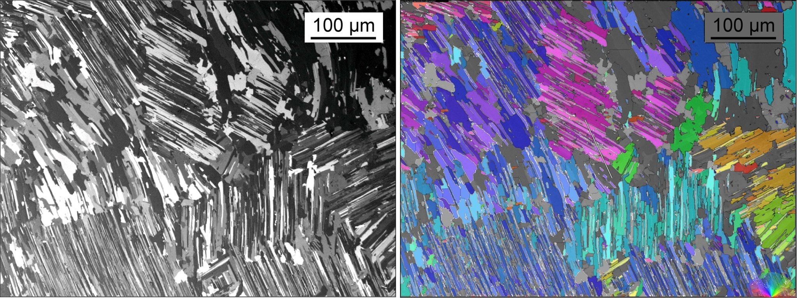
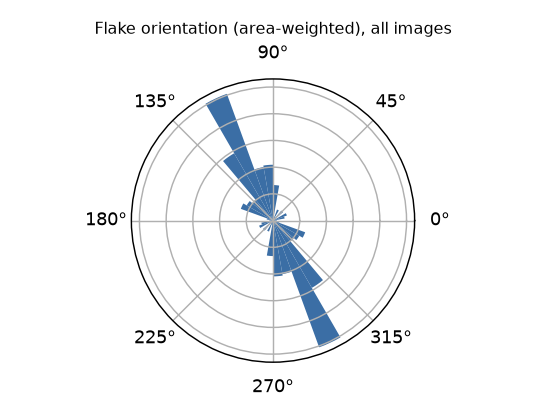
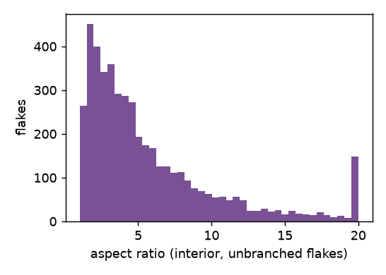

# Flake measurements: tial_lamellar_L26_live

1 images; reading: **regions** (switched by the agent after review 1: Confidence about 0.7. The real micrograph looks like a back-scattered electron image of lamellar TiAl/Ti. Lamellae appear as strips of several grey levels (white, light grey, dark grey, black) that touch each other. There are no thin dark boundary lines between them. The boundary reading (flakes bet); flake width 18.44 px; code version 2d70afd967.

## Confidence

- **Twin not usable** for this image set (it does not resemble the images closely enough, or flakes cannot be found on it at this size): the accuracy below is not evidence about these images, and no search was run on it; the settings were changed by the agent from its reading of the drawings (not scored against any truth). Treat the numbers as unvalidated; check them in the drawings.
- Twin accuracy (held-out twin images, exact truth): worst family ratio 2.47, pooled 1.80 (<= 1 means within the tolerances of config.yaml); dev 2.27: a gap shows how much the search fitted the dev twin images.
- The twin resembles the real images only roughly (worst profile mismatch x1.17; flake aspect ratio and width as measured by the method differ by up to x1.55); the twin accuracy carries over only as far as that, and only for structures the generator draws (straight laths in colonies).
- Rotation check on the real images (central disk turned by 30 deg and measured again): worst ratio 0.58 (passes); S changes by 0.003, the direction by 1.75 deg, the median aspect ratio by 2.4 %; for comparison, the 95 % interval of S from the finite number of flakes is +/-0.082.
- **Two scales**: 42% of the dark phase is in structures about 79 px wide, 4x the typical flake width used here (18.4 px). The settings fit the fine structures; the coarse ones may be split, merged or left out, and the statistics mix the two populations. If the coarse ones are the flakes you mean, rerun with --flake-width 79.
- Last agent review of the real drawings: reject, reading correct: yes.
- Lengths are in pixels (no --um-per-px given).
- Agent stage: 4 Claude calls, 24394 input / 8039 output tokens (about $0.26 at claude-opus-5-5 list prices).

## Set summary

| | median | min | max |
|---|---|---|---|
| order parameter S | 0.598 | 0.598 | 0.598 |
| local S (within colonies) | 0.938 | 0.938 | 0.938 |
| mean misalignment (deg) | 22.4 | 22.4 | 22.4 |
| median aspect ratio | 4.23 | 4.23 | 4.23 |
| median length (px) | 36.1 | 36.1 | 36.1 |
| median width (px) | 7.66 | 7.66 | 7.66 |
| flakes used per image | 4e+03 | 4e+03 | 4e+03 |

Mean directions differ per image (axial; see the table): a set-level mean direction is only meaningful when the images were taken in the same specimen frame.

## Per image

| image | mean dir (deg) | S [95 % CI] | local S | misalignment (deg) | AR [95 % CI] | flakes | scratches |
|---|---|---|---|---|---|---|---|
| L26__rank038__056_TiAl_Lammelar__CC0 | 115 | 0.598 [0.512, 0.676] | 0.938 | 22.4 | 4.23 [4.12, 4.34] | 4002 | 0 |

## How accurate is it (twin images with exact truth)

Twin: 18 code-generated images fitted to this set (realism ok: False; worst profile mismatch x1.17).

| twin images | params | mean direction err (deg) | S err | misalignment err (deg) | AR err | flake orientation err (deg) | flakes found | worst family ratio |
|---|---|---|---|---|---|---|---|---|
| dev | start | 0.283 | 0.016 | 0.696 | 0.295 | 1.75 | 0.552 | 2.56 |
| holdout | start | 0.251 | 0.02 | 0.798 | 0.295 | 1.72 | 0.544 | 2.76 |
| dev | chosen | 0.317 | 0.011 | 0.494 | 0.27 | 1.74 | 0.585 | 2.27 |
| holdout | chosen | 0.218 | 0.0114 | 0.467 | 0.269 | 1.7 | 0.582 | 2.47 |

Search: 1 new configurations evaluated (6 incl. cached); objective 3.053 at the start, 2.716 chosen.
Warm start: ti_basketweave_ma19010080 (distance 0.47), pearlite_L02 (distance 0.70).

## Real images: rotation check

Central disk measured as is and turned by 30 deg: direction off by 1.75 deg, S by 0.003, aspect ratio by 0.024 (relative) (worst ratio to tolerance 0.58; <= 1 passes). Necessary, not sufficient.

## Agent reviews of the real drawings

- Round 1: **reject**, reading correct: no. Confidence about 0.7. The real micrograph looks like a back-scattered electron image of lamellar TiAl/Ti. Lamellae appear as strips of several grey levels (white, light grey, dark grey, black) that touch each other. There are no thin dark boundary lines between them. The boundary reading (flakes between thin lines) therefore has nothing reliable to follow, and the regions reading is the one a metallographer would use.

What the drawing shows:
- Within colonies, the colour (orientation) is broadly coherent: magenta upper-left and centre, cyan/blue lower half, orange right. The mean direction and S=0.56 are therefore plausible at colony scale.
- Many coloured regions are wide blocks that span several lamellae, for example the large purple and magenta patches and the blue blocks at the upper right. The fine white and dark lamellae in the lower half are partly merged into broad bands.
- A median aspect ratio of 2.96 is not credible for lamellae that look roughly 10:1 or more by eye. This fits flakes being merged across their width. It also matches the twin's aspect-ratio bias of -0.30 (aspect ratio underestimated).
- Equiaxed blocky regions (green and orange at the right, grey patches) are partly coloured and counted. Some of them look like globular or grain-boundary alpha rather than lamellae.
- There is one long thin white line inside the magenta colony. It is either a false scratch or the mean-direction arrow. No real scratch is evident in that image, so scratch handling on the real set cannot be judged.

Twin:
- It is flagged untrusted, and rightly so. It shows dark rounded flakes in a light matrix with drawn boundary lines, which is a phase-in-matrix structure unlike the real image. Its scores say little about the real set.
- Even on its own terms it fails. Worst family tolerance ratio is 2.78. Flake precision is 0.69. Scratch recall is 0.002 and scratch precision is 0.03. The obvious horizontal scratch at the upper right is drawn as red flake fragments and reported as scratches0.

The same set (tial_lamellar_L26, distance 0) failed before under the boundary reading. Its rotation check of 0.974 shows only that the result is stable, not that it is correct. The drawings do not support the reported aspect ratio, the flake count, or the misalignment. They do not show that scratches are found or kept from cutting flakes.
- Round 2: **reject**, reading correct: yes. Reading (confidence about 0.7): the regions reading fits the real image. It is a BSE-type TiAl/Ti lamellar micrograph in which strips of 3–4 grey levels touch without dark separating lines. The drawing colours the colonies coherently: steep cyan/blue in the lower half, magenta/purple diagonal in the upper middle, orange/green in the right, with grey for the equiaxed dark patches at top right. The mean direction and the colony split are therefore plausible.

The drawings do not support the numbers, for three reasons.

(1) Twin, which is the only place with truth: worst tolerance ratio is 1.97 and worst family 2.56, both above 1. Flake recall is only 0.55. Aspect ratio has a +29% bias, and the bias equals the relative error, so it is systematic overestimation. The twin drawing shows why. Adjacent same-orientation flakes are merged into blobs, e.g. the magenta/purple H-shaped region centre-left and grey merged clumps along the colony boundaries. Collinear flakes are also joined end to end. Both raise the aspect ratio and lower recall.

(2) Scratches: the header says scratches0, and none of the three bright scratches is drawn as a white line. Instead they are segmented as thin orange/red flakes, and they cut the lamellae they cross. The listed scratch precision 0.95 / recall 0.90 cannot belong to this drawing. Either the scores are from a different configuration or split, or the drawing is wrong. This must be resolved before any score is trusted.

(3) Real image: no scratches are visible, so that part cannot be checked. In the fine-lamella band at the bottom (fine width about 18 px against coarse about 79 px), the coloured strips look wider than the individual white/black lamellae in the micrograph. I am unsure at this resolution, but it suggests neighbouring fine lamellae are merged, which would inflate AR (4.37) and lower S. Several large white equiaxed patches on the left are coloured as flakes rather than grey, so possible grain-boundary/globular alpha is taken as flakes. Coverage is 0.67.

No rotation check is reported for this regions configuration. The earlier 0.974 was for the boundary reading on L26. The twin is untrusted, so even a pass there would say little about this image.

Confidence the result is not acceptable: about 0.85.

## Drawings (left: original, right: flakes coloured by orientation; grey = not used)

## Files

- `flakes.csv`: every flake (orientation, length, width, aspect ratio, misalignment, flags)
- `image_summaries.csv`: one row per image, with bootstrap intervals
- `params.json`: the params used
- `adapt_log.json`: profile, twin, search trials, reviews
