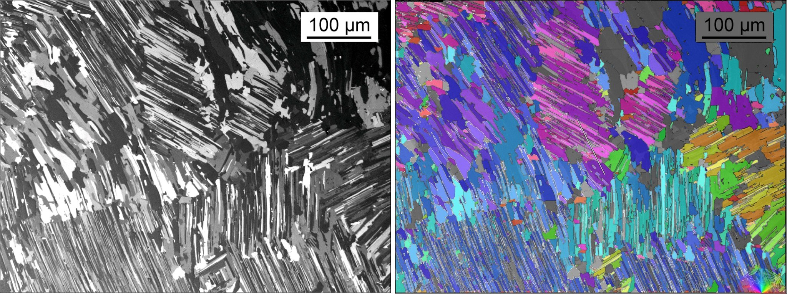
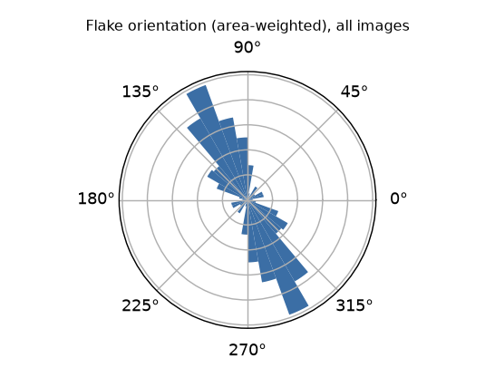
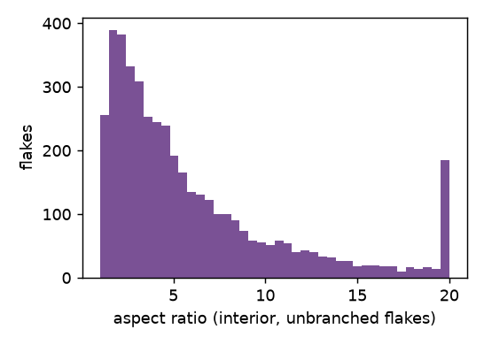

# Flake measurements: tial_regions_L26

1 images; reading: **regions** (set by the user); flake width 10.2 px; code version 2d70afd967.

## Confidence

- **Twin not usable** for this image set (it does not resemble the images closely enough, or flakes cannot be found on it at this size): the accuracy below is not evidence about these images, and no search was run on it; the scaled default settings were used. Treat the numbers as unvalidated; check them in the drawings.
- Twin accuracy (held-out twin images, exact truth): worst family ratio 2.91, pooled 2.16 (<= 1 means within the tolerances of config.yaml); dev 2.42: a gap shows how much the search fitted the dev twin images.
- The twin resembles the real images only roughly (worst profile mismatch x1.17; flake aspect ratio and width as measured by the method differ by up to x1.53); the twin accuracy carries over only as far as that, and only for structures the generator draws (straight laths in colonies).
- Rotation check on the real images (central disk turned by 30 deg and measured again): worst ratio 0.55 (passes); S changes by 0.0102, the direction by 1.6436 deg, the median aspect ratio by 0.0135 (relative); for comparison, the 95 % interval of S from the finite number of flakes is +/-0.065.
- **Two scales**: 44% of the bright phase is in structures about 43 px wide, 4x the typical flake width used here (10.2 px). The settings fit the fine structures; the coarse ones may be split, merged or left out, and the statistics mix the two populations. If the coarse ones are the flakes you mean, rerun with --flake-width 43.
- Lengths are in pixels (no --um-per-px given).

## Set summary

| | median | min | max |
|---|---|---|---|
| order parameter S | 0.58 | 0.58 | 0.58 |
| local S (within colonies) | 0.907 | 0.907 | 0.907 |
| mean misalignment (deg) | 23.3 | 23.3 | 23.3 |
| median aspect ratio | 4.37 | 4.37 | 4.37 |
| median length (px) | 39.5 | 39.5 | 39.5 |
| median width (px) | 7.99 | 7.99 | 7.99 |
| flakes used per image | 4.2e+03 | 4.2e+03 | 4.2e+03 |

Mean directions differ per image (axial; see the table): a set-level mean direction is only meaningful when the images were taken in the same specimen frame.

## Per image

| image | mean dir (deg) | S [95 % CI] | local S | misalignment (deg) | AR [95 % CI] | flakes | scratches |
|---|---|---|---|---|---|---|---|
| L26__rank038__056_TiAl_Lammelar__CC0 | 116 | 0.58 [0.516, 0.646] | 0.907 | 23.3 | 4.37 [4.25, 4.49] | 4199 | 0 |

## How accurate is it (twin images with exact truth)

Twin: 18 code-generated images fitted to this set (realism ok: False; worst profile mismatch x1.17).

| twin images | params | mean direction err (deg) | S err | misalignment err (deg) | AR err | flake orientation err (deg) | flakes found | worst family ratio |
|---|---|---|---|---|---|---|---|---|
| dev | start | 0.153 | 0.0118 | 0.627 | 0.105 | 1.68 | 0.819 | 0.947 |
| holdout | start | 0.277 | 0.01 | 0.557 | 0.101 | 1.63 | 0.83 | 0.931 |
| dev | chosen | 0.14 | 0.0186 | 0.893 | 0.335 | 1.84 | 0.547 | 2.42 |
| holdout | chosen | 0.322 | 0.0191 | 0.987 | 0.323 | 1.8 | 0.544 | 2.91 |

Search: 3 new configurations evaluated (8 incl. cached); objective 1.121 at the start, 2.979 chosen.
Warm start: duplex_bands_mixed (distance 5.27), pearlite_L02 (distance 5.28).

## Real images: rotation check

Central disk measured as is and turned by 30 deg: direction off by 1.6436 deg, S by 0.0102, aspect ratio by 0.0135 (worst ratio to tolerance 0.5478666666666666; <= 1 passes). Necessary, not sufficient.

## Drawings (left: original, right: flakes coloured by orientation; grey = not used)

## Files

- `flakes.csv`: every flake (orientation, length, width, aspect ratio, misalignment, flags)
- `image_summaries.csv`: one row per image, with bootstrap intervals
- `params.json`: the params used
- `adapt_log.json`: profile, twin, search trials, reviews
