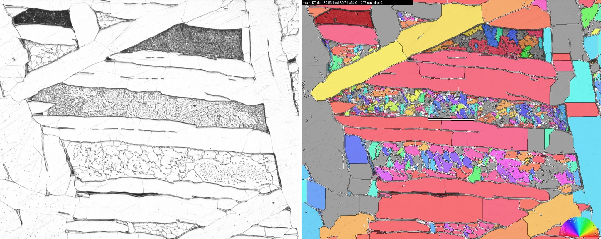
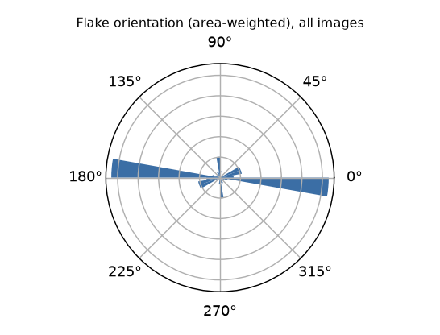
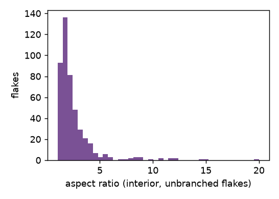

# Flake measurements: widmanstaetten_L18

1 images; reading: **boundaries** (ambiguous profile; boundary reading by default (the agent review checks it)); flake width 13.42 px; code version 77a86cd85c.

## Confidence

- **Twin not usable** for this image set (it does not resemble the images closely enough, or flakes cannot be found on it at this size): the accuracy below is not evidence about these images, and no search was run on it; the scaled default settings were used. Treat the numbers as unvalidated; check them in the drawings.
- Twin accuracy (held-out twin images, exact truth): worst family ratio 2.05, pooled 1.23 (<= 1 means within the tolerances of config.yaml); dev 2.08: a gap shows how much the search fitted the dev twin images.
- The twin resembles the real images only roughly (worst profile mismatch x1.73; flake aspect ratio and width as measured by the method differ by up to x1.35); the twin accuracy carries over only as far as that, and only for structures the generator draws (straight laths in colonies).
- Rotation check on the real images (central disk turned by 30 deg and measured again): worst ratio 0.35 (passes); S changes by 0.010, the direction by 1.04 deg, the median aspect ratio by 1.6 %; for comparison, the 95 % interval of S from the finite number of flakes is +/-0.193.
- **Two scales**: 57% of the bright phase is in structures about 62 px wide, 5x the typical flake width used here (13.4 px). The settings fit the fine structures; the coarse ones may be split, merged or left out, and the statistics mix the two populations. If the coarse ones are the flakes you mean, rerun with --flake-width 62.
- The image profile was ambiguous between a boundary network and phase islands: check in the drawings that the outlined regions are the flakes you mean; rerun with --mode phase otherwise.
- Lengths are in pixels (no --um-per-px given).

## Set summary

| | median | min | max |
|---|---|---|---|
| order parameter S | 0.533 | 0.533 | 0.533 |
| local S (within colonies) | 0.742 | 0.742 | 0.742 |
| mean misalignment (deg) | 23.6 | 23.6 | 23.6 |
| median aspect ratio | 1.99 | 1.99 | 1.99 |
| median length (px) | 27.4 | 27.4 | 27.4 |
| median width (px) | 12 | 12 | 12 |
| flakes used per image | 397 | 397 | 397 |

Mean directions differ per image (axial; see the table): a set-level mean direction is only meaningful when the images were taken in the same specimen frame.

## Per image

| image | mean dir (deg) | S [95 % CI] | local S | misalignment (deg) | AR [95 % CI] | flakes | scratches |
|---|---|---|---|---|---|---|---|
| L18__rank078__043_Widmannstaetten__CC-BY-SA-3.0 | 179 | 0.533 [0.313, 0.698] | 0.742 | 23.6 | 1.99 [1.87, 2.08] | 397 | 0 |

## How accurate is it (twin images with exact truth)

Twin: 18 code-generated images fitted to this set (realism ok: False; worst profile mismatch x1.73).

| twin images | params | mean direction err (deg) | S err | misalignment err (deg) | AR err | flake orientation err (deg) | flakes found | worst family ratio |
|---|---|---|---|---|---|---|---|---|
| dev | start | 0.196 | 0.0701 | 3.4 | 0.0234 | 2.85 | 0.924 | 2.08 |
| holdout | start | 0.566 | 0.0615 | 2.88 | 0.0236 | 2.8 | 0.924 | 2.05 |
| dev | chosen | 0.196 | 0.0701 | 3.4 | 0.0234 | 2.85 | 0.924 | 2.08 |
| holdout | chosen | 0.566 | 0.0615 | 2.88 | 0.0236 | 2.8 | 0.924 | 2.05 |

Search: 3 new configurations evaluated (8 incl. cached); objective 2.431 at the start, 2.431 chosen.
Warm start: ti_basketweave_ma19010080 (distance 0.38), pearlite_L02 (distance 0.49).

## Real images: rotation check

Central disk measured as is and turned by 30 deg: direction off by 1.04 deg, S by 0.010, aspect ratio by 0.016 (relative) (worst ratio to tolerance 0.35; <= 1 passes). Necessary, not sufficient.

## Drawings (left: original, right: flakes coloured by orientation; grey = not used)

## Files

- `flakes.csv`: every flake (orientation, length, width, aspect ratio, misalignment, flags)
- `image_summaries.csv`: one row per image, with bootstrap intervals
- `params.json`: the params used
- `adapt_log.json`: profile, twin, search trials, reviews
