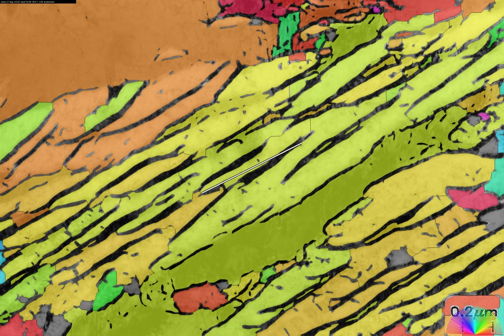
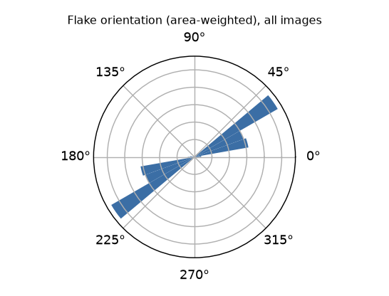
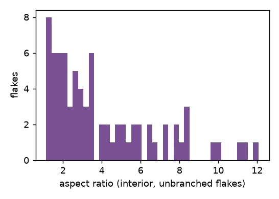

# Flake measurements: bainite_L06

1 images; reading: **boundaries** (ambiguous profile; boundary reading by default (the agent review checks it)); flake width 23.41 px; code version 12ac79dc07.

## Confidence

- Twin accuracy (held-out twin images, exact truth): worst family ratio 11.55, pooled 10.12 (<= 1 means within the tolerances of config.yaml); dev 12.20: a gap shows how much the search fitted the dev twin images.
- The twin resembles the real images only roughly (worst profile mismatch x2.05); the twin accuracy carries over only as far as that, and only for structures the generator draws (straight laths in colonies).
- Rotation check on the real images: worst ratio 1.4343000000000001 (FAILS).
- The image profile was ambiguous between a boundary network and phase islands: check in the drawings that the outlined regions are the flakes you mean; rerun with --mode phase otherwise.
- Lengths are in pixels (no --um-per-px given).

## Set summary

| | median | min | max |
|---|---|---|---|
| order parameter S | 0.92 | 0.92 | 0.92 |
| local S (within colonies) | 0.956 | 0.956 | 0.956 |
| mean misalignment (deg) | 9.05 | 9.05 | 9.05 |
| median aspect ratio | 3.11 | 3.11 | 3.11 |
| median length (px) | 137 | 137 | 137 |
| median width (px) | 48.6 | 48.6 | 48.6 |
| flakes used per image | 99 | 99 | 99 |

Mean directions differ per image (axial; see the table): a set-level mean direction is only meaningful when the images were taken in the same specimen frame.

## Per image

| image | mean dir (deg) | S [95 % CI] | local S | misalignment (deg) | AR [95 % CI] | flakes | scratches |
|---|---|---|---|---|---|---|---|
| L06__rank063__085_Bainit_Gefuge_von_80_Si_13__CC-BY-SA-3.0 | 26.7 | 0.92 [0.868, 0.956] | 0.956 | 9.05 | 3.11 [2.6, 3.97] | 99 | 0 |

## How accurate is it (twin images with exact truth)

Twin: 18 code-generated images fitted to this set (realism ok: False; worst profile mismatch x2.05).

| twin images | params | mean direction err (deg) | S err | misalignment err (deg) | AR err | flake orientation err (deg) | flakes found | worst family ratio |
|---|---|---|---|---|---|---|---|---|
| dev | start | 4.09 | 0.46 | 19.1 | 0.0553 | 42.4 | 0.231 | 12.4 |
| holdout | start | 5.07 | 0.484 | 19.2 | 0.0976 | 50.4 | 0.243 | 11.9 |
| dev | chosen | 3.22 | 0.474 | 19.1 | 0.0561 | 41.8 | 0.23 | 12.2 |
| holdout | chosen | 3.97 | 0.426 | 16.9 | 0.104 | 50.6 | 0.239 | 11.6 |

Search: 20 new configurations evaluated (24 incl. cached); objective 14.690 at the start, 14.566 chosen.
Warm start: tial_lamellar_L26 (distance 0.40), ti_basketweave_ma19010080 (distance 0.81).

## Real images: rotation check

Central disk measured as is and turned by 30 deg: direction off by 4.3029 deg, S by 0.0006, aspect ratio by 0.0162 (worst ratio to tolerance 1.4343000000000001; <= 1 passes). Necessary, not sufficient.

## Drawings

## Files

- `flakes.csv`: every flake (orientation, length, width, aspect ratio, misalignment, flags)
- `image_summaries.csv`: one row per image, with bootstrap intervals
- `params.json`: the params used
- `adapt_log.json`: profile, twin, search trials, reviews
