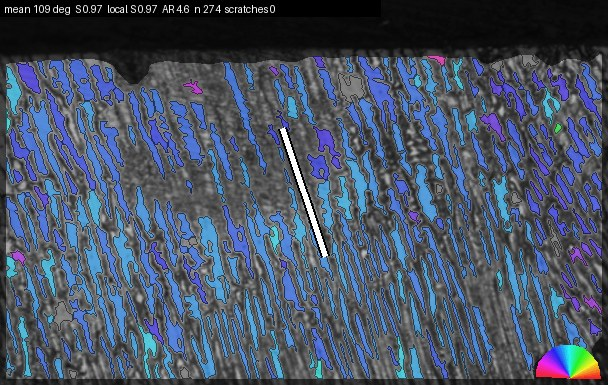
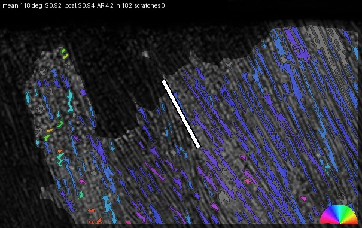
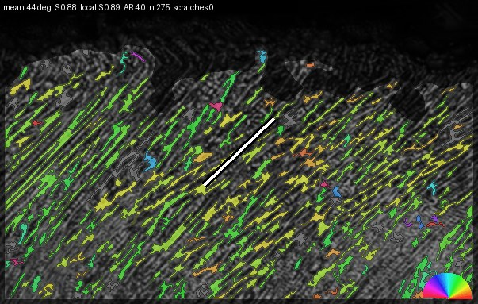
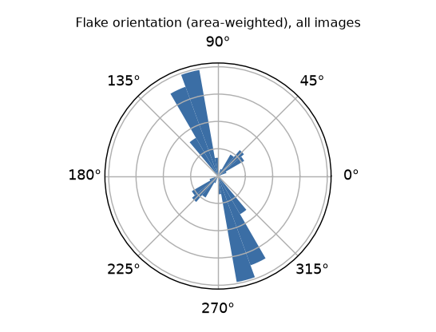
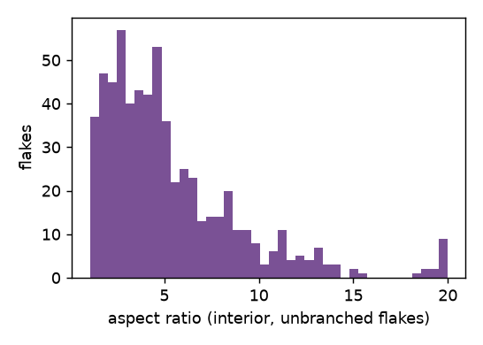

# Flake measurements: colour_lamellar_ma16020804

3 images; reading: **phase** (minority phase is separate blobs about as thick as the matrix); flake width 4.47 px; code version 12ac79dc07.

## Confidence

- Twin accuracy (held-out twin images, exact truth): worst family ratio 1.16, pooled 0.50 (<= 1 means within the tolerances of config.yaml); dev 0.62: a gap shows how much the search fitted the dev twin images.
- The twin resembles the real images (worst profile mismatch x1.12); the twin accuracy carries over only as far as that, and only for structures the generator draws (straight laths in colonies).
- Rotation check on the real images: worst ratio 0.848 (passes).
- Lengths are in pixels (no --um-per-px given).

## Set summary

| | median | min | max |
|---|---|---|---|
| order parameter S | 0.925 | 0.877 | 0.968 |
| local S (within colonies) | 0.938 | 0.893 | 0.974 |
| mean misalignment (deg) | 7.42 | 5.37 | 11.1 |
| median aspect ratio | 4.24 | 4 | 4.64 |
| median length (px) | 26 | 24.9 | 35.6 |
| median width (px) | 7.42 | 6.48 | 7.71 |
| flakes used per image | 274 | 182 | 275 |

Mean directions differ per image (axial; see the table): a set-level mean direction is only meaningful when the images were taken in the same specimen frame.

## Per image

| image | mean dir (deg) | S [95 % CI] | local S | misalignment (deg) | AR [95 % CI] | flakes | scratches |
|---|---|---|---|---|---|---|---|
| L09__10.3390_ma16020804_g005_p3 | 109 | 0.968 [0.959, 0.976] | 0.974 | 5.37 | 4.64 [4.33, 5.13] | 274 | 0 |
| L12__10.3390_ma16020804_g002_p3 | 118 | 0.925 [0.896, 0.95] | 0.938 | 7.42 | 4.24 [3.59, 4.97] | 182 | 0 |
| L13__10.3390_ma16020804_g002_p9 | 43.7 | 0.877 [0.843, 0.902] | 0.893 | 11.1 | 4 [3.54, 4.44] | 275 | 0 |

## How accurate is it (twin images with exact truth)

Twin: 18 code-generated images fitted to this set (realism ok: True; worst profile mismatch x1.12).

| twin images | params | mean direction err (deg) | S err | misalignment err (deg) | AR err | flake orientation err (deg) | flakes found | worst family ratio |
|---|---|---|---|---|---|---|---|---|
| dev | start | 0.734 | 0.0079 | 0.691 | 0.394 | 1.5 | 0.955 | 2.73 |
| holdout | start | 0.507 | 0.0253 | 1.32 | 0.362 | 1.49 | 0.958 | 2.85 |
| dev | chosen | 0.705 | 0.00481 | 0.262 | 0.0811 | 1.43 | 0.577 | 0.619 |
| holdout | chosen | 0.56 | 0.0247 | 1.29 | 0.0754 | 1.39 | 0.575 | 1.16 |

Search: 20 new configurations evaluated (26 incl. cached); objective 3.390 at the start, 0.754 chosen.
Warm start: ti64_dev (distance 5.84), sem_user (distance 6.24).

## Real images: rotation check

Central disk measured as is and turned by 30 deg: direction off by 0.3996 deg, S by 0.0098, aspect ratio by 0.0424 (worst ratio to tolerance 0.848; <= 1 passes). Necessary, not sufficient.

## Drawings

## Files

- `flakes.csv`: every flake (orientation, length, width, aspect ratio, misalignment, flags)
- `image_summaries.csv`: one row per image, with bootstrap intervals
- `params.json`: the params used
- `adapt_log.json`: profile, twin, search trials, reviews
