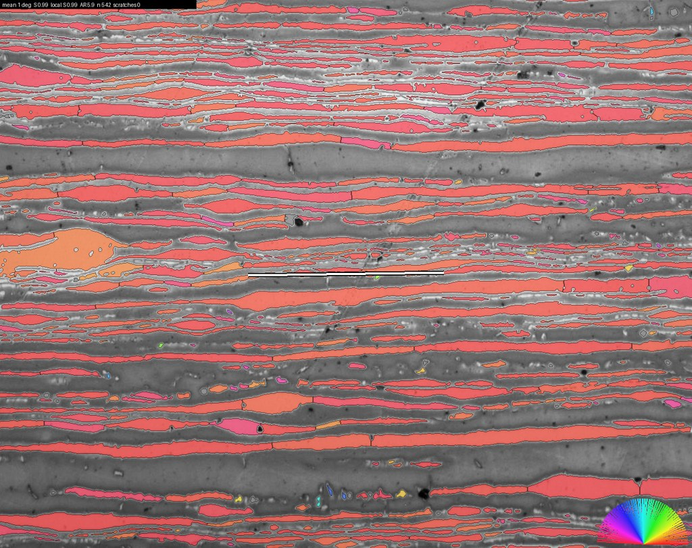
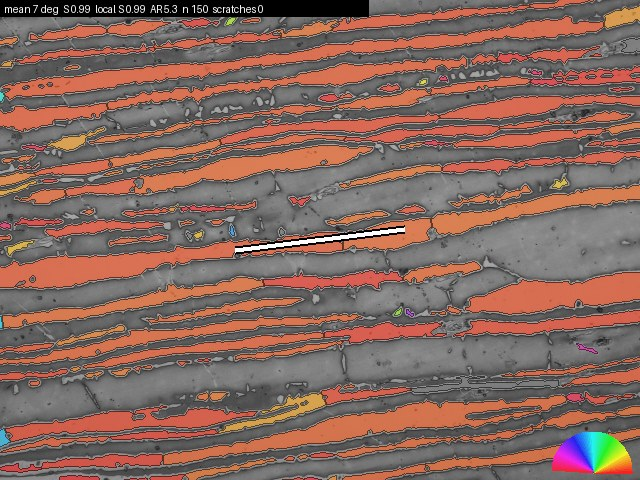
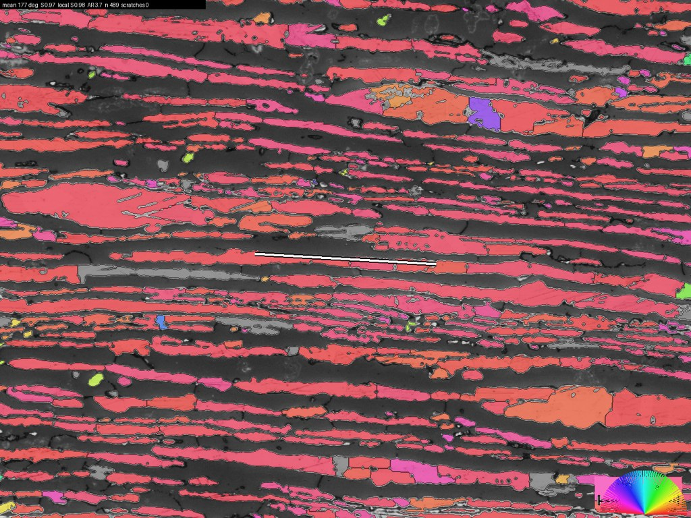
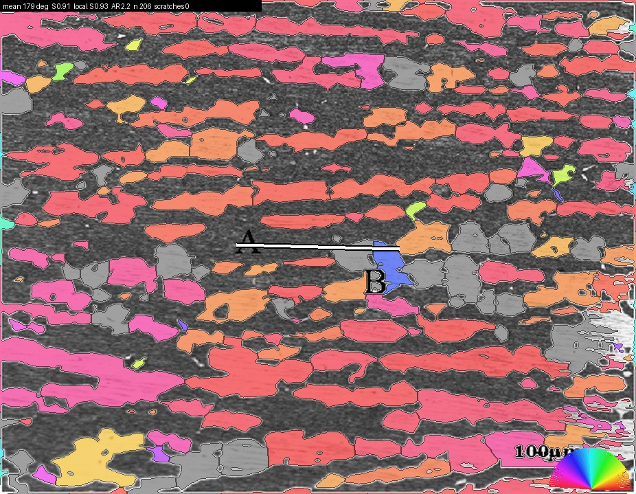
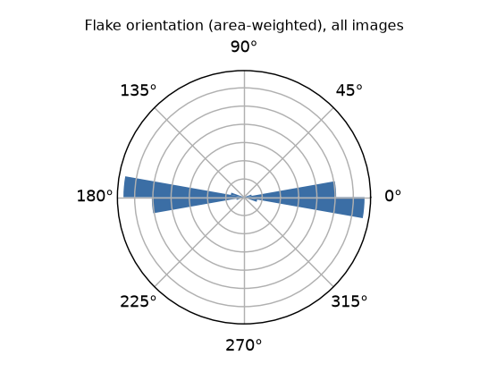
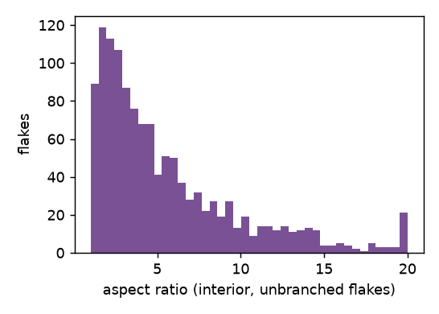

# Flake measurements: duplex_bands_mixed

4 images; reading: **phase** (minority phase is separate blobs about as thick as the matrix); flake width 10.385 px; code version 12ac79dc07.

## Confidence

- Twin accuracy (held-out twin images, exact truth): worst family ratio 0.64, pooled 0.37 (<= 1 means within the tolerances of config.yaml); dev 0.40: a gap shows how much the search fitted the dev twin images.
- The twin resembles the real images (worst profile mismatch x1.08); the twin accuracy carries over only as far as that, and only for structures the generator draws (straight laths in colonies).
- Rotation check on the real images: worst ratio 1.062 (FAILS).
- Lengths are in pixels (no --um-per-px given).

## Set summary

| | median | min | max |
|---|---|---|---|
| order parameter S | 0.981 | 0.913 | 0.989 |
| local S (within colonies) | 0.983 | 0.932 | 0.992 |
| mean misalignment (deg) | 3.53 | 2.36 | 8.53 |
| median aspect ratio | 4.49 | 2.23 | 5.87 |
| median length (px) | 45 | 38.1 | 48.9 |
| median width (px) | 10 | 7.61 | 20.3 |
| flakes used per image | 348 | 150 | 542 |

Mean directions differ per image (axial; see the table): a set-level mean direction is only meaningful when the images were taken in the same specimen frame.

## Per image

| image | mean dir (deg) | S [95 % CI] | local S | misalignment (deg) | AR [95 % CI] | flakes | scratches |
|---|---|---|---|---|---|---|---|
| L01__rank076__MB_DSSx100-3 | 0.75 | 0.989 [0.987, 0.992] | 0.992 | 2.89 | 5.87 [5.3, 6.22] | 542 | 0 |
| L04__rank007__MB_DSSx200-4 | 7.04 | 0.989 [0.979, 0.994] | 0.989 | 2.36 | 5.29 [4.57, 6.38] | 150 | 0 |
| L05__rank005__MBX200+ech | 177 | 0.973 [0.962, 0.982] | 0.978 | 4.18 | 3.69 [3.45, 4.16] | 489 | 0 |
| L24__rank027__102_Microstructure_of_2707_Hyper_Duplex_Stainless_Steel__CC-BY-4.0 | 179 | 0.913 [0.873, 0.941] | 0.932 | 8.53 | 2.23 [1.98, 2.53] | 206 | 0 |

## How accurate is it (twin images with exact truth)

Twin: 18 code-generated images fitted to this set (realism ok: True; worst profile mismatch x1.08).

| twin images | params | mean direction err (deg) | S err | misalignment err (deg) | AR err | flake orientation err (deg) | flakes found | worst family ratio |
|---|---|---|---|---|---|---|---|---|
| dev | start | 0.215 | 0.013 | 0.52 | 0.0267 | 1.99 | 0.982 | 0.416 |
| holdout | start | 0.388 | 0.0177 | 0.773 | 0.0397 | 1.95 | 0.979 | 0.662 |
| dev | chosen | 0.321 | 0.0116 | 0.462 | 0.0362 | 1.91 | 0.961 | 0.402 |
| holdout | chosen | 0.339 | 0.0147 | 0.659 | 0.0262 | 1.86 | 0.96 | 0.636 |

Search: 20 new configurations evaluated (24 incl. cached); objective 0.516 at the start, 0.498 chosen.
Warm start: colour_lamellar_ma16020804 (distance 0.99), ti64_dev (distance 5.66).

## Real images: rotation check

Central disk measured as is and turned by 30 deg: direction off by 0.0528 deg, S by 0.00165, aspect ratio by 0.0531 (worst ratio to tolerance 1.062; <= 1 passes). Necessary, not sufficient.

## Drawings

## Files

- `flakes.csv`: every flake (orientation, length, width, aspect ratio, misalignment, flags)
- `image_summaries.csv`: one row per image, with bootstrap intervals
- `params.json`: the params used
- `adapt_log.json`: profile, twin, search trials, reviews
