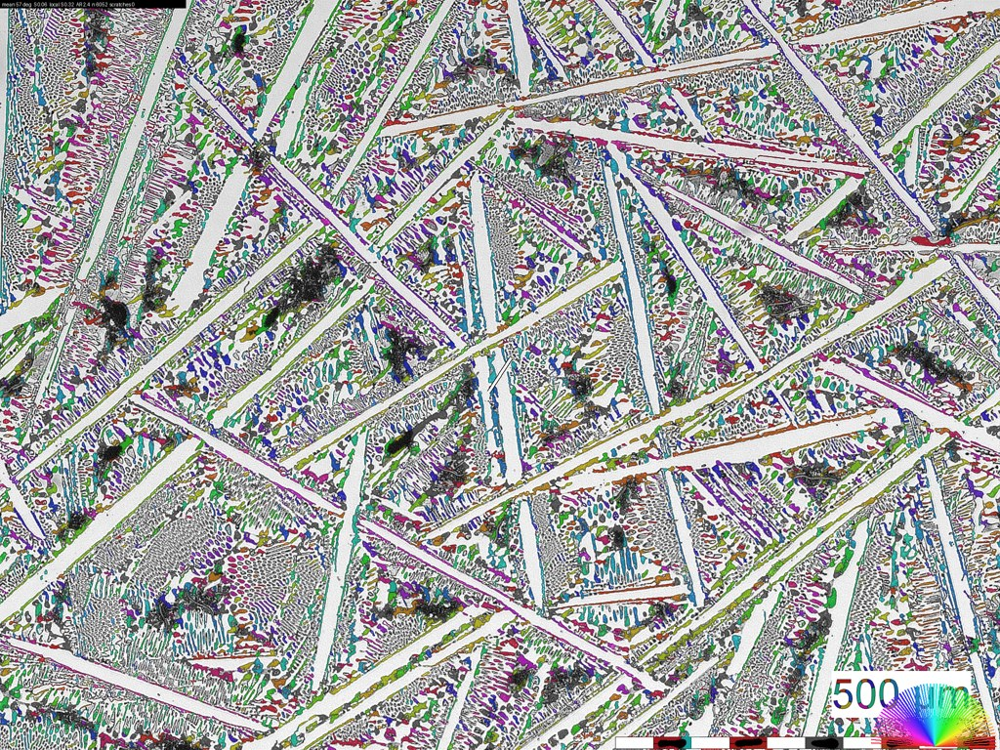
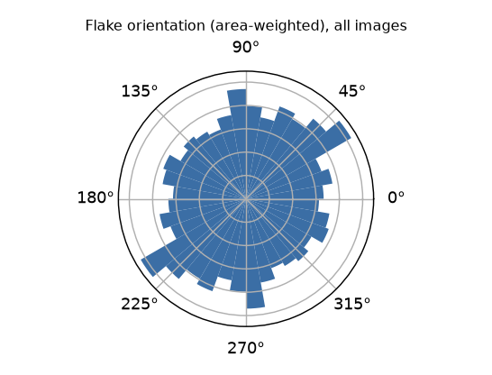
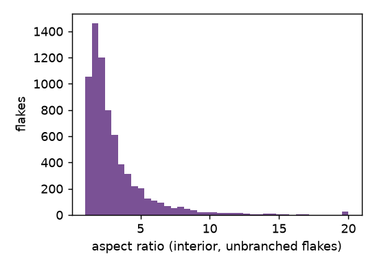

# Flake measurements: needles_L23

1 images; reading: **phase** (minority phase is separate blobs about as thick as the matrix); flake width 4.0 px; code version 12ac79dc07.

## Confidence

- Twin accuracy (held-out twin images, exact truth): worst family ratio 1.63, pooled 1.17 (<= 1 means within the tolerances of config.yaml); dev 1.40: a gap shows how much the search fitted the dev twin images.
- The twin resembles the real images (worst profile mismatch x1.08); the twin accuracy carries over only as far as that, and only for structures the generator draws (straight laths in colonies).
- Rotation check on the real images: worst ratio 0.53 (passes).
- Lengths are in pixels (no --um-per-px given).

## Set summary

| | median | min | max |
|---|---|---|---|
| order parameter S | 0.0638 | 0.0638 | 0.0638 |
| local S (within colonies) | 0.32 | 0.32 | 0.32 |
| mean misalignment (deg) | 42.8 | 42.8 | 42.8 |
| median aspect ratio | 2.35 | 2.35 | 2.35 |
| median length (px) | 18.6 | 18.6 | 18.6 |
| median width (px) | 7.44 | 7.44 | 7.44 |
| flakes used per image | 6.05e+03 | 6.05e+03 | 6.05e+03 |

Mean directions differ per image (axial; see the table): a set-level mean direction is only meaningful when the images were taken in the same specimen frame.

## Per image

| image | mean dir (deg) | S [95 % CI] | local S | misalignment (deg) | AR [95 % CI] | flakes | scratches |
|---|---|---|---|---|---|---|---|
| L23__rank003__066_Primaerzementit__CC-BY-SA-3.0 | 57.2 | 0.0638 [0.0424, 0.0859] | 0.32 | 42.8 | 2.35 [2.31, 2.39] | 6052 | 0 |

## How accurate is it (twin images with exact truth)

Twin: 18 code-generated images fitted to this set (realism ok: True; worst profile mismatch x1.08).

| twin images | params | mean direction err (deg) | S err | misalignment err (deg) | AR err | flake orientation err (deg) | flakes found | worst family ratio |
|---|---|---|---|---|---|---|---|---|
| dev | start | 0.601 | 0.0133 | 0.676 | 0.209 | 1.36 | 0.675 | 1.6 |
| holdout | start | 0.428 | 0.00839 | 0.537 | 0.202 | 1.32 | 0.68 | 1.8 |
| dev | chosen | 0.522 | 0.0108 | 0.542 | 0.188 | 1.35 | 0.606 | 1.4 |
| holdout | chosen | 0.181 | 0.00511 | 0.264 | 0.175 | 1.31 | 0.605 | 1.63 |

Search: 20 new configurations evaluated (26 incl. cached); objective 1.947 at the start, 1.712 chosen.
Warm start: colour_lamellar_ma16020804 (distance 0.74), duplex_bands_mixed (distance 1.55).

## Real images: rotation check

Central disk measured as is and turned by 30 deg: direction off by None deg, S by 0.0159, aspect ratio by 0.0168 (worst ratio to tolerance 0.53; <= 1 passes). Necessary, not sufficient.

## Drawings

## Files

- `flakes.csv`: every flake (orientation, length, width, aspect ratio, misalignment, flags)
- `image_summaries.csv`: one row per image, with bootstrap intervals
- `params.json`: the params used
- `adapt_log.json`: profile, twin, search trials, reviews
