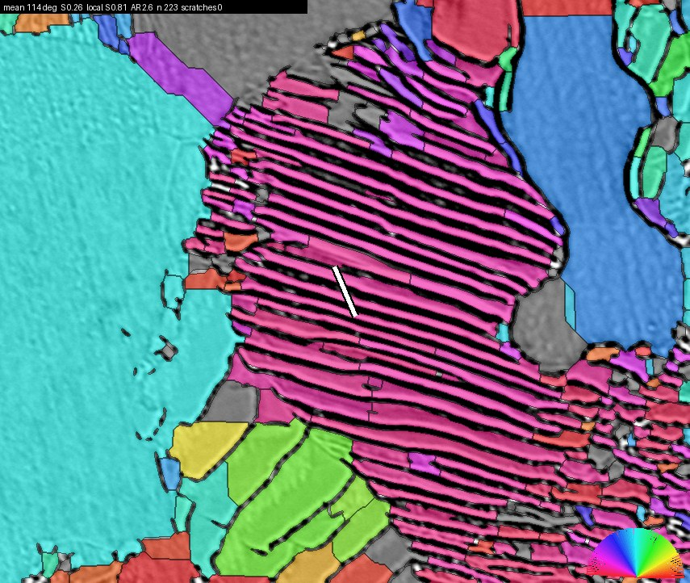
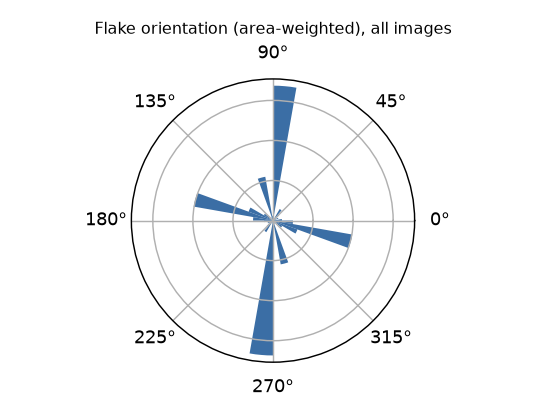
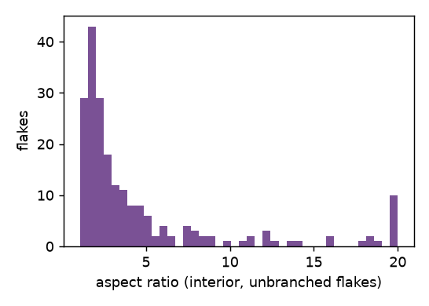

# Flake measurements: pearlite_L02

1 images; reading: **boundaries** (ambiguous profile; boundary reading by default (the agent review checks it)); flake width 10.0 px; code version 12ac79dc07.

## Confidence

- Twin accuracy (held-out twin images, exact truth): worst family ratio 0.47, pooled 0.37 (<= 1 means within the tolerances of config.yaml); dev 0.42: a gap shows how much the search fitted the dev twin images.
- The twin resembles the real images only roughly (worst profile mismatch x2.29); the twin accuracy carries over only as far as that, and only for structures the generator draws (straight laths in colonies).
- Rotation check on the real images: worst ratio 4.26 (FAILS).
- The image profile was ambiguous between a boundary network and phase islands: check in the drawings that the outlined regions are the flakes you mean; rerun with --mode phase otherwise.
- Lengths are in pixels (no --um-per-px given).

## Set summary

| | median | min | max |
|---|---|---|---|
| order parameter S | 0.256 | 0.256 | 0.256 |
| local S (within colonies) | 0.814 | 0.814 | 0.814 |
| mean misalignment (deg) | 36.2 | 36.2 | 36.2 |
| median aspect ratio | 2.58 | 2.58 | 2.58 |
| median length (px) | 45.8 | 45.8 | 45.8 |
| median width (px) | 14.7 | 14.7 | 14.7 |
| flakes used per image | 223 | 223 | 223 |

Mean directions differ per image (axial; see the table): a set-level mean direction is only meaningful when the images were taken in the same specimen frame.

## Per image

| image | mean dir (deg) | S [95 % CI] | local S | misalignment (deg) | AR [95 % CI] | flakes | scratches |
|---|---|---|---|---|---|---|---|
| L02__10.3390_ma18204798_g006_p4 | 114 | 0.256 [0.134, 0.63] | 0.814 | 36.2 | 2.58 [2.31, 2.94] | 223 | 0 |

## How accurate is it (twin images with exact truth)

Twin: 18 code-generated images fitted to this set (realism ok: False; worst profile mismatch x2.29).

| twin images | params | mean direction err (deg) | S err | misalignment err (deg) | AR err | flake orientation err (deg) | flakes found | worst family ratio |
|---|---|---|---|---|---|---|---|---|
| dev | start | 0.172 | 0.0142 | 0.798 | 0.0341 | 1.94 | 0.755 | 0.48 |
| holdout | start | 0.275 | 0.0115 | 0.368 | 0.00963 | 1.93 | 0.779 | 0.464 |
| dev | chosen | 0.161 | 0.015 | 0.688 | 0.0307 | 1.91 | 0.824 | 0.417 |
| holdout | chosen | 0.446 | 0.0134 | 0.71 | 0.0294 | 1.87 | 0.837 | 0.465 |

Search: 20 new configurations evaluated (26 incl. cached); objective 0.577 at the start, 0.512 chosen.
Warm start: ti_basketweave_ma19010080 (distance 0.46), ti64_dev (distance 0.51).

## Real images: rotation check

Central disk measured as is and turned by 30 deg: direction off by 5.8101 deg, S by 0.1278, aspect ratio by 0.1026 (worst ratio to tolerance 4.26; <= 1 passes). Necessary, not sufficient.

## Drawings

## Files

- `flakes.csv`: every flake (orientation, length, width, aspect ratio, misalignment, flags)
- `image_summaries.csv`: one row per image, with bootstrap intervals
- `params.json`: the params used
- `adapt_log.json`: profile, twin, search trials, reviews
