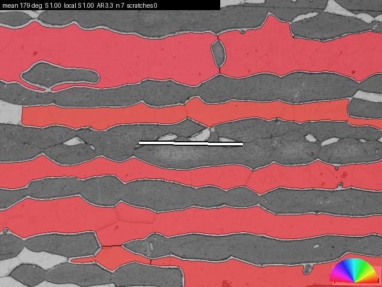
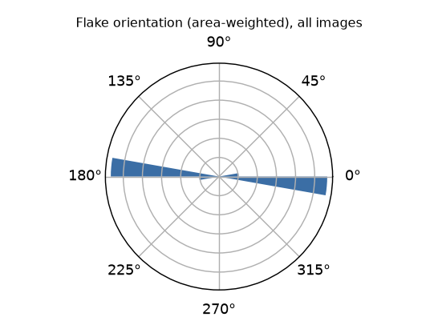
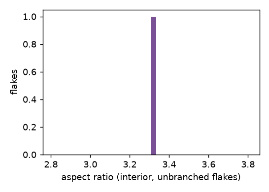

# Flake measurements: purple_flakes_L10

1 images; reading: **phase** (minority phase is separate blobs about as thick as the matrix); flake width 28.28 px; code version 12ac79dc07.

## Confidence

- Twin accuracy (held-out twin images, exact truth): worst family ratio 4.65, pooled 1.24 (<= 1 means within the tolerances of config.yaml); dev 2.41: a gap shows how much the search fitted the dev twin images.
- The twin resembles the real images only roughly (worst profile mismatch x1.61); the twin accuracy carries over only as far as that, and only for structures the generator draws (straight laths in colonies).
- Rotation check on the real images: worst ratio 0.06 (passes).
- Lengths are in pixels (no --um-per-px given).

## Set summary

| | median | min | max |
|---|---|---|---|
| order parameter S | 0.999 | 0.999 | 0.999 |
| local S (within colonies) | 0.999 | 0.999 | 0.999 |
| mean misalignment (deg) | 0.953 | 0.953 | 0.953 |
| median aspect ratio | 3.31 | 3.31 | 3.31 |
| median length (px) | 115 | 115 | 115 |
| median width (px) | 34.7 | 34.7 | 34.7 |
| flakes used per image | 7 | 7 | 7 |

Mean directions differ per image (axial; see the table): a set-level mean direction is only meaningful when the images were taken in the same specimen frame.

## Per image

| image | mean dir (deg) | S [95 % CI] | local S | misalignment (deg) | AR [95 % CI] | flakes | scratches |
|---|---|---|---|---|---|---|---|
| L10__rank046__40MIN-G500-00 | 179 | 0.999 [–, –] | 0.999 | 0.953 | 3.31 [–, –] | 7 | 0 |

## How accurate is it (twin images with exact truth)

Twin: 18 code-generated images fitted to this set (realism ok: False; worst profile mismatch x1.61).

| twin images | params | mean direction err (deg) | S err | misalignment err (deg) | AR err | flake orientation err (deg) | flakes found | worst family ratio |
|---|---|---|---|---|---|---|---|---|
| dev | start | 1.77 | 0.0412 | 3.11 | 0.194 | 2.7 | 0.337 | 2.72 |
| holdout | start | 1.88 | 0.0415 | 1.63 | 0.122 | 3.51 | 0.397 | 1.75 |
| dev | chosen | 2.15 | 0.0301 | 2 | 0.195 | 2.94 | 0.344 | 2.41 |
| holdout | chosen | 1.85 | 0.0621 | 3.52 | 0.0922 | 3.76 | 0.392 | 4.65 |

Search: 20 new configurations evaluated (24 incl. cached); objective 3.047 at the start, 2.737 chosen.
Warm start: duplex_bands_mixed (distance 1.09), colour_lamellar_ma16020804 (distance 2.01).

## Real images: rotation check

Central disk measured as is and turned by 30 deg: direction off by 0.1636 deg, S by 0.0018, aspect ratio by None (worst ratio to tolerance 0.06; <= 1 passes). Necessary, not sufficient.

## Drawings

## Files

- `flakes.csv`: every flake (orientation, length, width, aspect ratio, misalignment, flags)
- `image_summaries.csv`: one row per image, with bootstrap intervals
- `params.json`: the params used
- `adapt_log.json`: profile, twin, search trials, reviews
