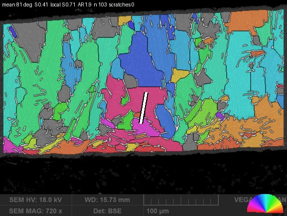
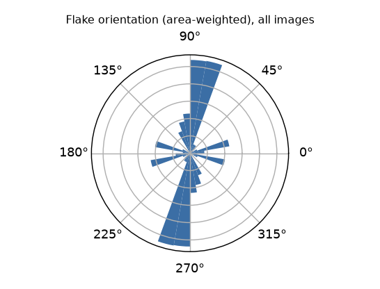
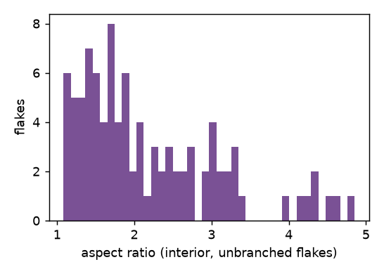

# Flake measurements: sem_user

1 images; reading: **boundaries** (ambiguous profile; boundary reading by default (the agent review checks it)); flake width 4.0 px; code version 12ac79dc07.

## Confidence

- Twin accuracy (held-out twin images, exact truth): worst family ratio 17.36, pooled 9.51 (<= 1 means within the tolerances of config.yaml); dev 12.69: a gap shows how much the search fitted the dev twin images.
- The twin resembles the real images only roughly (worst profile mismatch x1.41); the twin accuracy carries over only as far as that, and only for structures the generator draws (straight laths in colonies).
- Rotation check on the real images: worst ratio 2.69 (FAILS).
- The image profile was ambiguous between a boundary network and phase islands: check in the drawings that the outlined regions are the flakes you mean; rerun with --mode phase otherwise.
- Lengths are in pixels (no --um-per-px given).

## Set summary

| | median | min | max |
|---|---|---|---|
| order parameter S | 0.407 | 0.407 | 0.407 |
| local S (within colonies) | 0.707 | 0.707 | 0.707 |
| mean misalignment (deg) | 29.3 | 29.3 | 29.3 |
| median aspect ratio | 1.89 | 1.89 | 1.89 |
| median length (px) | 27.2 | 27.2 | 27.2 |
| median width (px) | 13.6 | 13.6 | 13.6 |
| flakes used per image | 103 | 103 | 103 |

Mean directions differ per image (axial; see the table): a set-level mean direction is only meaningful when the images were taken in the same specimen frame.

## Per image

| image | mean dir (deg) | S [95 % CI] | local S | misalignment (deg) | AR [95 % CI] | flakes | scratches |
|---|---|---|---|---|---|---|---|
| sem_bse | 80.9 | 0.407 [0.12, 0.66] | 0.707 | 29.3 | 1.89 [1.73, 2.08] | 103 | 0 |

## How accurate is it (twin images with exact truth)

Twin: 18 code-generated images fitted to this set (realism ok: False; worst profile mismatch x1.41).

| twin images | params | mean direction err (deg) | S err | misalignment err (deg) | AR err | flake orientation err (deg) | flakes found | worst family ratio |
|---|---|---|---|---|---|---|---|---|
| dev | start | 17.9 | 0.629 | 24.1 | 0.855 | 3.03 | 0.00139 | 16.1 |
| holdout | start | 40.8 | 0.716 | 28.8 | 0.854 | 6.04 | 0.000393 | 18.2 |
| dev | chosen | 21.6 | 0.42 | 18.9 | 0.85 | 3.57 | 0.000298 | 12.7 |
| holdout | chosen | 45.5 | 0.475 | 18.2 | 0.857 | 9.24 | 0.000196 | 17.4 |

Search: 20 new configurations evaluated (25 incl. cached); objective 19.264 at the start, 14.792 chosen.
Warm start: none (no similar image set in the memory).

## Real images: rotation check

Central disk measured as is and turned by 30 deg: direction off by 7.263 deg, S by 0.0807, aspect ratio by 0.0581 (worst ratio to tolerance 2.69; <= 1 passes). Necessary, not sufficient.

## Drawings

## Files

- `flakes.csv`: every flake (orientation, length, width, aspect ratio, misalignment, flags)
- `image_summaries.csv`: one row per image, with bootstrap intervals
- `params.json`: the params used
- `adapt_log.json`: profile, twin, search trials, reviews
