# Flake measurements: ti64_dev

13 images; reading: **boundaries** (minority phase is a connected thin network); flake width 10.0 px; code version 12ac79dc07.

## Confidence

- Twin accuracy (held-out twin images, exact truth): worst family ratio 0.47, pooled 0.44 (<= 1 means within the tolerances of config.yaml); dev 0.46: a gap shows how much the search fitted the dev twin images.
- The twin resembles the real images (worst profile mismatch x1.06); the twin accuracy carries over only as far as that, and only for structures the generator draws (straight laths in colonies).
- Rotation check on the real images: worst ratio 0.2783333333333333 (passes).
- Lengths are in pixels (no --um-per-px given).

## Set summary

| | median | min | max |
|---|---|---|---|
| order parameter S | 0.553 | 0.154 | 0.877 |
| local S (within colonies) | 0.711 | 0.563 | 0.89 |
| mean misalignment (deg) | 25.4 | 9.95 | 39.5 |
| median aspect ratio | 2.98 | 2.54 | 4.28 |
| median length (px) | 48.9 | 40.9 | 61 |
| median width (px) | 15.4 | 13.2 | 17 |
| flakes used per image | 1.06e+03 | 898 | 1.4e+03 |

Mean directions differ per image (axial; see the table): a set-level mean direction is only meaningful when the images were taken in the same specimen frame.

## Per image

| image | mean dir (deg) | S [95 % CI] | local S | misalignment (deg) | AR [95 % CI] | flakes | scratches |
|---|---|---|---|---|---|---|---|
| Ti64_21 | 2.88 | 0.489 [0.454, 0.53] | 0.694 | 27.4 | 2.85 [2.75, 2.96] | 1116 | 0 |
| Ti64_22 | 19.1 | 0.358 [0.317, 0.395] | 0.607 | 31.9 | 3.24 [3.06, 3.42] | 1009 | 0 |
| Ti64_23 | 135 | 0.553 [0.508, 0.595] | 0.706 | 24.4 | 2.69 [2.61, 2.8] | 1263 | 0 |
| Ti64_24 | 13.4 | 0.588 [0.535, 0.638] | 0.73 | 23.8 | 2.72 [2.58, 2.84] | 1018 | 0 |
| Ti64_28 | 1.16 | 0.599 [0.568, 0.631] | 0.816 | 25.4 | 4.28 [4.11, 4.46] | 1058 | 0 |
| Ti64_29 | 41.1 | 0.498 [0.466, 0.534] | 0.777 | 27.6 | 3.97 [3.81, 4.14] | 1027 | 0 |
| Ti64_32 | 171 | 0.223 [0.172, 0.279] | 0.603 | 36.7 | 2.98 [2.83, 3.15] | 908 | 0 |
| Ti64_33 | 179 | 0.649 [0.616, 0.688] | 0.773 | 20.7 | 3.06 [2.93, 3.18] | 1095 | 0 |
| Ti64_34 | 0.578 | 0.745 [0.724, 0.769] | 0.821 | 16.6 | 2.71 [2.62, 2.8] | 1371 | 0 |
| Ti64_36 | 14.5 | 0.154 [0.0943, 0.219] | 0.563 | 39.5 | 2.75 [2.63, 2.89] | 898 | 0 |
| Ti64_37 | 180 | 0.877 [0.861, 0.892] | 0.89 | 9.95 | 3.41 [3.31, 3.54] | 1400 | 0 |
| Ti64_38 | 157 | 0.322 [0.274, 0.377] | 0.611 | 31.9 | 2.54 [2.47, 2.64] | 1158 | 0 |
| Ti64_39 | 17.8 | 0.589 [0.549, 0.622] | 0.711 | 22.8 | 3 [2.89, 3.21] | 988 | 0 |

## How accurate is it (twin images with exact truth)

Twin: 18 code-generated images fitted to this set (realism ok: True; worst profile mismatch x1.06).

| twin images | params | mean direction err (deg) | S err | misalignment err (deg) | AR err | flake orientation err (deg) | flakes found | worst family ratio |
|---|---|---|---|---|---|---|---|---|
| dev | start | 0.42 | 0.0174 | 0.719 | 0.0651 | 2.17 | 0.76 | 0.577 |
| holdout | start | 0.127 | 0.0225 | 0.92 | 0.0707 | 2.19 | 0.767 | 0.556 |
| dev | chosen | 0.406 | 0.0107 | 0.581 | 0.0305 | 2.2 | 0.799 | 0.463 |
| holdout | chosen | 0.314 | 0.0198 | 0.817 | 0.0222 | 2.21 | 0.814 | 0.468 |

Search: 30 new configurations evaluated (35 incl. cached); objective 0.686 at the start, 0.573 chosen.
Warm start: sem_user (distance 1.42).

## Real images: rotation check

Central disk measured as is and turned by 30 deg: direction off by 0.29910000000000003 deg, S by 0.00835, aspect ratio by 0.00845 (worst ratio to tolerance 0.2783333333333333; <= 1 passes). Necessary, not sufficient.

## Drawings

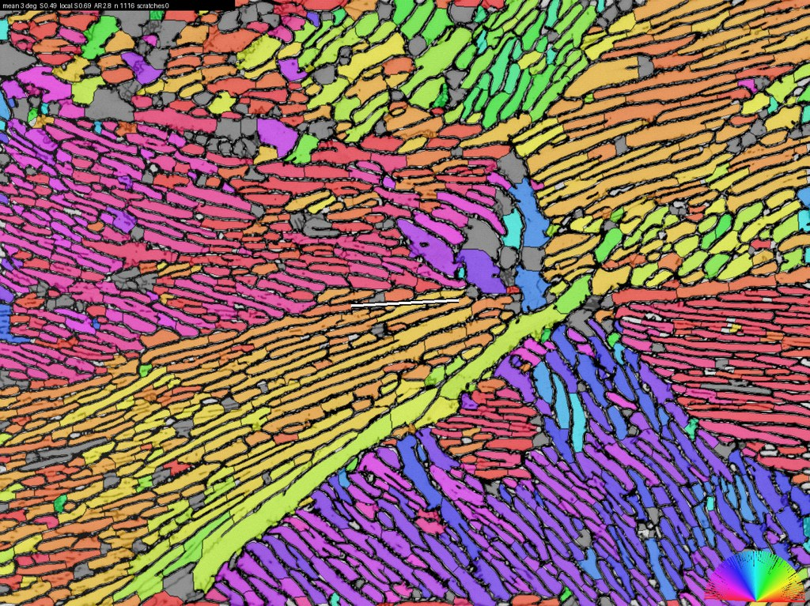
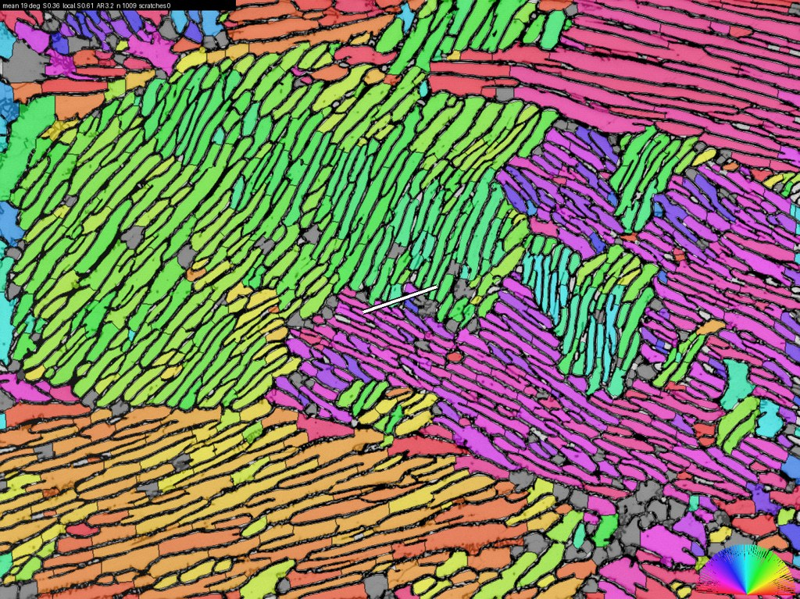
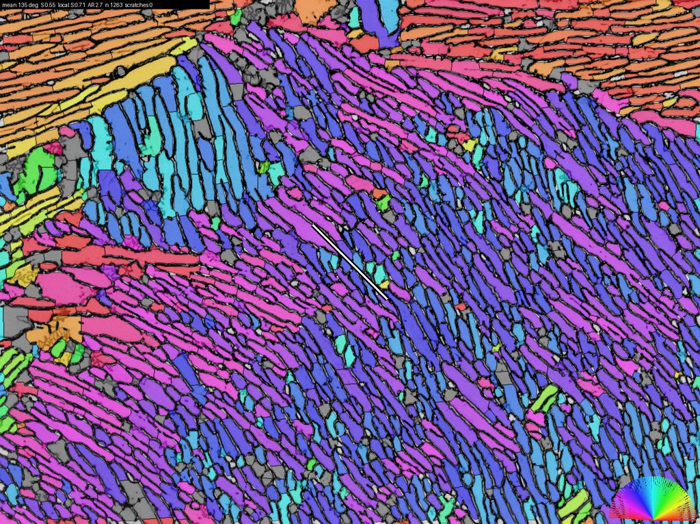
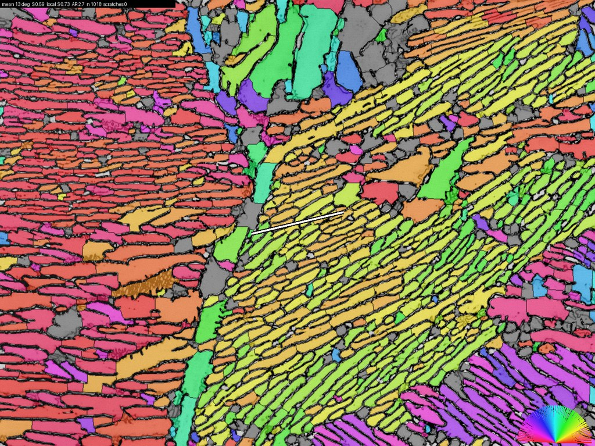
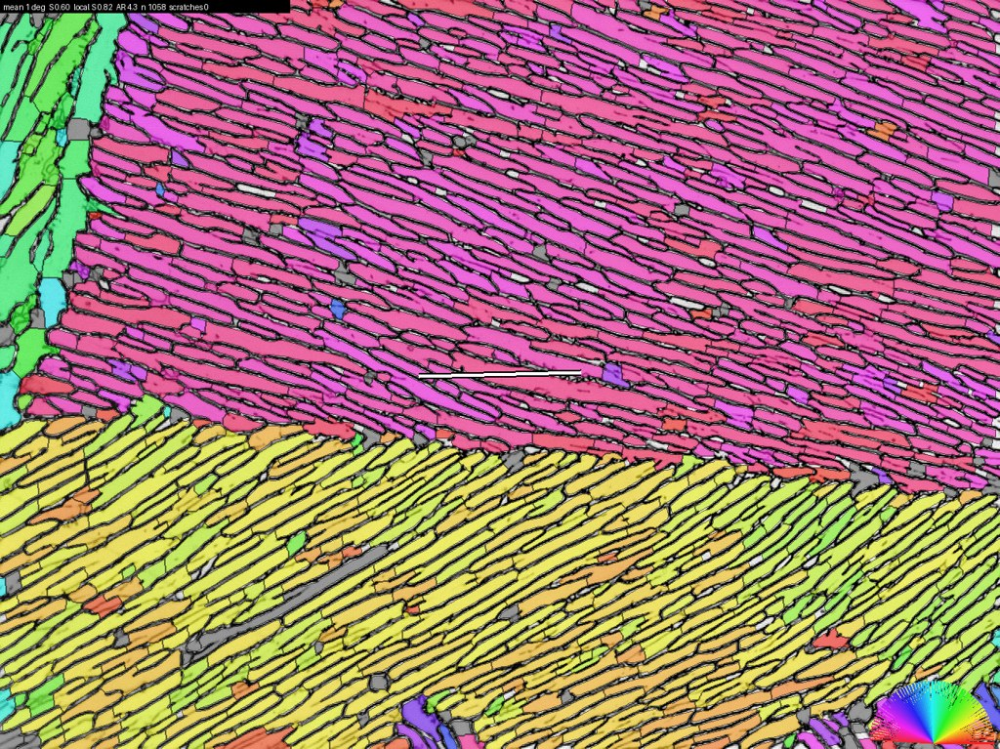
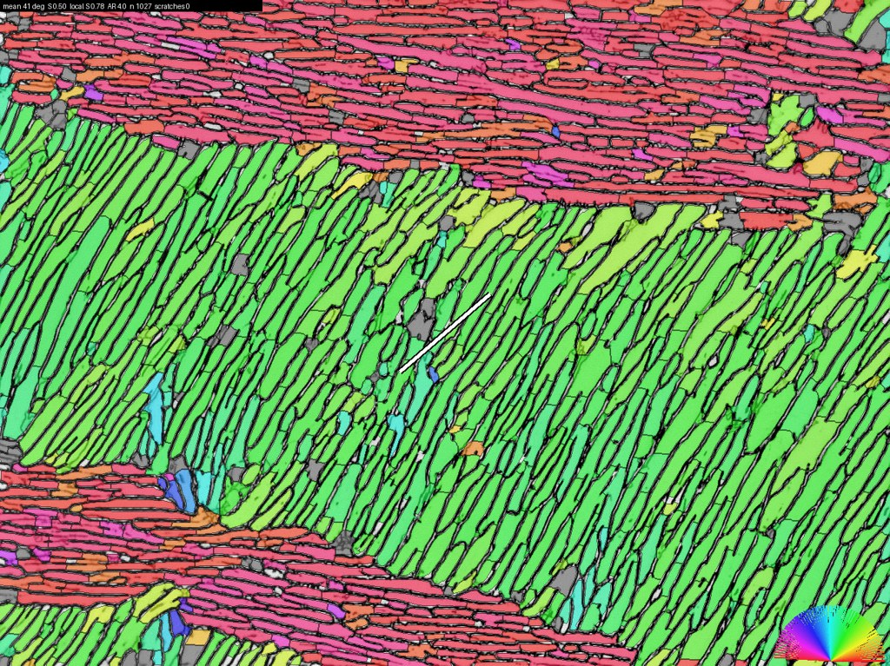
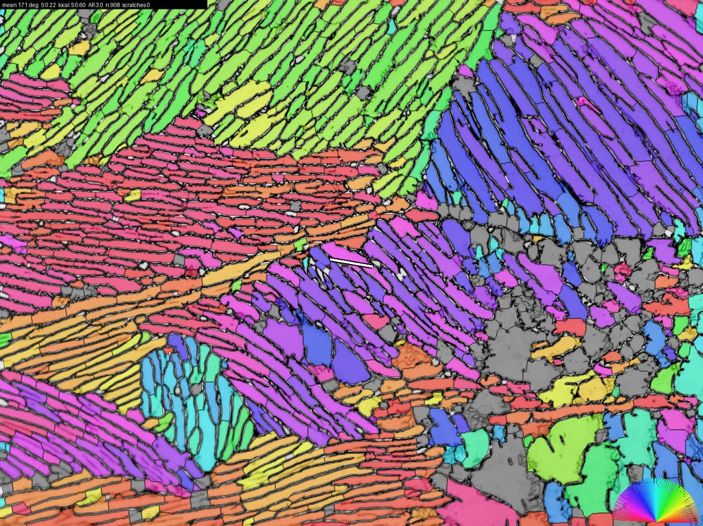
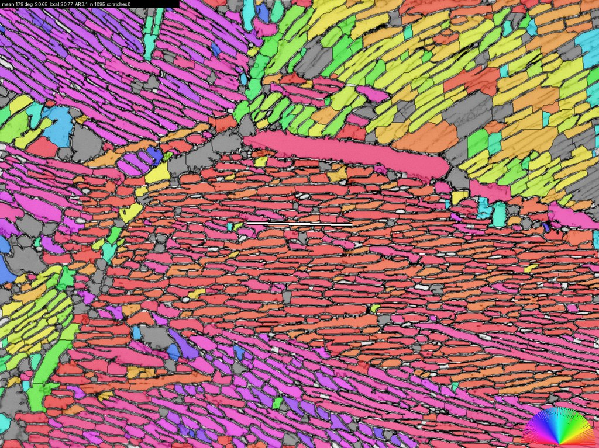
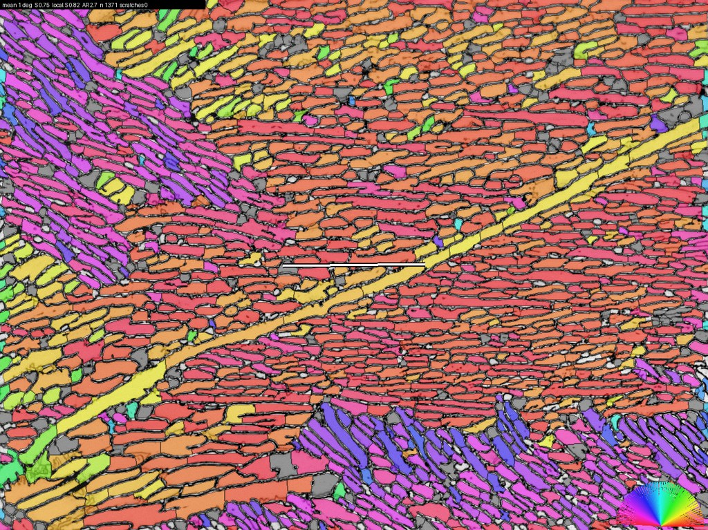
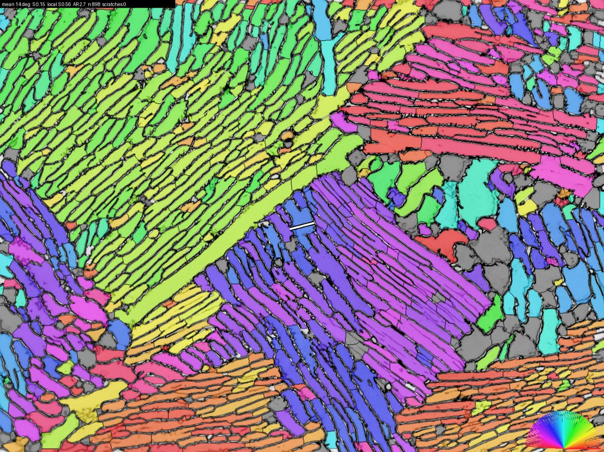
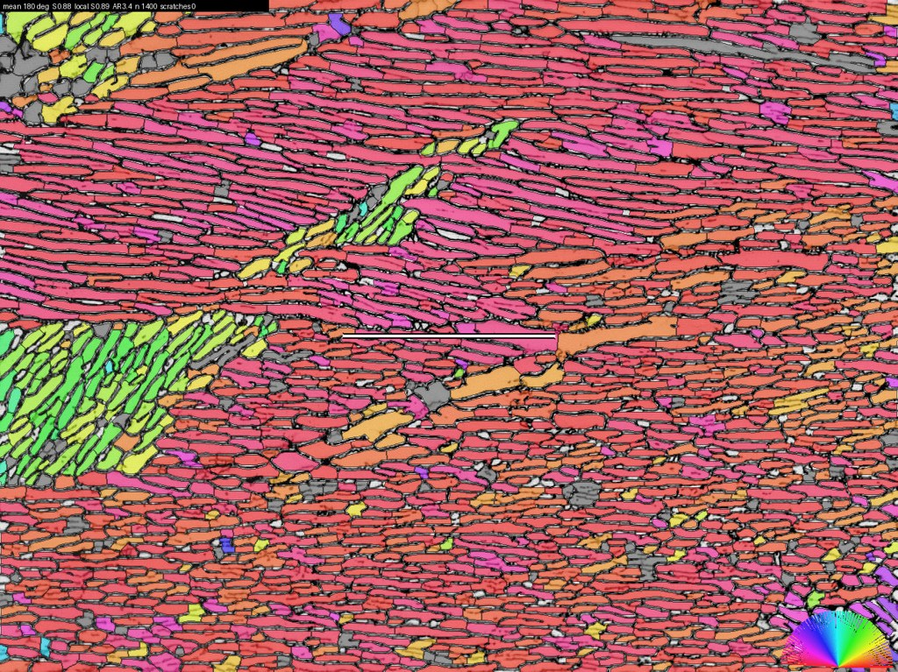
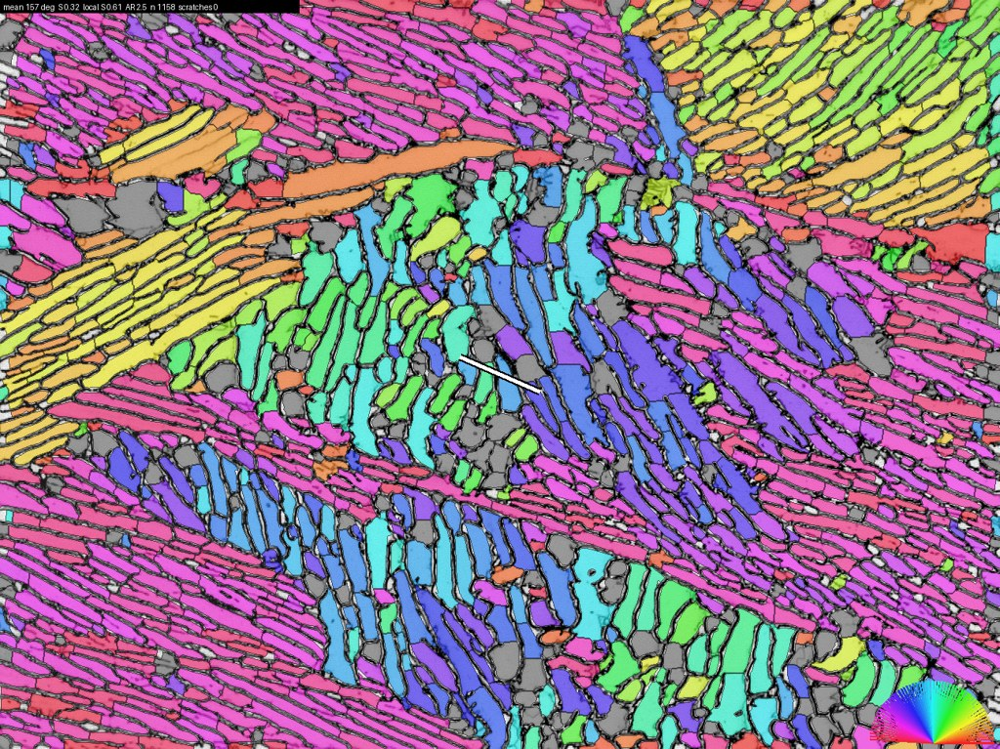

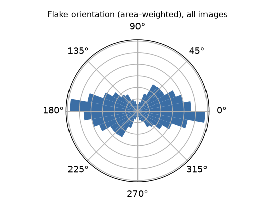
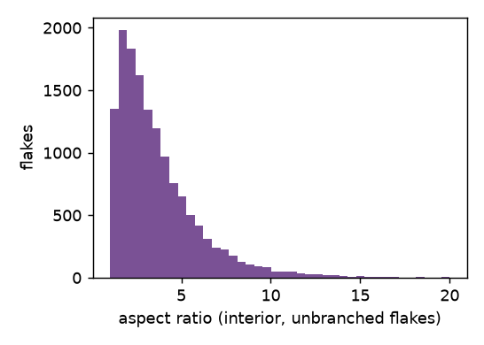

## Files

- `flakes.csv`: every flake (orientation, length, width, aspect ratio, misalignment, flags)
- `image_summaries.csv`: one row per image, with bootstrap intervals
- `params.json`: the params used
- `adapt_log.json`: profile, twin, search trials, reviews
