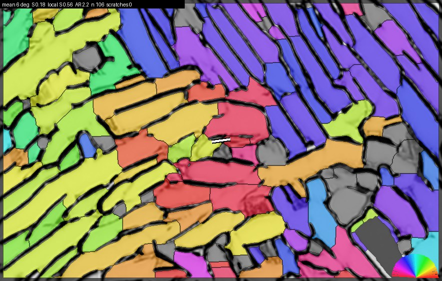
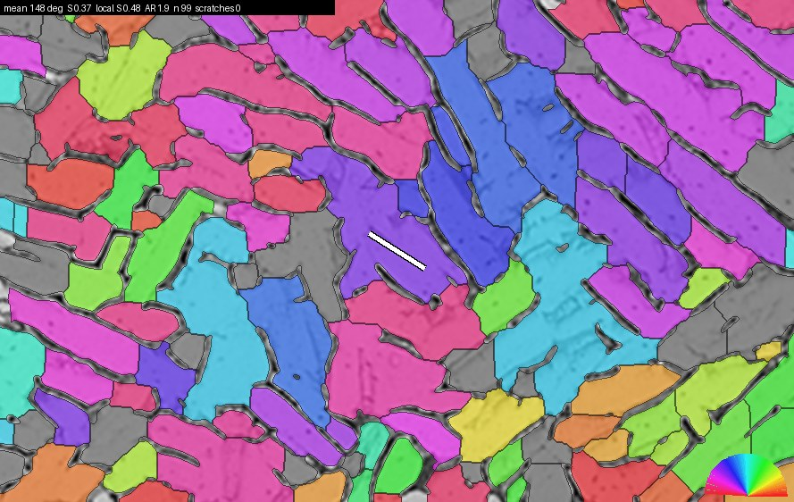
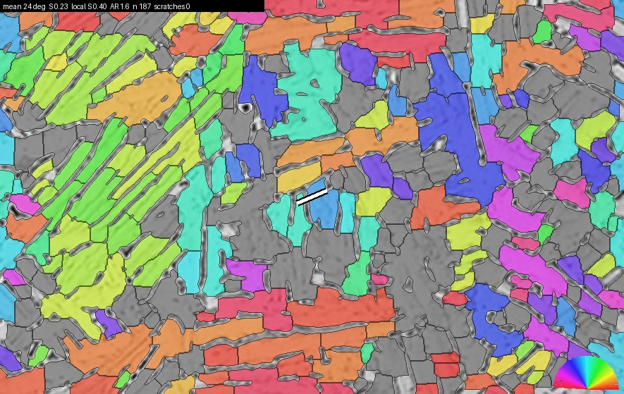
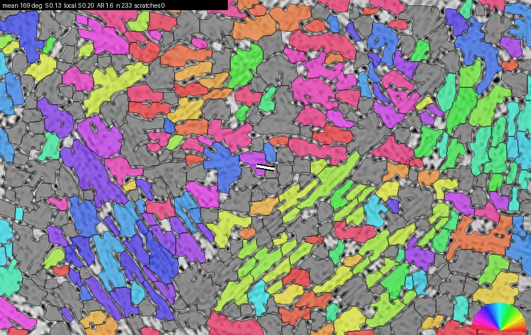
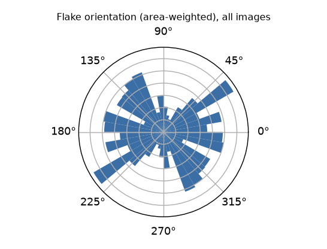
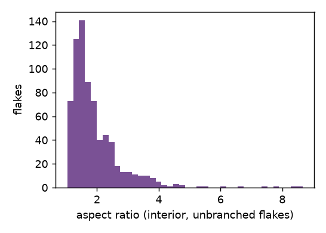

# Flake measurements: ti_basketweave_ma19010080

4 images; reading: **boundaries** (ambiguous profile; boundary reading by default (the agent review checks it)); flake width 15.22 px; code version 12ac79dc07.

## Confidence

- Twin accuracy (held-out twin images, exact truth): worst family ratio 0.65, pooled 0.42 (<= 1 means within the tolerances of config.yaml); dev 0.50: a gap shows how much the search fitted the dev twin images.
- The twin resembles the real images only roughly (worst profile mismatch x1.93); the twin accuracy carries over only as far as that, and only for structures the generator draws (straight laths in colonies).
- Rotation check on the real images: worst ratio 1.9216666666666666 (FAILS).
- The image profile was ambiguous between a boundary network and phase islands: check in the drawings that the outlined regions are the flakes you mean; rerun with --mode phase otherwise.
- Lengths are in pixels (no --um-per-px given).

## Set summary

| | median | min | max |
|---|---|---|---|
| order parameter S | 0.205 | 0.127 | 0.366 |
| local S (within colonies) | 0.442 | 0.2 | 0.556 |
| mean misalignment (deg) | 37.8 | 31.5 | 39.7 |
| median aspect ratio | 1.75 | 1.57 | 2.22 |
| median length (px) | 66.5 | 42.2 | 87.4 |
| median width (px) | 33.2 | 25.2 | 46.1 |
| flakes used per image | 146 | 99 | 233 |

Mean directions differ per image (axial; see the table): a set-level mean direction is only meaningful when the images were taken in the same specimen frame.

## Per image

| image | mean dir (deg) | S [95 % CI] | local S | misalignment (deg) | AR [95 % CI] | flakes | scratches |
|---|---|---|---|---|---|---|---|
| L08__10.3390_ma19010080_g003_p10 | 6.2 | 0.184 [0.0909, 0.358] | 0.556 | 38.2 | 2.22 [1.93, 2.39] | 106 | 0 |
| L20__10.3390_ma19010080_g003_p9 | 148 | 0.366 [0.23, 0.529] | 0.482 | 31.5 | 1.85 [1.72, 2.04] | 99 | 0 |
| L21__10.3390_ma19010080_g003_p7 | 24.5 | 0.226 [0.0783, 0.384] | 0.402 | 37.3 | 1.64 [1.56, 1.74] | 187 | 0 |
| L22__10.3390_ma19010080_g003_p5 | 169 | 0.127 [0.0553, 0.232] | 0.2 | 39.7 | 1.57 [1.53, 1.63] | 233 | 0 |

## How accurate is it (twin images with exact truth)

Twin: 18 code-generated images fitted to this set (realism ok: False; worst profile mismatch x1.93).

| twin images | params | mean direction err (deg) | S err | misalignment err (deg) | AR err | flake orientation err (deg) | flakes found | worst family ratio |
|---|---|---|---|---|---|---|---|---|
| dev | start | 0.609 | 0.0154 | 0.758 | 0.0519 | 2.23 | 0.692 | 0.574 |
| holdout | start | 0.234 | 0.0188 | 0.653 | 0.0414 | 2.12 | 0.727 | 0.672 |
| dev | chosen | 0.687 | 0.0148 | 0.915 | 0.0269 | 2.2 | 0.695 | 0.502 |
| holdout | chosen | 0.349 | 0.0176 | 0.674 | 0.0245 | 2.11 | 0.724 | 0.65 |

Search: 20 new configurations evaluated (25 incl. cached); objective 0.685 at the start, 0.612 chosen.
Warm start: ti64_dev (distance 0.74), sem_user (distance 2.09).

## Real images: rotation check

Central disk measured as is and turned by 30 deg: direction off by 5.20195 deg, S by 0.05765, aspect ratio by 0.04355 (worst ratio to tolerance 1.9216666666666666; <= 1 passes). Necessary, not sufficient.

## Drawings

## Files

- `flakes.csv`: every flake (orientation, length, width, aspect ratio, misalignment, flags)
- `image_summaries.csv`: one row per image, with bootstrap intervals
- `params.json`: the params used
- `adapt_log.json`: profile, twin, search trials, reviews
