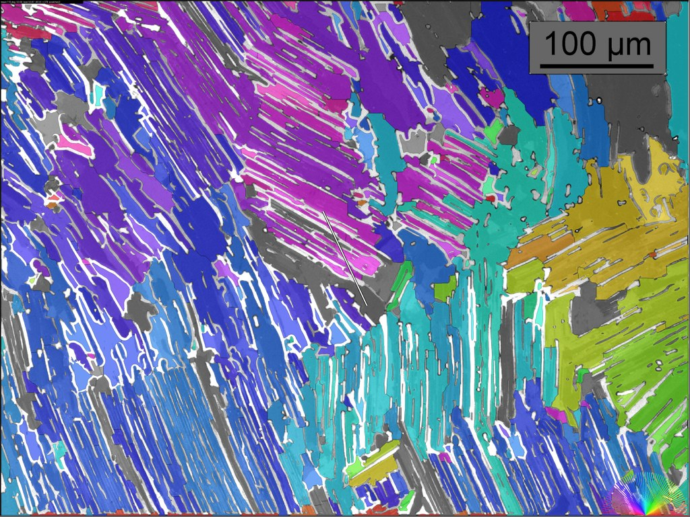
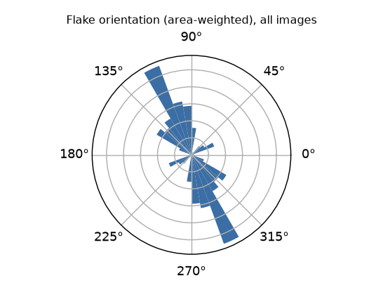
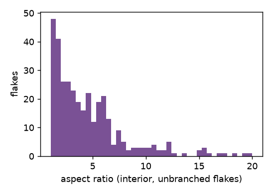

# Flake measurements: tial_lamellar_L26

1 images; reading: **boundaries** (ambiguous profile; boundary reading by default (the agent review checks it)); flake width 18.44 px; code version 12ac79dc07.

## Confidence

- Twin accuracy (held-out twin images, exact truth): worst family ratio 12.44, pooled 9.72 (<= 1 means within the tolerances of config.yaml); dev 12.48: a gap shows how much the search fitted the dev twin images.
- The twin resembles the real images (worst profile mismatch x1.31); the twin accuracy carries over only as far as that, and only for structures the generator draws (straight laths in colonies).
- Rotation check on the real images: worst ratio 2.432 (FAILS).
- The image profile was ambiguous between a boundary network and phase islands: check in the drawings that the outlined regions are the flakes you mean; rerun with --mode phase otherwise.
- Lengths are in pixels (no --um-per-px given).

## Set summary

| | median | min | max |
|---|---|---|---|
| order parameter S | 0.558 | 0.558 | 0.558 |
| local S (within colonies) | 0.868 | 0.868 | 0.868 |
| mean misalignment (deg) | 24.4 | 24.4 | 24.4 |
| median aspect ratio | 3.61 | 3.61 | 3.61 |
| median length (px) | 140 | 140 | 140 |
| median width (px) | 37.8 | 37.8 | 37.8 |
| flakes used per image | 378 | 378 | 378 |

Mean directions differ per image (axial; see the table): a set-level mean direction is only meaningful when the images were taken in the same specimen frame.

## Per image

| image | mean dir (deg) | S [95 % CI] | local S | misalignment (deg) | AR [95 % CI] | flakes | scratches |
|---|---|---|---|---|---|---|---|
| L26__rank038__056_TiAl_Lammelar__CC0 | 115 | 0.558 [0.379, 0.706] | 0.868 | 24.4 | 3.61 [3.12, 4.18] | 378 | 0 |

## How accurate is it (twin images with exact truth)

Twin: 18 code-generated images fitted to this set (realism ok: True; worst profile mismatch x1.31).

| twin images | params | mean direction err (deg) | S err | misalignment err (deg) | AR err | flake orientation err (deg) | flakes found | worst family ratio |
|---|---|---|---|---|---|---|---|---|
| dev | start | 6.25 | 0.459 | 18.8 | 0.141 | 38.3 | 0.33 | 15.2 |
| holdout | start | 6.15 | 0.502 | 19.5 | 0.183 | 44 | 0.294 | 13.5 |
| dev | chosen | 4.79 | 0.477 | 19.6 | 0.0376 | 36.3 | 0.386 | 12.5 |
| holdout | chosen | 6.2 | 0.486 | 20.1 | 0.0967 | 45.6 | 0.336 | 12.4 |

Search: 20 new configurations evaluated (28 incl. cached); objective 17.453 at the start, 14.867 chosen.
Warm start: ti_basketweave_ma19010080 (distance 0.47), ti64_dev (distance 0.93).

## Real images: rotation check

Central disk measured as is and turned by 30 deg: direction off by 0.234 deg, S by 0.0029, aspect ratio by 0.1216 (worst ratio to tolerance 2.432; <= 1 passes). Necessary, not sufficient.

## Drawings

## Files

- `flakes.csv`: every flake (orientation, length, width, aspect ratio, misalignment, flags)
- `image_summaries.csv`: one row per image, with bootstrap intervals
- `params.json`: the params used
- `adapt_log.json`: profile, twin, search trials, reviews
