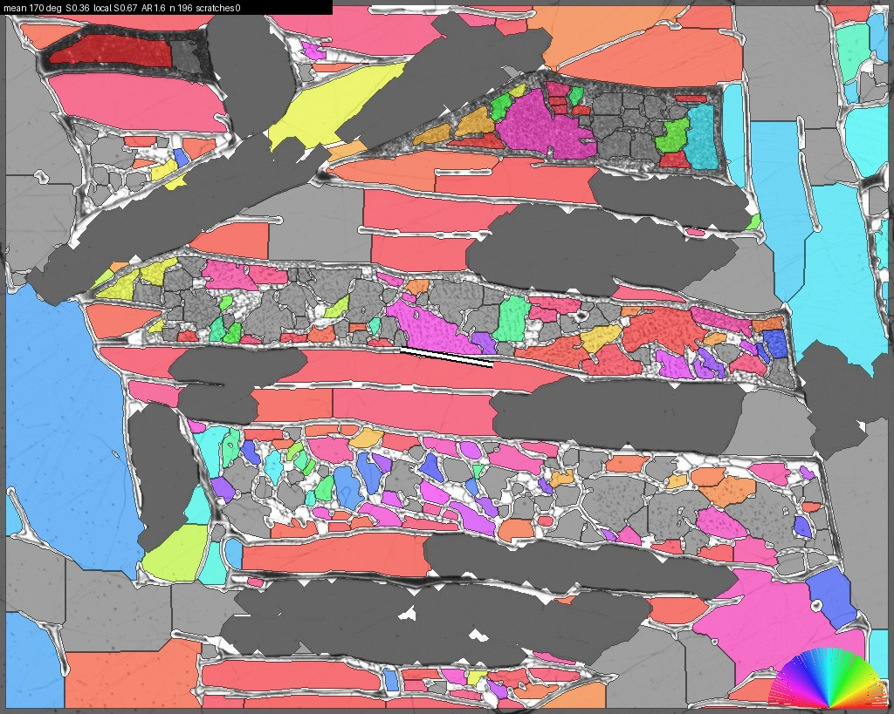
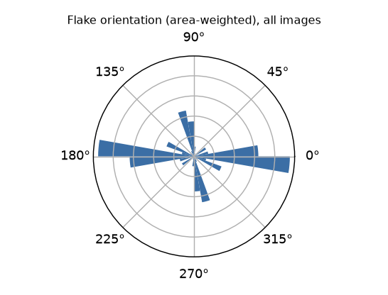
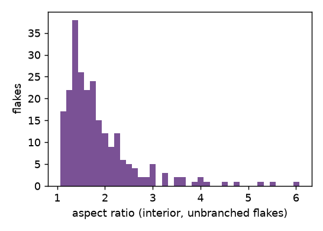

# Flake measurements: widmanstaetten_L18

1 images; reading: **boundaries** (ambiguous profile; boundary reading by default (the agent review checks it)); flake width 11.31 px; code version 12ac79dc07.

## Confidence

- Twin accuracy (held-out twin images, exact truth): worst family ratio 1.74, pooled 1.20 (<= 1 means within the tolerances of config.yaml); dev 2.09: a gap shows how much the search fitted the dev twin images.
- The twin resembles the real images only roughly (worst profile mismatch x2.29); the twin accuracy carries over only as far as that, and only for structures the generator draws (straight laths in colonies).
- Rotation check on the real images: worst ratio 0.6634333333333333 (passes).
- The image profile was ambiguous between a boundary network and phase islands: check in the drawings that the outlined regions are the flakes you mean; rerun with --mode phase otherwise.
- Lengths are in pixels (no --um-per-px given).

## Set summary

| | median | min | max |
|---|---|---|---|
| order parameter S | 0.365 | 0.365 | 0.365 |
| local S (within colonies) | 0.672 | 0.672 | 0.672 |
| mean misalignment (deg) | 30.4 | 30.4 | 30.4 |
| median aspect ratio | 1.65 | 1.65 | 1.65 |
| median length (px) | 32.8 | 32.8 | 32.8 |
| median width (px) | 18.8 | 18.8 | 18.8 |
| flakes used per image | 196 | 196 | 196 |

Mean directions differ per image (axial; see the table): a set-level mean direction is only meaningful when the images were taken in the same specimen frame.

## Per image

| image | mean dir (deg) | S [95 % CI] | local S | misalignment (deg) | AR [95 % CI] | flakes | scratches |
|---|---|---|---|---|---|---|---|
| L18__rank078__043_Widmannstaetten__CC-BY-SA-3.0 | 170 | 0.365 [0.17, 0.665] | 0.672 | 30.4 | 1.65 [1.57, 1.74] | 196 | 0 |

## How accurate is it (twin images with exact truth)

Twin: 18 code-generated images fitted to this set (realism ok: False; worst profile mismatch x2.29).

| twin images | params | mean direction err (deg) | S err | misalignment err (deg) | AR err | flake orientation err (deg) | flakes found | worst family ratio |
|---|---|---|---|---|---|---|---|---|
| dev | start | 0.959 | 0.158 | 6.88 | 0.0193 | 7.55 | 0.714 | 4.39 |
| holdout | start | 0.928 | 0.158 | 6.63 | 0.0178 | 6.84 | 0.721 | 3.79 |
| dev | chosen | 0.627 | 0.0777 | 3.39 | 0.0487 | 5.43 | 0.617 | 2.09 |
| holdout | chosen | 0.554 | 0.0602 | 3.06 | 0.0707 | 4.82 | 0.622 | 1.74 |

Search: 20 new configurations evaluated (25 incl. cached); objective 5.176 at the start, 2.482 chosen.
Warm start: pearlite_L02 (distance 0.36), ti_basketweave_ma19010080 (distance 0.40).

## Real images: rotation check

Central disk measured as is and turned by 30 deg: direction off by 1.9903 deg, S by 0.0166, aspect ratio by 0.0157 (worst ratio to tolerance 0.6634333333333333; <= 1 passes). Necessary, not sufficient.

## Drawings

## Files

- `flakes.csv`: every flake (orientation, length, width, aspect ratio, misalignment, flags)
- `image_summaries.csv`: one row per image, with bootstrap intervals
- `params.json`: the params used
- `adapt_log.json`: profile, twin, search trials, reviews
