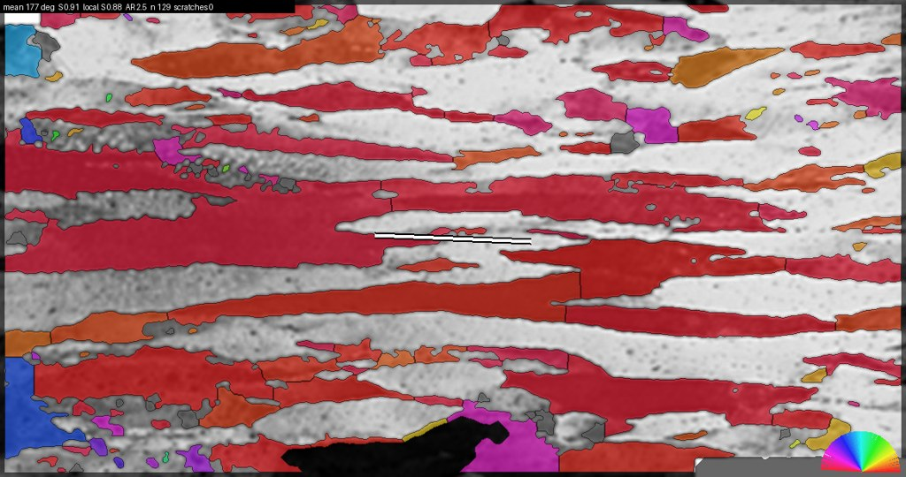
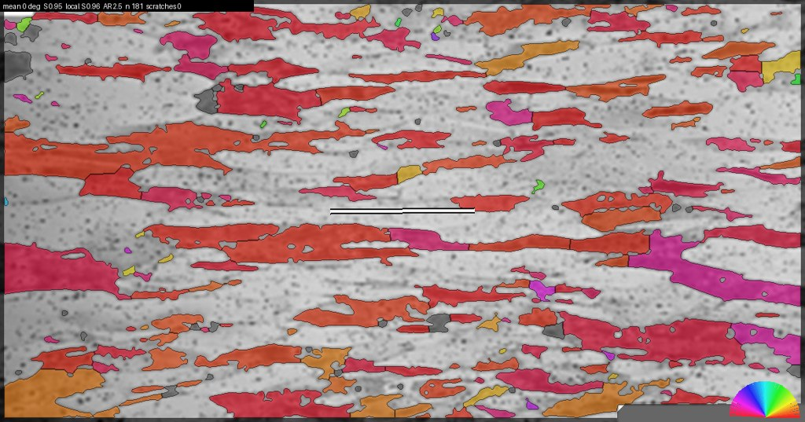
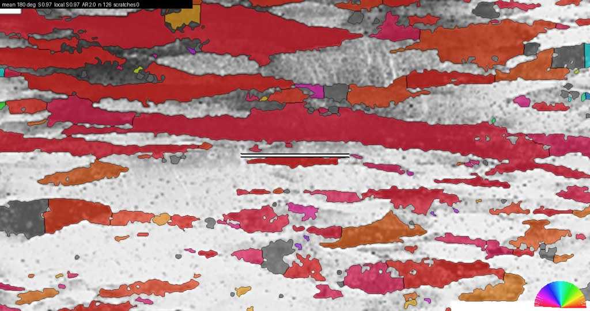
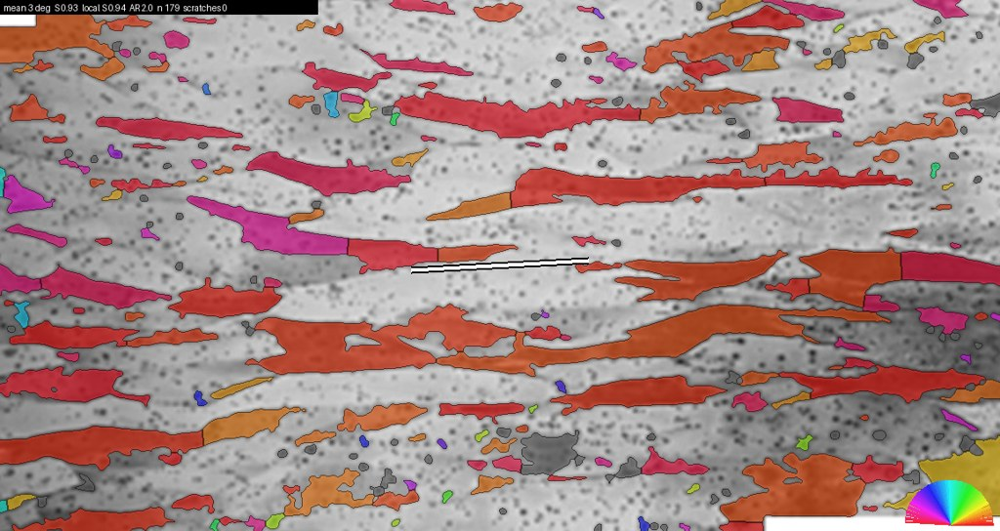
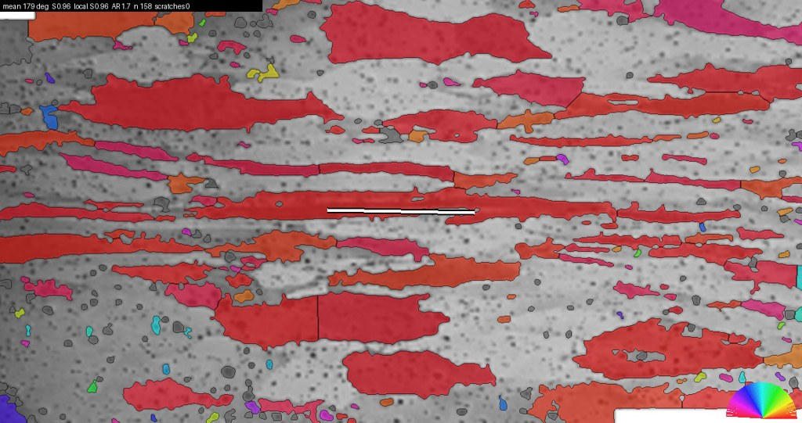
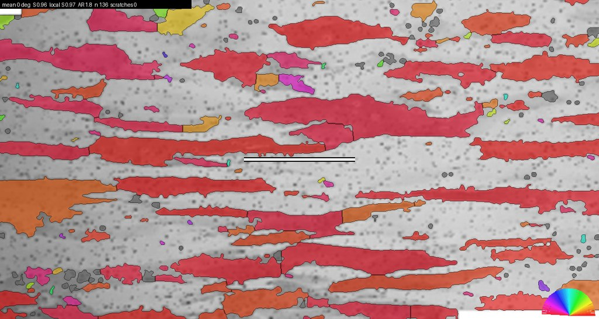
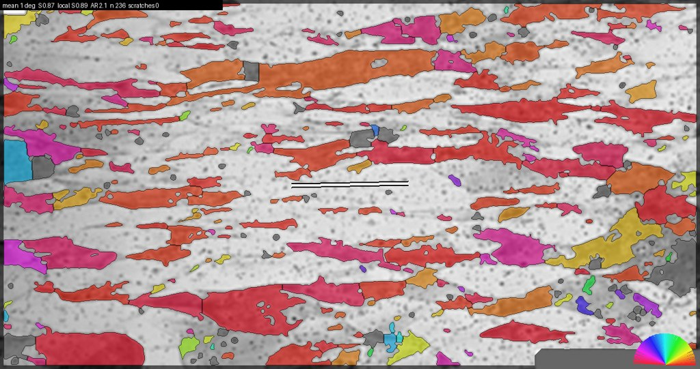
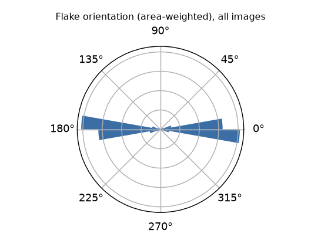
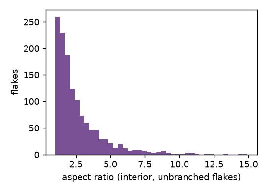

# Flake measurements: banded_islands_ma17081847

7 images; reading: **phase** (minority phase is separate blobs about as thick as the matrix); flake width 13.42 px; code version bda0a7c33b.

## Confidence

- **Twin not usable** for this image set (it does not resemble the images closely enough, or flakes cannot be found on it at this size): the accuracy below is not evidence about these images, and no search was run on it; the scaled default settings were used. Treat the numbers as unvalidated; check them in the drawings.
- Twin accuracy (held-out twin images, exact truth): worst family ratio 0.66, pooled 0.36 (<= 1 means within the tolerances of config.yaml); dev 0.54: a gap shows how much the search fitted the dev twin images.
- The twin resembles the real images only roughly (worst profile mismatch x1.27; flake aspect ratio and width as measured by the method differ by up to x1.74); the twin accuracy carries over only as far as that, and only for structures the generator draws (straight laths in colonies).
- Rotation check on the real images (central disk turned by 30 deg and measured again): worst ratio 0.51 (passes); S changes by 0.013500000000000002, the direction by 0.4919 deg, the median aspect ratio by 0.02565 (relative); for comparison, the 95 % interval of S from the finite number of flakes is +/-0.023.
- Lengths are in pixels (no --um-per-px given).

## Set summary

| | median | min | max |
|---|---|---|---|
| order parameter S | 0.947 | 0.871 | 0.968 |
| local S (within colonies) | 0.961 | 0.88 | 0.974 |
| mean misalignment (deg) | 7.12 | 4.37 | 10.8 |
| median aspect ratio | 2.02 | 1.72 | 2.54 |
| median length (px) | 23.2 | 17.1 | 30.6 |
| median width (px) | 10.5 | 9.98 | 13.4 |
| flakes used per image | 158 | 126 | 236 |

Mean directions differ per image (axial; see the table): a set-level mean direction is only meaningful when the images were taken in the same specimen frame.

## Per image

| image | mean dir (deg) | S [95 % CI] | local S | misalignment (deg) | AR [95 % CI] | flakes | scratches |
|---|---|---|---|---|---|---|---|
| L03__10.3390_ma17081847_g009_p6 | 177 | 0.907 [0.808, 0.964] | 0.88 | 7.12 | 2.47 [2.15, 2.9] | 129 | 0 |
| L07__10.3390_ma17081847_g009_p2 | 0.37 | 0.947 [0.927, 0.964] | 0.961 | 7.12 | 2.54 [2.27, 2.92] | 181 | 0 |
| L11__10.3390_ma17081847_g009_p7 | 180 | 0.968 [0.946, 0.983] | 0.974 | 5.12 | 2.01 [1.91, 2.23] | 126 | 0 |
| L14__10.3390_ma17081847_g009_p3 | 2.89 | 0.925 [0.892, 0.951] | 0.945 | 7.9 | 2.02 [1.85, 2.29] | 179 | 0 |
| L16__10.3390_ma17081847_g010_p8 | 179 | 0.958 [0.929, 0.976] | 0.962 | 4.37 | 1.72 [1.55, 1.87] | 158 | 0 |
| L17__10.3390_ma17081847_g010_p7 | 0.23 | 0.96 [0.942, 0.974] | 0.965 | 5.45 | 1.8 [1.64, 1.97] | 136 | 0 |
| L19__10.3390_ma17081847_g009_p1 | 1.09 | 0.871 [0.808, 0.915] | 0.891 | 10.8 | 2.11 [1.97, 2.34] | 236 | 0 |

## How accurate is it (twin images with exact truth)

Twin: 18 code-generated images fitted to this set (realism ok: False; worst profile mismatch x1.27).

| twin images | params | mean direction err (deg) | S err | misalignment err (deg) | AR err | flake orientation err (deg) | flakes found | worst family ratio |
|---|---|---|---|---|---|---|---|---|
| dev | start | 0.18 | 0.0107 | 0.58 | 0.0495 | 1.83 | 0.966 | 0.538 |
| holdout | start | 0.393 | 0.0158 | 0.604 | 0.0327 | 1.81 | 0.968 | 0.661 |
| dev | chosen | 0.18 | 0.0107 | 0.58 | 0.0495 | 1.83 | 0.966 | 0.538 |
| holdout | chosen | 0.393 | 0.0158 | 0.604 | 0.0327 | 1.81 | 0.968 | 0.661 |

Search: 2 new configurations evaluated (7 incl. cached); objective 0.629 at the start, 0.629 chosen.
Warm start: ti64_dev (distance 5.92).

## Real images: rotation check

Central disk measured as is and turned by 30 deg: direction off by 0.4919 deg, S by 0.013500000000000002, aspect ratio by 0.02565 (worst ratio to tolerance 0.5129999999999999; <= 1 passes). Necessary, not sufficient.

## Drawings (left: original, right: flakes coloured by orientation; grey = not used)

## Files

- `flakes.csv`: every flake (orientation, length, width, aspect ratio, misalignment, flags)
- `image_summaries.csv`: one row per image, with bootstrap intervals
- `params.json`: the params used
- `adapt_log.json`: profile, twin, search trials, reviews
