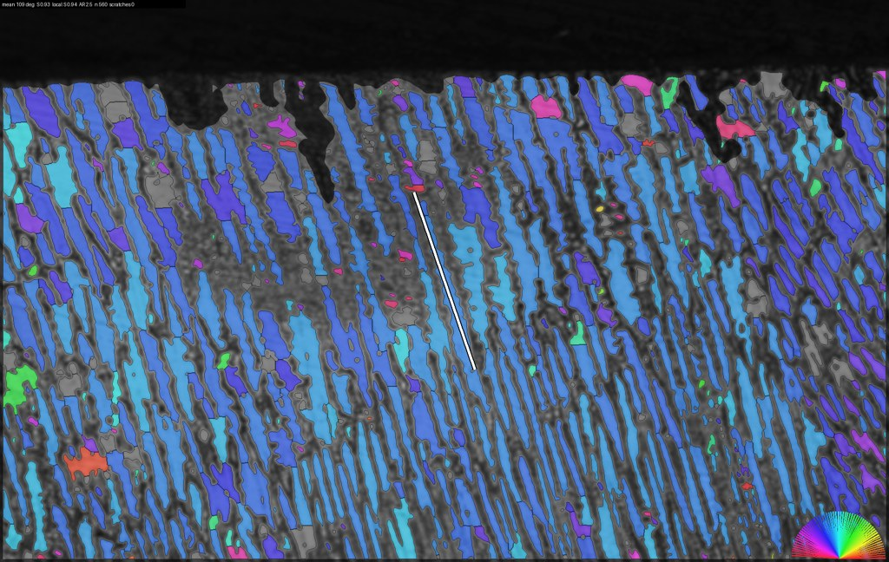
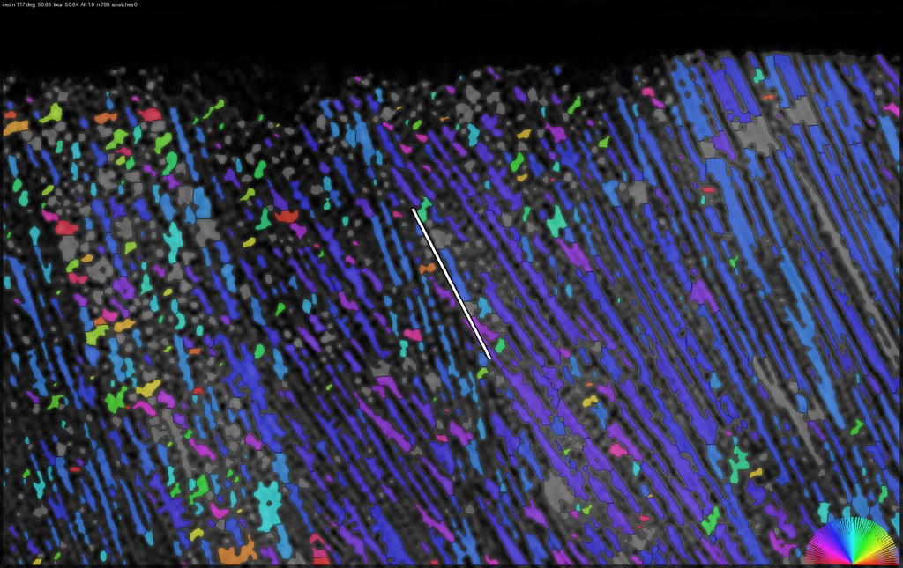
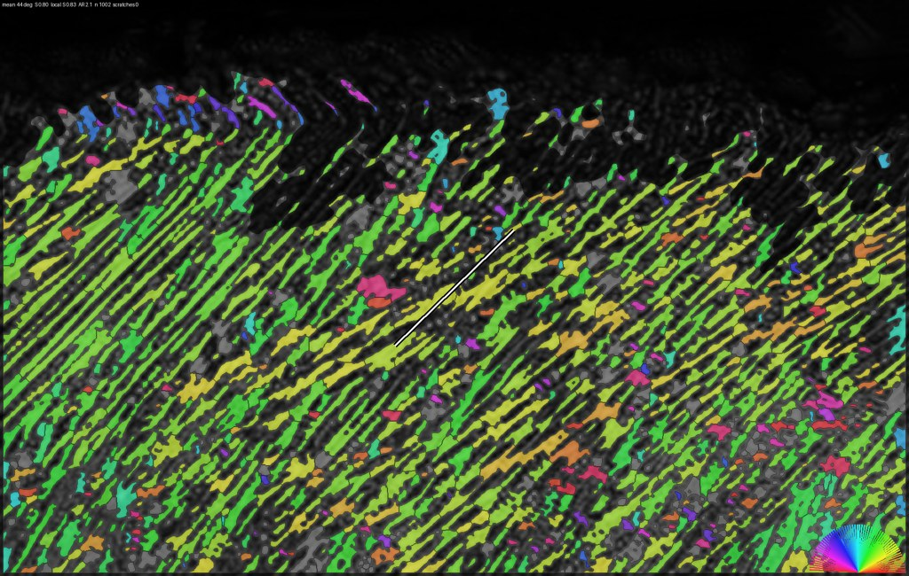
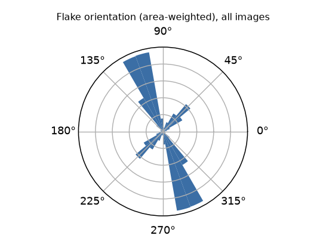
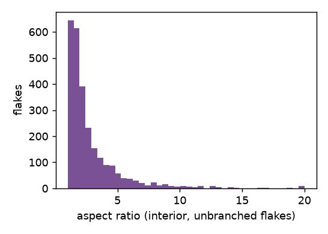

# Flake measurements: colour_lamellar_ma16020804

3 images; reading: **phase** (minority phase is separate blobs about as thick as the matrix); flake width 4.47 px; code version bda0a7c33b.

## Confidence

- **Twin not usable** for this image set (it does not resemble the images closely enough, or flakes cannot be found on it at this size): the accuracy below is not evidence about these images, and no search was run on it; the scaled default settings were used. Treat the numbers as unvalidated; check them in the drawings.
- Twin accuracy (held-out twin images, exact truth): worst family ratio 1.16, pooled 0.61 (<= 1 means within the tolerances of config.yaml); dev 1.09: a gap shows how much the search fitted the dev twin images.
- The twin resembles the real images only roughly (worst profile mismatch x1.53; flake aspect ratio and width as measured by the method differ by up to x2.50); the twin accuracy carries over only as far as that, and only for structures the generator draws (straight laths in colonies).
- Rotation check on the real images (central disk turned by 30 deg and measured again): worst ratio 0.39 (passes); S changes by 0.0116, the direction by 0.2929 deg, the median aspect ratio by 0.0162 (relative); for comparison, the 95 % interval of S from the finite number of flakes is +/-0.027.
- Flakes are only ~4.5 px wide (the profiler over-reads small widths by ~1 px): the images were analysed at 3x size. Near and below ~4-5 px the boundaries are at the resolution limit: orientation and S hold best, aspect ratios and lengths least. Use higher-resolution images if you can.
- Lengths are in pixels (no --um-per-px given).

## Set summary

| | median | min | max |
|---|---|---|---|
| order parameter S | 0.827 | 0.799 | 0.928 |
| local S (within colonies) | 0.843 | 0.828 | 0.943 |
| mean misalignment (deg) | 11.9 | 7.13 | 13.8 |
| median aspect ratio | 2.07 | 1.86 | 2.5 |
| median length (px) | 10.5 | 9 | 14.4 |
| median width (px) | 4.7 | 4.5 | 5.45 |
| flakes used per image | 789 | 560 | 1e+03 |

Mean directions differ per image (axial; see the table): a set-level mean direction is only meaningful when the images were taken in the same specimen frame.

## Per image

| image | mean dir (deg) | S [95 % CI] | local S | misalignment (deg) | AR [95 % CI] | flakes | scratches |
|---|---|---|---|---|---|---|---|
| L09__10.3390_ma16020804_g005_p3 | 109 | 0.928 [0.907, 0.947] | 0.943 | 7.13 | 2.5 [2.25, 2.71] | 560 | 0 |
| L12__10.3390_ma16020804_g002_p3 | 117 | 0.827 [0.791, 0.859] | 0.843 | 11.9 | 1.86 [1.78, 1.93] | 789 | 0 |
| L13__10.3390_ma16020804_g002_p9 | 44.2 | 0.799 [0.773, 0.826] | 0.828 | 13.8 | 2.07 [1.97, 2.14] | 1002 | 0 |

## How accurate is it (twin images with exact truth)

Twin: 18 code-generated images fitted to this set (realism ok: False; worst profile mismatch x1.53).

| twin images | params | mean direction err (deg) | S err | misalignment err (deg) | AR err | flake orientation err (deg) | flakes found | worst family ratio |
|---|---|---|---|---|---|---|---|---|
| dev | start | 0.525 | 0.00735 | 0.58 | 0.0839 | 1.61 | 0.978 | 1.09 |
| holdout | start | 0.24 | 0.00596 | 0.387 | 0.0916 | 1.65 | 0.975 | 1.16 |
| dev | chosen | 0.525 | 0.00735 | 0.58 | 0.0839 | 1.61 | 0.978 | 1.09 |
| holdout | chosen | 0.24 | 0.00596 | 0.387 | 0.0916 | 1.65 | 0.975 | 1.16 |

Search: 2 new configurations evaluated (7 incl. cached); objective 1.226 at the start, 1.226 chosen.
Warm start: ti64_dev (distance 5.85).

## Real images: rotation check

Central disk measured as is and turned by 30 deg: direction off by 0.2929 deg, S by 0.0116, aspect ratio by 0.0162 (worst ratio to tolerance 0.38666666666666666; <= 1 passes). Necessary, not sufficient.

## Drawings (left: original, right: flakes coloured by orientation; grey = not used)

## Files

- `flakes.csv`: every flake (orientation, length, width, aspect ratio, misalignment, flags)
- `image_summaries.csv`: one row per image, with bootstrap intervals
- `params.json`: the params used
- `adapt_log.json`: profile, twin, search trials, reviews
