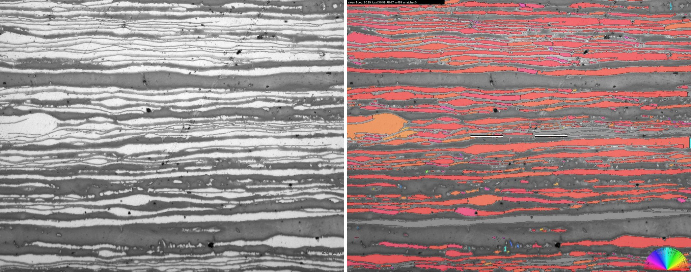
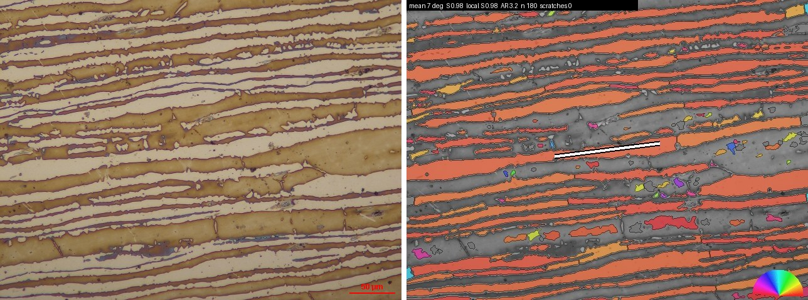
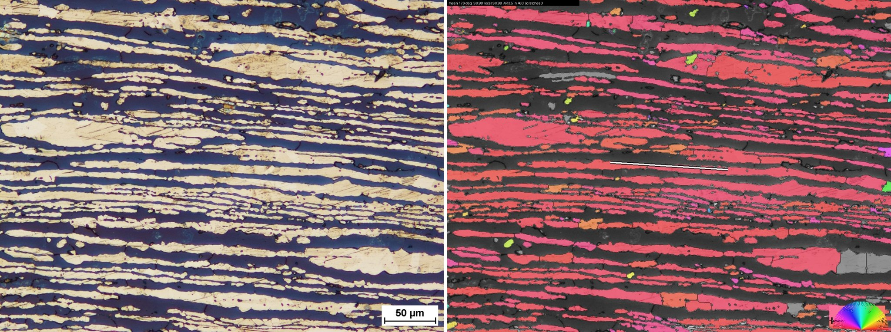
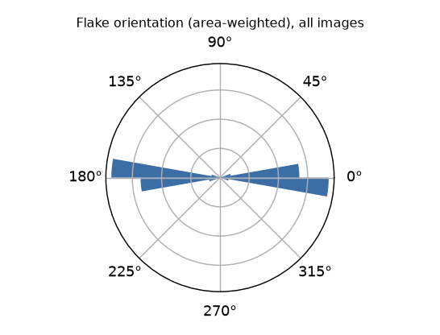
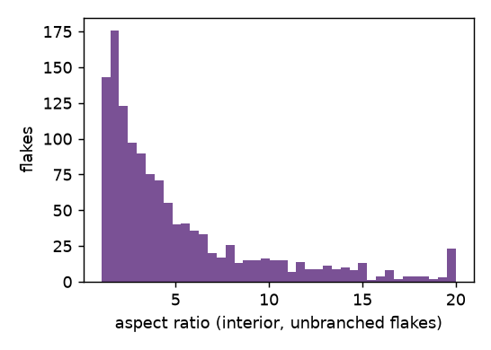

# Flake measurements: duplex_bands_mixed

4 images; reading: **phase** (minority phase is separate blobs about as thick as the matrix); flake width 10.385 px; code version bda0a7c33b.

## Confidence

- **Twin not usable** for this image set (it does not resemble the images closely enough, or flakes cannot be found on it at this size): the accuracy below is not evidence about these images, and no search was run on it; the scaled default settings were used. Treat the numbers as unvalidated; check them in the drawings.
- Twin accuracy (held-out twin images, exact truth): worst family ratio 0.46, pooled 0.31 (<= 1 means within the tolerances of config.yaml); dev 0.38: a gap shows how much the search fitted the dev twin images.
- The twin resembles the real images only roughly (worst profile mismatch x1.19; flake aspect ratio and width as measured by the method differ by up to x1.55); the twin accuracy carries over only as far as that, and only for structures the generator draws (straight laths in colonies).
- Rotation check on the real images (central disk turned by 30 deg and measured again): worst ratio 0.95 (passes); S changes by 0.00155, the direction by 0.23915 deg, the median aspect ratio by 0.04765 (relative); for comparison, the 95 % interval of S from the finite number of flakes is +/-0.008.
- Lengths are in pixels (no --um-per-px given).

## Set summary

| | median | min | max |
|---|---|---|---|
| order parameter S | 0.979 | 0.897 | 0.987 |
| local S (within colonies) | 0.981 | 0.92 | 0.99 |
| mean misalignment (deg) | 3.14 | 2.85 | 9.2 |
| median aspect ratio | 3.36 | 2.08 | 4.67 |
| median length (px) | 39.8 | 22.4 | 44.1 |
| median width (px) | 10.4 | 7.66 | 20.7 |
| flakes used per image | 336 | 180 | 499 |

Mean directions differ per image (axial; see the table): a set-level mean direction is only meaningful when the images were taken in the same specimen frame.

## Per image

| image | mean dir (deg) | S [95 % CI] | local S | misalignment (deg) | AR [95 % CI] | flakes | scratches |
|---|---|---|---|---|---|---|---|
| L01__rank076__MB_DSSx100-3 | 0.558 | 0.987 [0.983, 0.991] | 0.99 | 2.85 | 4.67 [4.32, 5.02] | 499 | 0 |
| L04__rank007__MB_DSSx200-4 | 6.85 | 0.978 [0.964, 0.986] | 0.979 | 2.92 | 3.2 [2.71, 4.05] | 180 | 0 |
| L05__rank005__MBX200+ech | 176 | 0.981 [0.974, 0.986] | 0.984 | 3.37 | 3.52 [3.23, 3.89] | 463 | 0 |
| L24__rank027__102_Microstructure_of_2707_Hyper_Duplex_Stainless_Steel__CC-BY-4.0 | 0.689 | 0.897 [0.861, 0.932] | 0.92 | 9.2 | 2.08 [1.9, 2.25] | 210 | 0 |

## How accurate is it (twin images with exact truth)

Twin: 18 code-generated images fitted to this set (realism ok: False; worst profile mismatch x1.19).

| twin images | params | mean direction err (deg) | S err | misalignment err (deg) | AR err | flake orientation err (deg) | flakes found | worst family ratio |
|---|---|---|---|---|---|---|---|---|
| dev | start | 0.124 | 0.00669 | 0.408 | 0.0492 | 1.54 | 0.991 | 0.381 |
| holdout | start | 0.238 | 0.00661 | 0.364 | 0.0382 | 1.55 | 0.988 | 0.464 |
| dev | chosen | 0.124 | 0.00669 | 0.408 | 0.0492 | 1.54 | 0.991 | 0.381 |
| holdout | chosen | 0.238 | 0.00661 | 0.364 | 0.0382 | 1.55 | 0.988 | 0.464 |

Search: 2 new configurations evaluated (7 incl. cached); objective 0.463 at the start, 0.463 chosen.
Warm start: ti64_dev (distance 5.65).

## Real images: rotation check

Central disk measured as is and turned by 30 deg: direction off by 0.23915 deg, S by 0.00155, aspect ratio by 0.04765 (worst ratio to tolerance 0.953; <= 1 passes). Necessary, not sufficient.

## Drawings (left: original, right: flakes coloured by orientation; grey = not used)

## Files

- `flakes.csv`: every flake (orientation, length, width, aspect ratio, misalignment, flags)
- `image_summaries.csv`: one row per image, with bootstrap intervals
- `params.json`: the params used
- `adapt_log.json`: profile, twin, search trials, reviews
