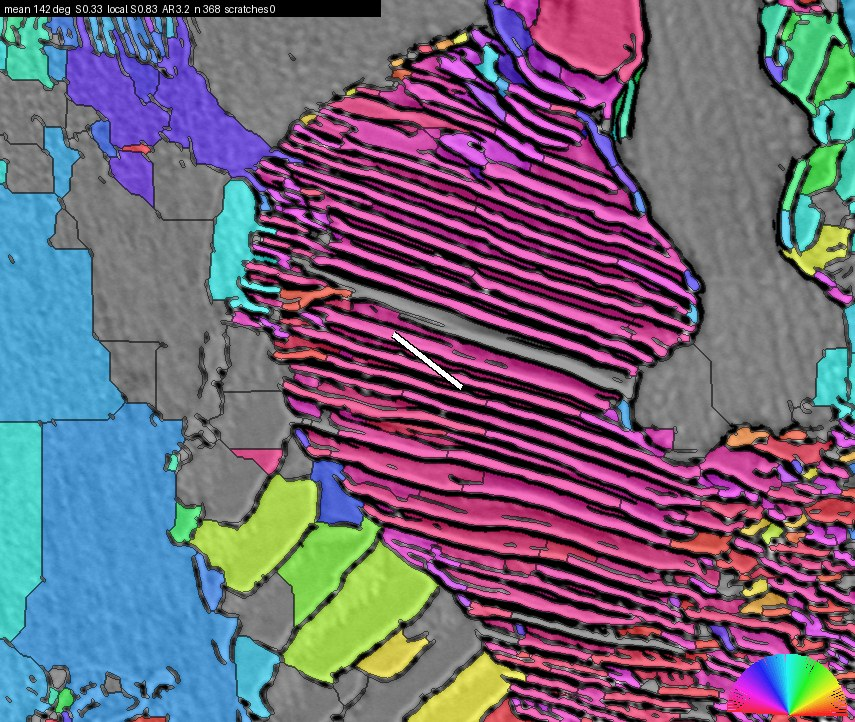
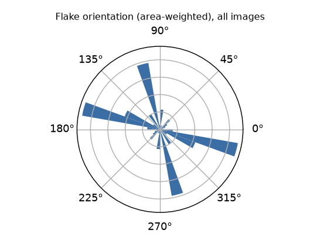
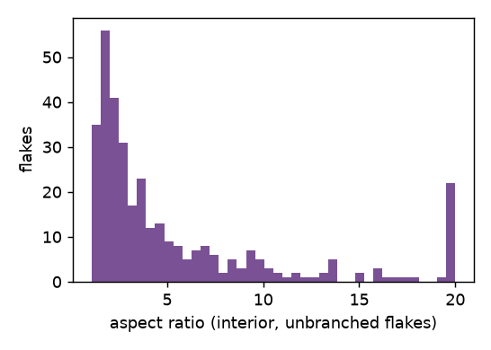

# Flake measurements: pearlite_L02

1 images; reading: **boundaries** (ambiguous profile; boundary reading by default (the agent review checks it)); flake width 10.0 px; code version bda0a7c33b.

## Confidence

- **Twin not usable** for this image set (it does not resemble the images closely enough, or flakes cannot be found on it at this size): the accuracy below is not evidence about these images, and no search was run on it; the scaled default settings were used. Treat the numbers as unvalidated; check them in the drawings.
- Twin accuracy (held-out twin images, exact truth): worst family ratio 1.33, pooled 0.77 (<= 1 means within the tolerances of config.yaml); dev 0.95: a gap shows how much the search fitted the dev twin images.
- The twin resembles the real images only roughly (worst profile mismatch x2.30; flake aspect ratio and width as measured by the method differ by up to x1.28); the twin accuracy carries over only as far as that, and only for structures the generator draws (straight laths in colonies).
- Rotation check on the real images (central disk turned by 30 deg and measured again): worst ratio 4.21 (FAILS); S changes by 0.1263, the direction by 6.988 deg, the median aspect ratio by 0.0003 (relative); for comparison, the 95 % interval of S from the finite number of flakes is +/-0.158.
- The image profile was ambiguous between a boundary network and phase islands: check in the drawings that the outlined regions are the flakes you mean; rerun with --mode phase otherwise.
- Lengths are in pixels (no --um-per-px given).

## Set summary

| | median | min | max |
|---|---|---|---|
| order parameter S | 0.331 | 0.331 | 0.331 |
| local S (within colonies) | 0.825 | 0.825 | 0.825 |
| mean misalignment (deg) | 34.3 | 34.3 | 34.3 |
| median aspect ratio | 3.16 | 3.16 | 3.16 |
| median length (px) | 38.3 | 38.3 | 38.3 |
| median width (px) | 10.1 | 10.1 | 10.1 |
| flakes used per image | 368 | 368 | 368 |

Mean directions differ per image (axial; see the table): a set-level mean direction is only meaningful when the images were taken in the same specimen frame.

## Per image

| image | mean dir (deg) | S [95 % CI] | local S | misalignment (deg) | AR [95 % CI] | flakes | scratches |
|---|---|---|---|---|---|---|---|
| L02__10.3390_ma18204798_g006_p4 | 142 | 0.331 [0.222, 0.538] | 0.825 | 34.3 | 3.16 [2.71, 3.75] | 368 | 0 |

## How accurate is it (twin images with exact truth)

Twin: 18 code-generated images fitted to this set (realism ok: False; worst profile mismatch x2.30).

| twin images | params | mean direction err (deg) | S err | misalignment err (deg) | AR err | flake orientation err (deg) | flakes found | worst family ratio |
|---|---|---|---|---|---|---|---|---|
| dev | start | 0.233 | 0.01 | 0.603 | 0.016 | 1.88 | 0.886 | 0.399 |
| holdout | start | 0.221 | 0.00939 | 0.532 | 0.00375 | 1.94 | 0.894 | 0.462 |
| dev | chosen | 0.312 | 0.031 | 1.55 | 0.131 | 2.19 | 0.975 | 0.951 |
| holdout | chosen | 0.39 | 0.0307 | 1.54 | 0.115 | 2.21 | 0.981 | 1.33 |

Search: 2 new configurations evaluated (7 incl. cached); objective 0.493 at the start, 1.170 chosen.
Warm start: ti64_dev (distance 0.51).

## Real images: rotation check

Central disk measured as is and turned by 30 deg: direction off by 6.988 deg, S by 0.1263, aspect ratio by 0.0003 (worst ratio to tolerance 4.21; <= 1 passes). Necessary, not sufficient.

## Drawings (left: original, right: flakes coloured by orientation; grey = not used)

## Files

- `flakes.csv`: every flake (orientation, length, width, aspect ratio, misalignment, flags)
- `image_summaries.csv`: one row per image, with bootstrap intervals
- `params.json`: the params used
- `adapt_log.json`: profile, twin, search trials, reviews
