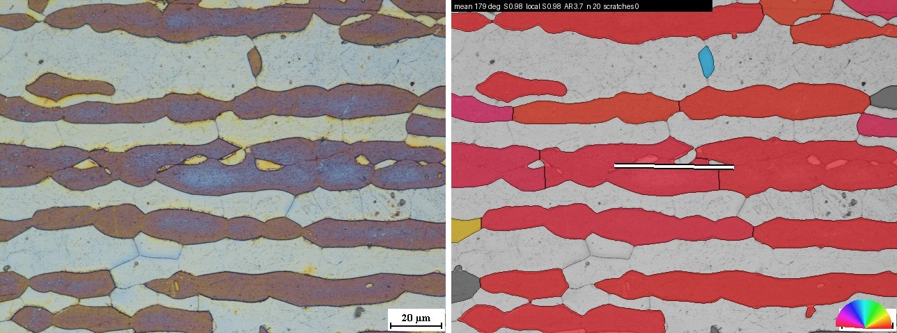
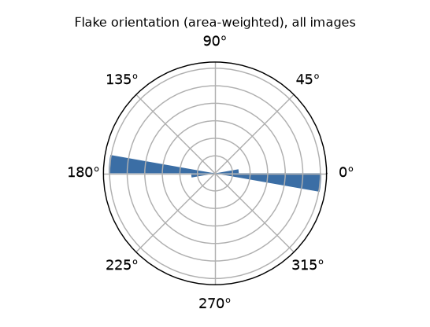
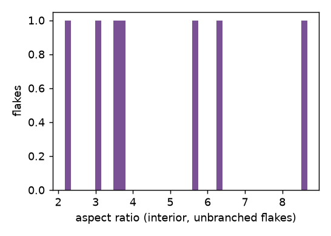

# Flake measurements: purple_flakes_L10

1 images; reading: **phase** (minority phase is separate blobs about as thick as the matrix); flake width 30.07 px; code version bda0a7c33b.

## Confidence

- Twin accuracy (held-out twin images, exact truth): worst family ratio 1.91, pooled 1.19 (<= 1 means within the tolerances of config.yaml); dev 1.24: a gap shows how much the search fitted the dev twin images.
- The twin resembles the real images (worst profile mismatch x1.26; flake aspect ratio and width as measured by the method differ by up to x1.29); the twin accuracy carries over only as far as that, and only for structures the generator draws (straight laths in colonies).
- Rotation check on the real images (central disk turned by 30 deg and measured again): worst ratio 3.18 (FAILS); S changes by 0.0024, the direction by 1.5197 deg, the median aspect ratio by 0.1589 (relative); for comparison, the 95 % interval of S from the finite number of flakes is +/-0.017.
- Lengths are in pixels (no --um-per-px given).

## Set summary

| | median | min | max |
|---|---|---|---|
| order parameter S | 0.984 | 0.984 | 0.984 |
| local S (within colonies) | 0.984 | 0.984 | 0.984 |
| mean misalignment (deg) | 2.34 | 2.34 | 2.34 |
| median aspect ratio | 3.71 | 3.71 | 3.71 |
| median length (px) | 264 | 264 | 264 |
| median width (px) | 43 | 43 | 43 |
| flakes used per image | 20 | 20 | 20 |

Mean directions differ per image (axial; see the table): a set-level mean direction is only meaningful when the images were taken in the same specimen frame.

## Per image

| image | mean dir (deg) | S [95 % CI] | local S | misalignment (deg) | AR [95 % CI] | flakes | scratches |
|---|---|---|---|---|---|---|---|
| L10__rank046__40MIN-G500-00 | 179 | 0.984 [0.963, 0.997] | 0.984 | 2.34 | 3.71 [3.11, 6.35] | 20 | 0 |

## How accurate is it (twin images with exact truth)

Twin: 18 code-generated images fitted to this set (realism ok: True; worst profile mismatch x1.26).

| twin images | params | mean direction err (deg) | S err | misalignment err (deg) | AR err | flake orientation err (deg) | flakes found | worst family ratio |
|---|---|---|---|---|---|---|---|---|
| dev | start | 1.85 | 0.036 | 1.54 | 0.109 | 3.11 | 0.505 | 1.59 |
| holdout | start | 0.819 | 0.0473 | 3.34 | 0.133 | 3.11 | 0.575 | 1.65 |
| dev | chosen | 2.01 | 0.0447 | 1.56 | 0.0867 | 3.11 | 0.769 | 1.24 |
| holdout | chosen | 0.509 | 0.0596 | 3.23 | 0.0415 | 3.42 | 0.845 | 1.91 |

Search: 20 new configurations evaluated (29 incl. cached); objective 1.775 at the start, 1.461 chosen.
Warm start: ti64_dev (distance 6.44).

## Real images: rotation check

Central disk measured as is and turned by 30 deg: direction off by 1.5197 deg, S by 0.0024, aspect ratio by 0.1589 (worst ratio to tolerance 3.178; <= 1 passes). Necessary, not sufficient.

## Drawings (left: original, right: flakes coloured by orientation; grey = not used)

## Files

- `flakes.csv`: every flake (orientation, length, width, aspect ratio, misalignment, flags)
- `image_summaries.csv`: one row per image, with bootstrap intervals
- `params.json`: the params used
- `adapt_log.json`: profile, twin, search trials, reviews
