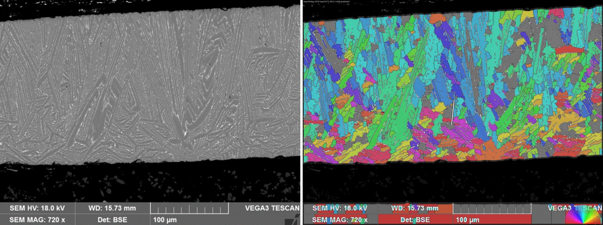
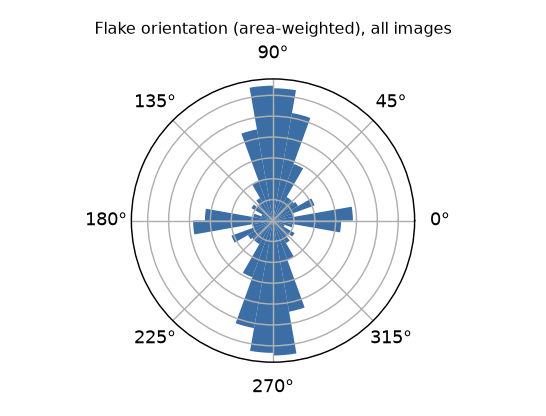
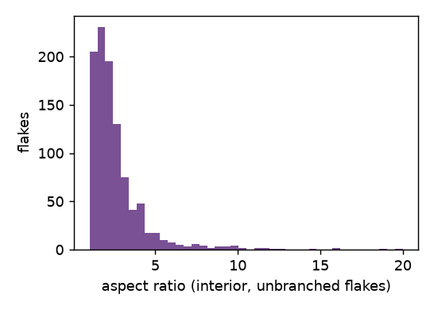

# Flake measurements: sem_user

1 images; reading: **boundaries** (ambiguous profile; boundary reading by default (the agent review checks it)); flake width 4.47 px; code version bda0a7c33b.

## Confidence

- **Twin not usable** for this image set (it does not resemble the images closely enough, or flakes cannot be found on it at this size): the accuracy below is not evidence about these images, and no search was run on it; the scaled default settings were used. Treat the numbers as unvalidated; check them in the drawings.
- Twin accuracy (held-out twin images, exact truth): worst family ratio 0.93, pooled 0.40 (<= 1 means within the tolerances of config.yaml); dev 0.69: a gap shows how much the search fitted the dev twin images.
- The twin resembles the real images only roughly (worst profile mismatch x1.80; flake aspect ratio and width as measured by the method differ by up to x1.77); the twin accuracy carries over only as far as that, and only for structures the generator draws (straight laths in colonies).
- Rotation check on the real images (central disk turned by 30 deg and measured again): worst ratio 0.45 (passes); S changes by 0.0064, the direction by 1.3636 deg, the median aspect ratio by 0.0109 (relative); for comparison, the 95 % interval of S from the finite number of flakes is +/-0.102.
- Flakes are only ~4.5 px wide (the profiler over-reads small widths by ~1 px): the images were analysed at 3x size. Near and below ~4-5 px the boundaries are at the resolution limit: orientation and S hold best, aspect ratios and lengths least. Use higher-resolution images if you can.
- The image profile was ambiguous between a boundary network and phase islands: check in the drawings that the outlined regions are the flakes you mean; rerun with --mode phase otherwise.
- Lengths are in pixels (no --um-per-px given).

## Set summary

| | median | min | max |
|---|---|---|---|
| order parameter S | 0.304 | 0.304 | 0.304 |
| local S (within colonies) | 0.724 | 0.724 | 0.724 |
| mean misalignment (deg) | 33.6 | 33.6 | 33.6 |
| median aspect ratio | 2.16 | 2.16 | 2.16 |
| median length (px) | 12.5 | 12.5 | 12.5 |
| median width (px) | 5.66 | 5.66 | 5.66 |
| flakes used per image | 944 | 944 | 944 |

Mean directions differ per image (axial; see the table): a set-level mean direction is only meaningful when the images were taken in the same specimen frame.

## Per image

| image | mean dir (deg) | S [95 % CI] | local S | misalignment (deg) | AR [95 % CI] | flakes | scratches |
|---|---|---|---|---|---|---|---|
| sem_bse | 83.7 | 0.304 [0.201, 0.406] | 0.724 | 33.6 | 2.16 [2.07, 2.23] | 944 | 0 |

## How accurate is it (twin images with exact truth)

Twin: 18 code-generated images fitted to this set (realism ok: False; worst profile mismatch x1.80).

| twin images | params | mean direction err (deg) | S err | misalignment err (deg) | AR err | flake orientation err (deg) | flakes found | worst family ratio |
|---|---|---|---|---|---|---|---|---|
| dev | start | 0.139 | 0.025 | 1.01 | 0.0187 | 1.8 | 0.977 | 0.689 |
| holdout | start | 0.14 | 0.0198 | 1.06 | 0.0293 | 1.82 | 0.973 | 0.932 |
| dev | chosen | 0.139 | 0.025 | 1.01 | 0.0187 | 1.8 | 0.977 | 0.689 |
| holdout | chosen | 0.14 | 0.0198 | 1.06 | 0.0293 | 1.82 | 0.973 | 0.932 |

Search: 0 new configurations evaluated (6 incl. cached); objective 0.814 at the start, 0.814 chosen.
Warm start: none (no similar image set in the memory).

## Real images: rotation check

Central disk measured as is and turned by 30 deg: direction off by 1.3636 deg, S by 0.0064, aspect ratio by 0.0109 (worst ratio to tolerance 0.4545333333333333; <= 1 passes). Necessary, not sufficient.

## Drawings (left: original, right: flakes coloured by orientation; grey = not used)

## Files

- `flakes.csv`: every flake (orientation, length, width, aspect ratio, misalignment, flags)
- `image_summaries.csv`: one row per image, with bootstrap intervals
- `params.json`: the params used
- `adapt_log.json`: profile, twin, search trials, reviews
