# Flake measurements: ti64_dev

13 images; reading: **boundaries** (minority phase is a connected thin network); flake width 10.0 px; code version bda0a7c33b.

## Confidence

- **Within tolerances** on held-out twin images, and consistent under rotation on the real images.
- Twin accuracy (held-out twin images, exact truth): worst family ratio 0.43, pooled 0.36 (<= 1 means within the tolerances of config.yaml); dev 0.39: a gap shows how much the search fitted the dev twin images.
- The twin resembles the real images (worst profile mismatch x1.07; flake aspect ratio and width as measured by the method differ by up to x1.25); the twin accuracy carries over only as far as that, and only for structures the generator draws (straight laths in colonies).
- Rotation check on the real images (central disk turned by 30 deg and measured again): worst ratio 0.19 (passes); S changes by 0.00375, the direction by 0.24259999999999998 deg, the median aspect ratio by 0.00975 (relative); for comparison, the 95 % interval of S from the finite number of flakes is +/-0.050.
- Lengths are in pixels (no --um-per-px given).

## Set summary

| | median | min | max |
|---|---|---|---|
| order parameter S | 0.577 | 0.156 | 0.867 |
| local S (within colonies) | 0.843 | 0.767 | 0.932 |
| mean misalignment (deg) | 25.4 | 10.3 | 39.6 |
| median aspect ratio | 3.58 | 3.18 | 6.48 |
| median length (px) | 62.8 | 52.8 | 103 |
| median width (px) | 16.2 | 13.2 | 18.7 |
| flakes used per image | 677 | 554 | 979 |

Mean directions differ per image (axial; see the table): a set-level mean direction is only meaningful when the images were taken in the same specimen frame.

## Per image

| image | mean dir (deg) | S [95 % CI] | local S | misalignment (deg) | AR [95 % CI] | flakes | scratches |
|---|---|---|---|---|---|---|---|
| Ti64_21 | 3.09 | 0.474 [0.415, 0.536] | 0.816 | 27.9 | 3.54 [3.29, 3.82] | 749 | 0 |
| Ti64_22 | 20.2 | 0.377 [0.327, 0.425] | 0.78 | 31.1 | 4.34 [3.97, 4.68] | 657 | 0 |
| Ti64_23 | 135 | 0.577 [0.528, 0.63] | 0.854 | 23.5 | 3.41 [3.22, 3.67] | 833 | 0 |
| Ti64_24 | 14.8 | 0.579 [0.523, 0.643] | 0.843 | 24.3 | 3.5 [3.32, 3.7] | 677 | 0 |
| Ti64_28 | 180 | 0.597 [0.553, 0.642] | 0.898 | 25.4 | 6.48 [6.16, 6.92] | 598 | 0 |
| Ti64_29 | 42.4 | 0.515 [0.474, 0.561] | 0.861 | 26.4 | 5.84 [5.5, 6.35] | 584 | 0 |
| Ti64_32 | 162 | 0.223 [0.153, 0.297] | 0.774 | 37.3 | 3.93 [3.66, 4.24] | 554 | 0 |
| Ti64_33 | 0.214 | 0.637 [0.589, 0.689] | 0.865 | 21.3 | 3.58 [3.32, 3.83] | 747 | 0 |
| Ti64_34 | 0.404 | 0.762 [0.735, 0.789] | 0.884 | 16 | 3.21 [3.09, 3.39] | 979 | 0 |
| Ti64_36 | 20 | 0.156 [0.0852, 0.241] | 0.767 | 39.6 | 3.44 [3.19, 3.66] | 628 | 0 |
| Ti64_37 | 0.398 | 0.867 [0.842, 0.89] | 0.932 | 10.3 | 4.78 [4.52, 5.05] | 901 | 1 |
| Ti64_38 | 153 | 0.287 [0.224, 0.357] | 0.782 | 33.2 | 3.18 [3, 3.39] | 775 | 0 |
| Ti64_39 | 18 | 0.59 [0.544, 0.634] | 0.818 | 22.6 | 3.89 [3.66, 4.12] | 672 | 1 |

## How accurate is it (twin images with exact truth)

Twin: 18 code-generated images fitted to this set (realism ok: True; worst profile mismatch x1.07).

| twin images | params | mean direction err (deg) | S err | misalignment err (deg) | AR err | flake orientation err (deg) | flakes found | worst family ratio |
|---|---|---|---|---|---|---|---|---|
| dev | start | 0.221 | 0.025 | 1.23 | 0.0689 | 2.06 | 0.979 | 0.873 |
| holdout | start | 0.123 | 0.0252 | 1.11 | 0.0737 | 2.04 | 0.977 | 1.08 |
| dev | chosen | 0.215 | 0.0115 | 0.575 | 0.00806 | 1.82 | 0.883 | 0.394 |
| holdout | chosen | 0.126 | 0.0123 | 0.551 | 0.0172 | 1.79 | 0.883 | 0.433 |

Search: 30 new configurations evaluated (38 incl. cached); objective 0.997 at the start, 0.485 chosen.
Warm start: none (no similar image set in the memory).

## Real images: rotation check

Central disk measured as is and turned by 30 deg: direction off by 0.24259999999999998 deg, S by 0.00375, aspect ratio by 0.00975 (worst ratio to tolerance 0.19499999999999998; <= 1 passes). Necessary, not sufficient.

## Drawings (left: original, right: flakes coloured by orientation; grey = not used)

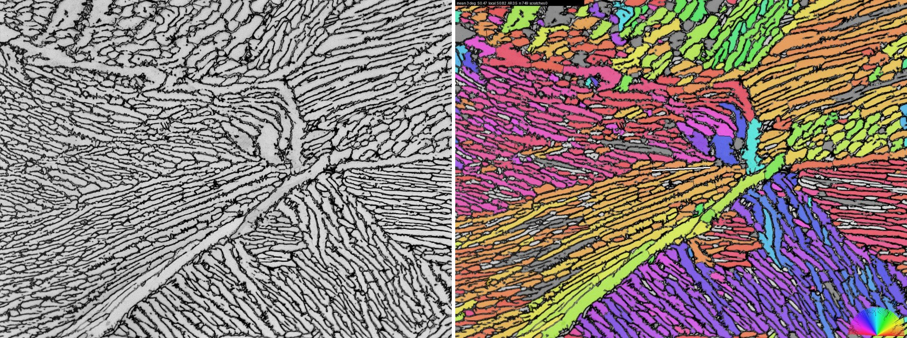
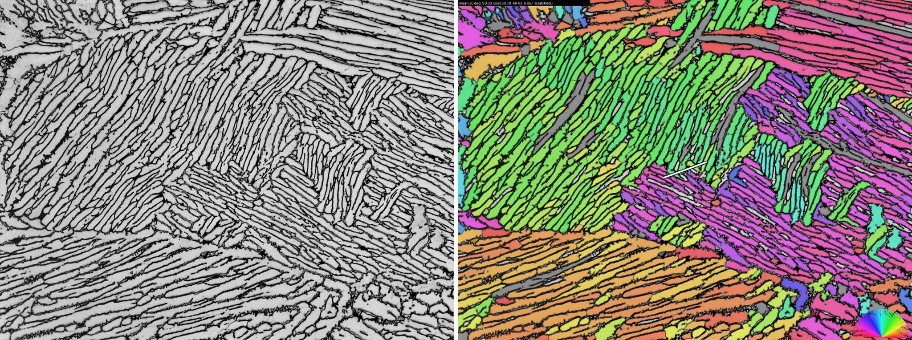
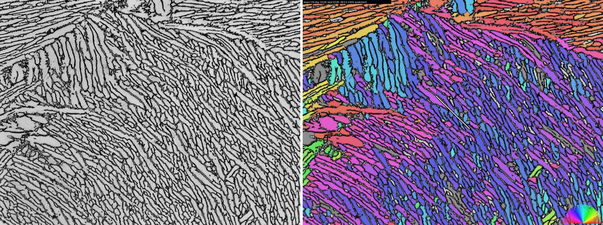
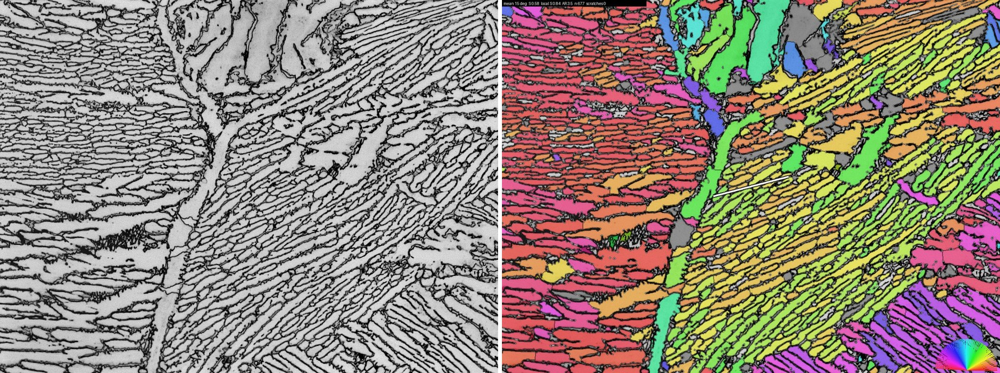
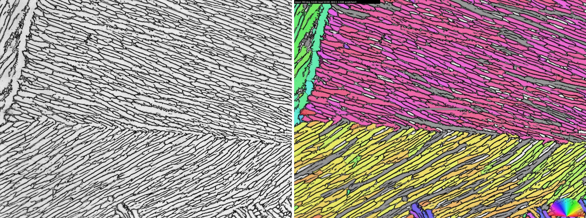
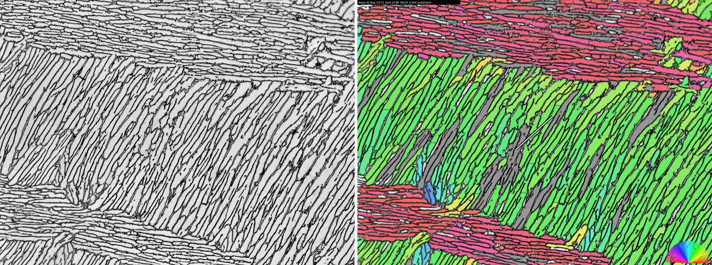
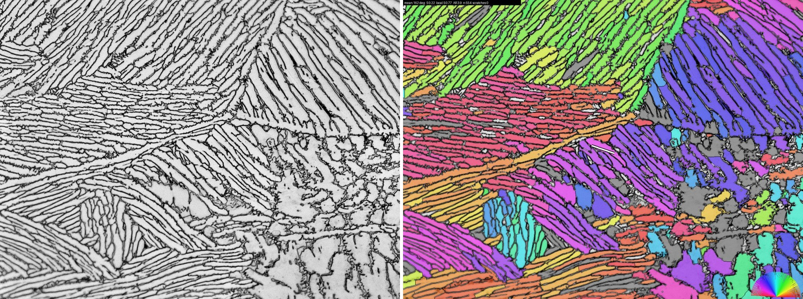
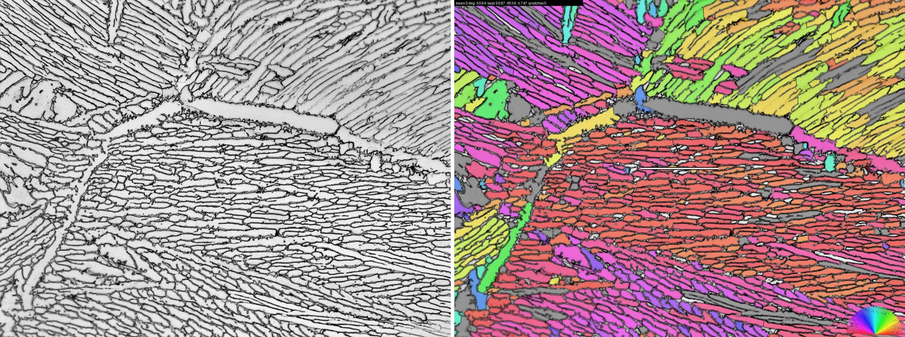
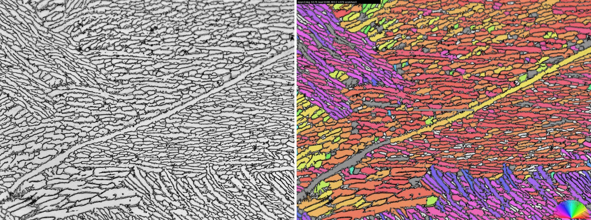
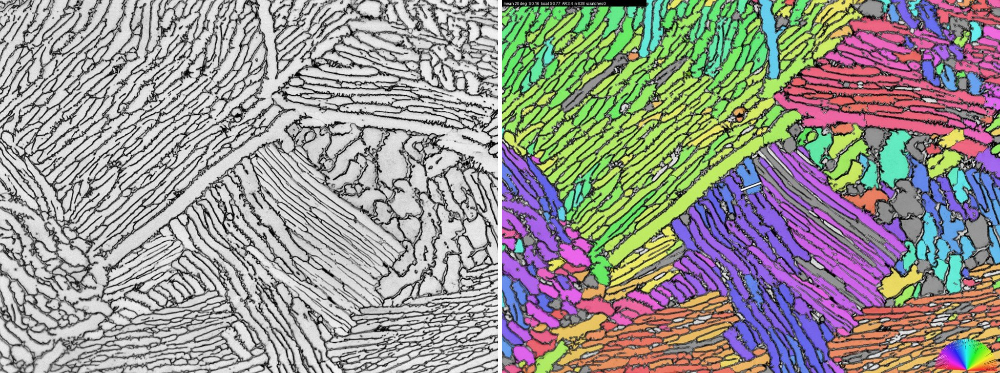
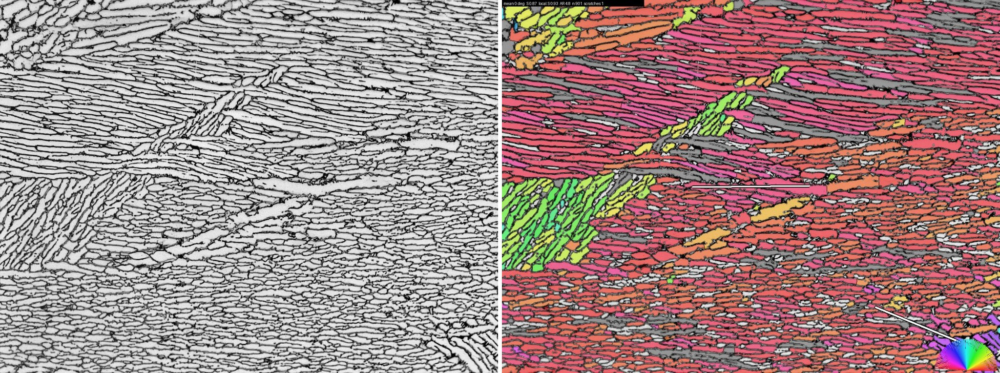
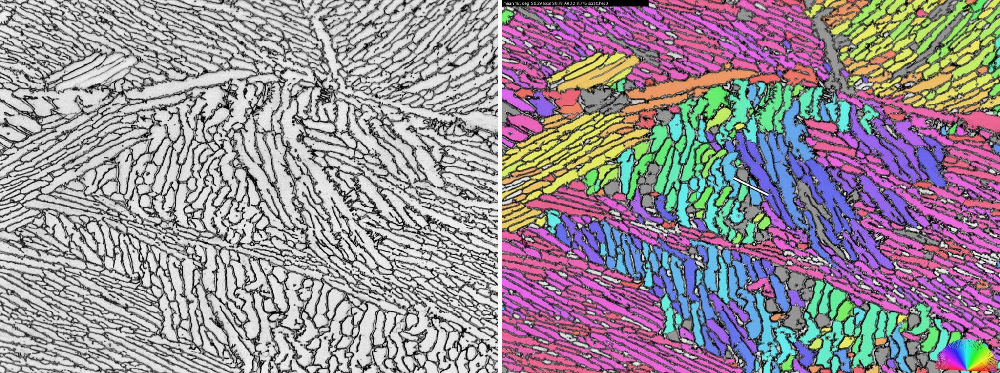
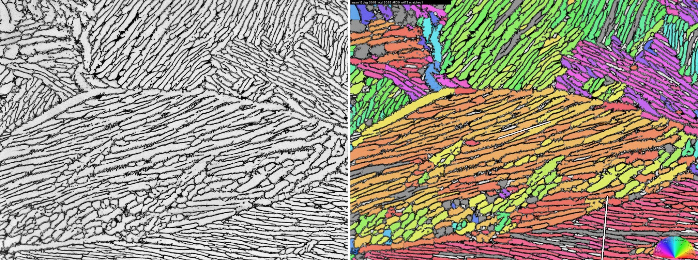

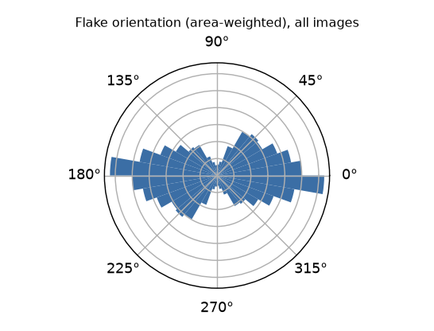
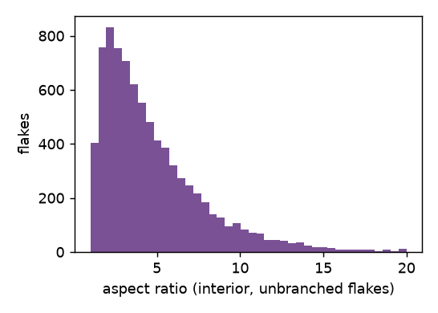

## Files

- `flakes.csv`: every flake (orientation, length, width, aspect ratio, misalignment, flags)
- `image_summaries.csv`: one row per image, with bootstrap intervals
- `params.json`: the params used
- `adapt_log.json`: profile, twin, search trials, reviews
