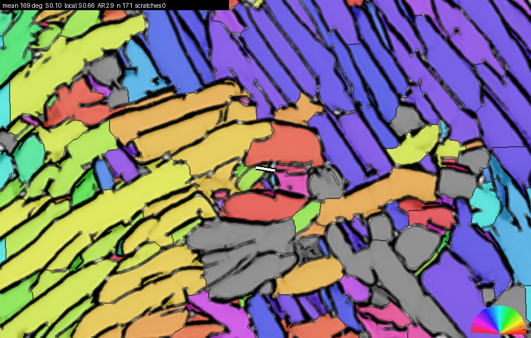
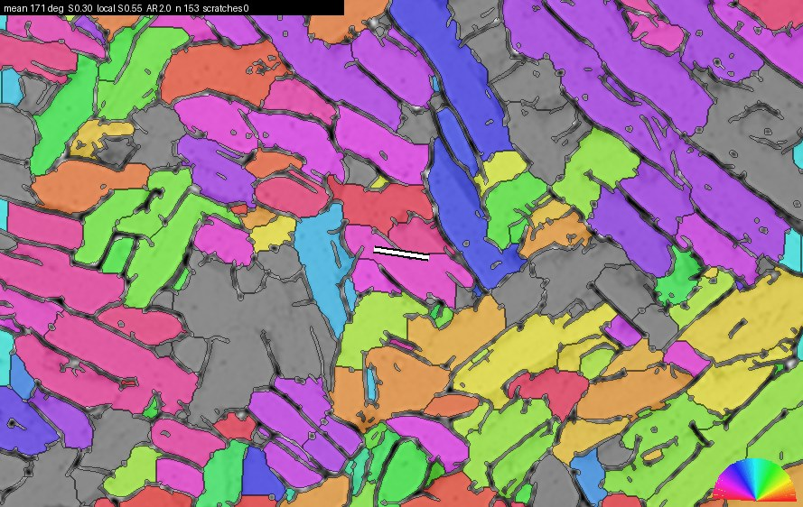
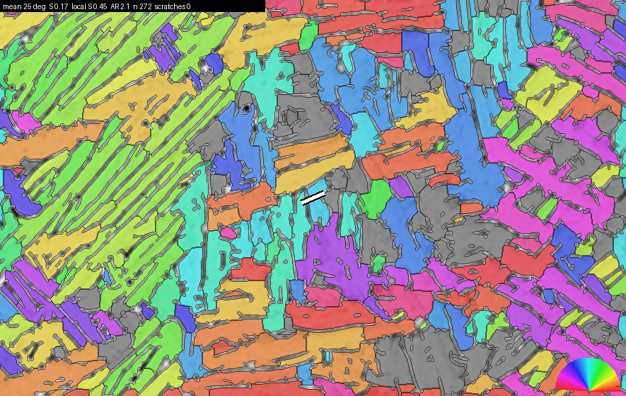
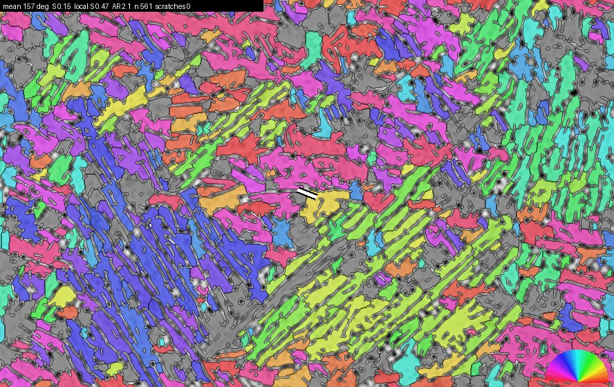
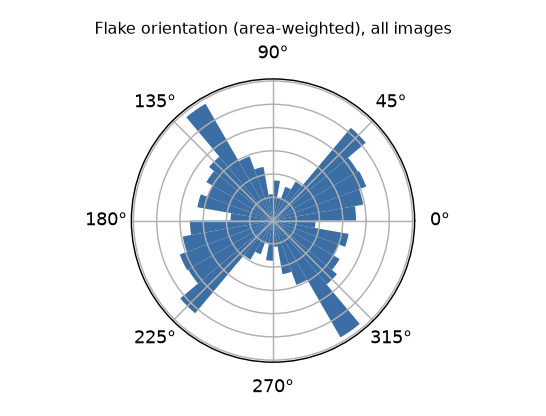
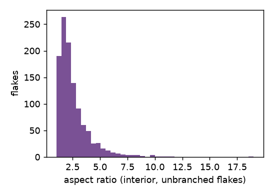

# Flake measurements: ti_basketweave_ma19010080

4 images; reading: **boundaries** (ambiguous profile; boundary reading by default (the agent review checks it)); flake width 15.22 px; code version bda0a7c33b.

## Confidence

- **Twin not usable** for this image set (it does not resemble the images closely enough, or flakes cannot be found on it at this size): the accuracy below is not evidence about these images, and no search was run on it; the scaled default settings were used. Treat the numbers as unvalidated; check them in the drawings.
- Twin accuracy (held-out twin images, exact truth): worst family ratio 1.10, pooled 0.66 (<= 1 means within the tolerances of config.yaml); dev 1.05: a gap shows how much the search fitted the dev twin images.
- The twin resembles the real images only roughly (worst profile mismatch x1.66; flake aspect ratio and width as measured by the method differ by up to x1.67); the twin accuracy carries over only as far as that, and only for structures the generator draws (straight laths in colonies).
- Rotation check on the real images (central disk turned by 30 deg and measured again): worst ratio 1.17 (FAILS); S changes by 0.035, the direction by None deg, the median aspect ratio by 0.0335 (relative); for comparison, the 95 % interval of S from the finite number of flakes is +/-0.116. At S below ~0.3 the mean direction is weakly defined and moves easily.
- The image profile was ambiguous between a boundary network and phase islands: check in the drawings that the outlined regions are the flakes you mean; rerun with --mode phase otherwise.
- Lengths are in pixels (no --um-per-px given).

## Set summary

| | median | min | max |
|---|---|---|---|
| order parameter S | 0.159 | 0.101 | 0.298 |
| local S (within colonies) | 0.512 | 0.447 | 0.659 |
| mean misalignment (deg) | 39 | 34.4 | 41.8 |
| median aspect ratio | 2.14 | 2.01 | 2.86 |
| median length (px) | 50.9 | 32.9 | 61.9 |
| median width (px) | 20.9 | 15 | 33 |
| flakes used per image | 222 | 153 | 561 |

Mean directions differ per image (axial; see the table): a set-level mean direction is only meaningful when the images were taken in the same specimen frame.

## Per image

| image | mean dir (deg) | S [95 % CI] | local S | misalignment (deg) | AR [95 % CI] | flakes | scratches |
|---|---|---|---|---|---|---|---|
| L08__10.3390_ma19010080_g003_p10 | 169 | 0.101 [0.0547, 0.297] | 0.659 | 41.8 | 2.86 [2.33, 3.21] | 171 | 0 |
| L20__10.3390_ma19010080_g003_p9 | 171 | 0.298 [0.201, 0.442] | 0.555 | 34.4 | 2.01 [1.87, 2.22] | 153 | 0 |
| L21__10.3390_ma19010080_g003_p7 | 25.5 | 0.171 [0.067, 0.29] | 0.447 | 38.6 | 2.14 [1.97, 2.29] | 272 | 0 |
| L22__10.3390_ma19010080_g003_p5 | 157 | 0.147 [0.0633, 0.237] | 0.47 | 39.5 | 2.13 [1.99, 2.21] | 561 | 0 |

## How accurate is it (twin images with exact truth)

Twin: 18 code-generated images fitted to this set (realism ok: False; worst profile mismatch x1.66).

| twin images | params | mean direction err (deg) | S err | misalignment err (deg) | AR err | flake orientation err (deg) | flakes found | worst family ratio |
|---|---|---|---|---|---|---|---|---|
| dev | start | 0.44 | 0.0136 | 0.896 | 0.0438 | 2.04 | 0.753 | 0.561 |
| holdout | start | 0.506 | 0.0187 | 1.05 | 0.0429 | 1.94 | 0.771 | 0.681 |
| dev | chosen | 0.486 | 0.0416 | 1.96 | 0.02 | 2.74 | 0.96 | 1.05 |
| holdout | chosen | 0.402 | 0.0331 | 1.34 | 0.0216 | 2.51 | 0.971 | 1.1 |

Search: 2 new configurations evaluated (7 incl. cached); objective 0.663 at the start, 1.255 chosen.
Warm start: ti64_dev (distance 0.74).

## Real images: rotation check

Central disk measured as is and turned by 30 deg: direction off by None deg, S by 0.035, aspect ratio by 0.0335 (worst ratio to tolerance 1.1666666666666667; <= 1 passes). Necessary, not sufficient.

## Drawings (left: original, right: flakes coloured by orientation; grey = not used)

## Files

- `flakes.csv`: every flake (orientation, length, width, aspect ratio, misalignment, flags)
- `image_summaries.csv`: one row per image, with bootstrap intervals
- `params.json`: the params used
- `adapt_log.json`: profile, twin, search trials, reviews
