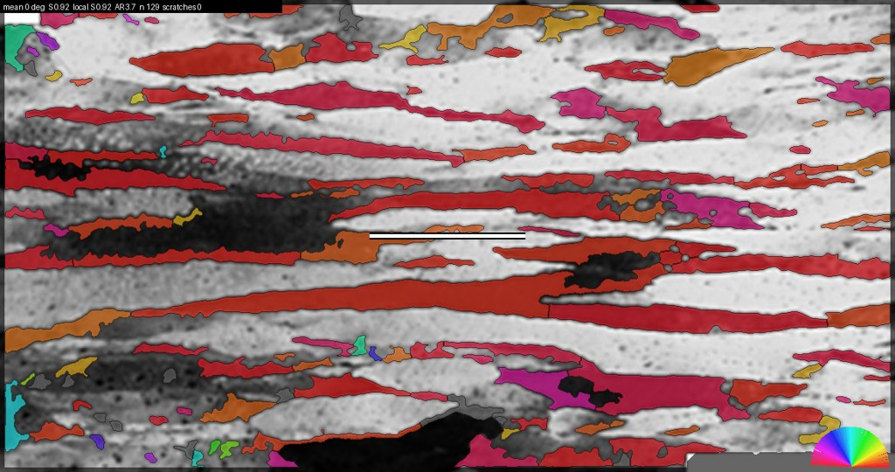
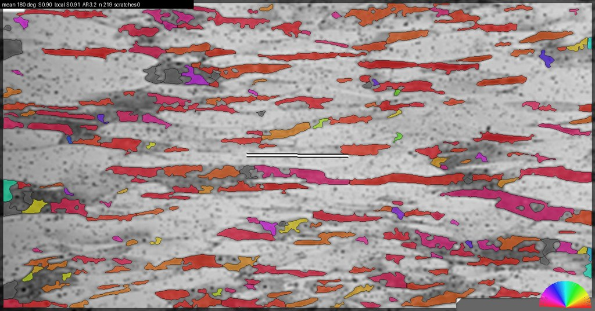
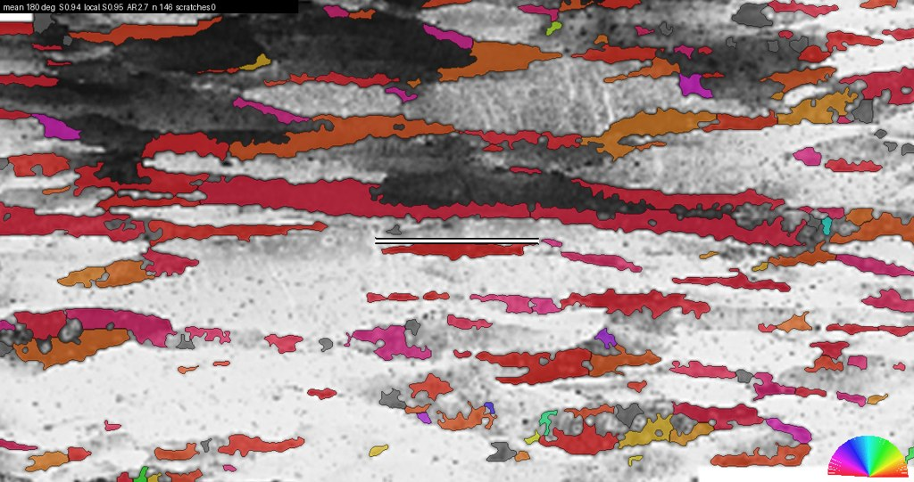
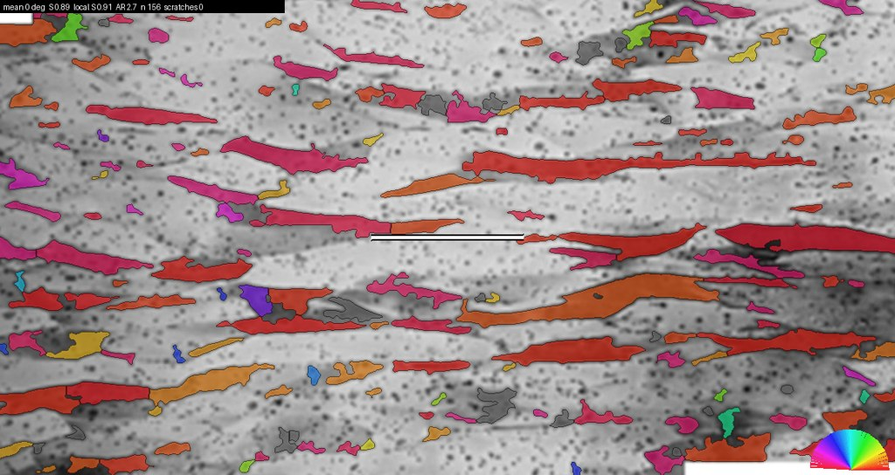
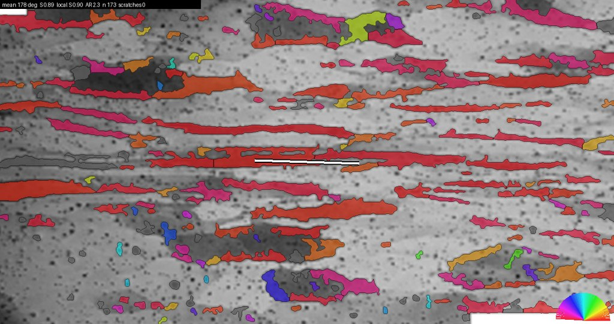
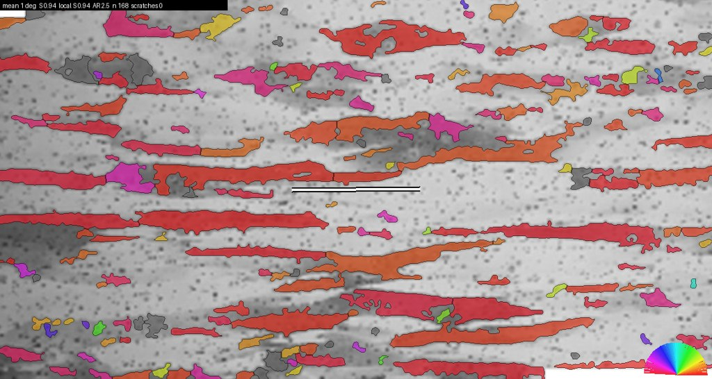
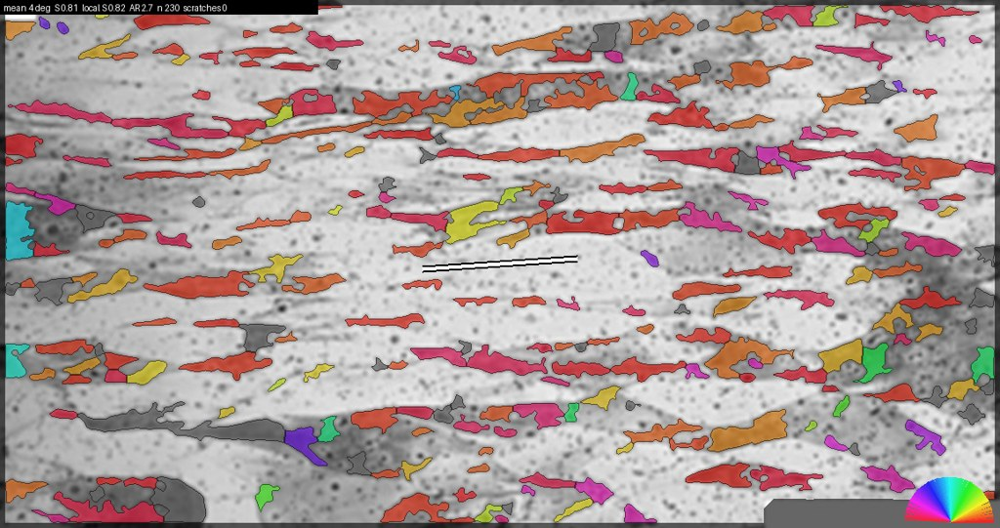
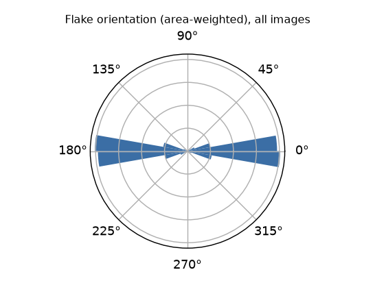
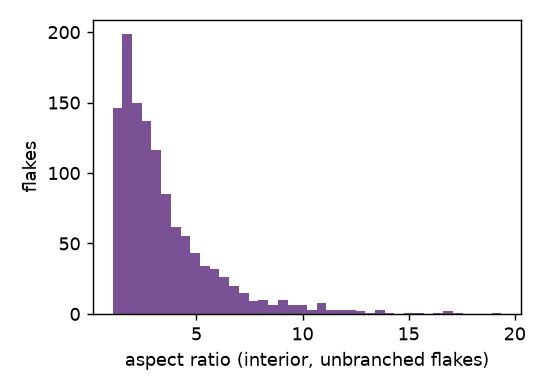

# Flake measurements: banded_islands_ma17081847

7 images; reading: **phase** (minority phase is separate blobs about as thick as the matrix); flake width 13.42 px; code version 2d70afd967.

## Confidence

- **Within tolerances** on held-out twin images, and consistent under rotation on the real images.
- Twin accuracy (held-out twin images, exact truth): worst family ratio 0.48, pooled 0.38 (<= 1 means within the tolerances of config.yaml); dev 0.45: a gap shows how much the search fitted the dev twin images.
- The twin resembles the real images (worst profile mismatch x1.14; flake aspect ratio and width as measured by the method differ by up to x1.33); the twin accuracy carries over only as far as that, and only for structures the generator draws (straight laths in colonies).
- Rotation check on the real images (central disk turned by 30 deg and measured again): worst ratio 0.41 (passes); S changes by 0.009850000000000001, the direction by 0.7300500000000001 deg, the median aspect ratio by 0.0203 (relative); for comparison, the 95 % interval of S from the finite number of flakes is +/-0.037.
- **Two scales**: 46% of the dark phase is in structures about 58 px wide, 4x the typical flake width used here (13.4 px). The settings fit the fine structures; the coarse ones may be split, merged or left out, and the statistics mix the two populations. If the coarse ones are the flakes you mean, rerun with --flake-width 58 --mode phase --flake-phase dark.
- Lengths are in pixels (no --um-per-px given).

## Set summary

| | median | min | max |
|---|---|---|---|
| order parameter S | 0.904 | 0.815 | 0.937 |
| local S (within colonies) | 0.912 | 0.823 | 0.948 |
| mean misalignment (deg) | 8.92 | 7.02 | 13.1 |
| median aspect ratio | 2.69 | 2.29 | 3.65 |
| median length (px) | 40.2 | 32.4 | 53.2 |
| median width (px) | 13.8 | 12.7 | 16.6 |
| flakes used per image | 168 | 129 | 230 |

Mean directions differ per image (axial; see the table): a set-level mean direction is only meaningful when the images were taken in the same specimen frame.

## Per image

| image | mean dir (deg) | S [95 % CI] | local S | misalignment (deg) | AR [95 % CI] | flakes | scratches |
|---|---|---|---|---|---|---|---|
| L03__10.3390_ma17081847_g009_p6 | 0.263 | 0.918 [0.872, 0.958] | 0.924 | 7.68 | 3.65 [3.06, 4.21] | 129 | 0 |
| L07__10.3390_ma17081847_g009_p2 | 180 | 0.904 [0.867, 0.933] | 0.912 | 8.92 | 3.25 [2.97, 3.62] | 219 | 0 |
| L11__10.3390_ma17081847_g009_p7 | 180 | 0.937 [0.916, 0.954] | 0.948 | 7.61 | 2.69 [2.36, 3.18] | 146 | 0 |
| L14__10.3390_ma17081847_g009_p3 | 0.446 | 0.893 [0.855, 0.929] | 0.909 | 9.47 | 2.66 [2.42, 3.02] | 156 | 0 |
| L16__10.3390_ma17081847_g010_p8 | 178 | 0.889 [0.84, 0.927] | 0.898 | 8.96 | 2.29 [2.02, 2.75] | 173 | 0 |
| L17__10.3390_ma17081847_g010_p7 | 0.574 | 0.936 [0.915, 0.954] | 0.944 | 7.02 | 2.48 [2.21, 2.77] | 168 | 0 |
| L19__10.3390_ma17081847_g009_p1 | 3.57 | 0.815 [0.742, 0.881] | 0.823 | 13.1 | 2.69 [2.42, 2.86] | 230 | 0 |

## How accurate is it (twin images with exact truth)

Twin: 18 code-generated images fitted to this set (realism ok: True; worst profile mismatch x1.14).

| twin images | params | mean direction err (deg) | S err | misalignment err (deg) | AR err | flake orientation err (deg) | flakes found | worst family ratio |
|---|---|---|---|---|---|---|---|---|
| dev | start | 0.545 | 0.00769 | 0.606 | 0.169 | 1.9 | 0.931 | 1.33 |
| holdout | start | 0.605 | 0.00995 | 0.494 | 0.182 | 2.05 | 0.94 | 1.29 |
| dev | chosen | 0.612 | 0.00694 | 0.507 | 0.0438 | 1.78 | 0.863 | 0.447 |
| holdout | chosen | 0.669 | 0.00589 | 0.398 | 0.0414 | 1.9 | 0.863 | 0.482 |

Search: 20 new configurations evaluated (29 incl. cached); objective 1.609 at the start, 0.536 chosen.
Warm start: ti64_dev (distance 5.92).

## Real images: rotation check

Central disk measured as is and turned by 30 deg: direction off by 0.7300500000000001 deg, S by 0.009850000000000001, aspect ratio by 0.0203 (worst ratio to tolerance 0.40599999999999997; <= 1 passes). Necessary, not sufficient.

## Drawings (left: original, right: flakes coloured by orientation; grey = not used)

## Files

- `flakes.csv`: every flake (orientation, length, width, aspect ratio, misalignment, flags)
- `image_summaries.csv`: one row per image, with bootstrap intervals
- `params.json`: the params used
- `adapt_log.json`: profile, twin, search trials, reviews
