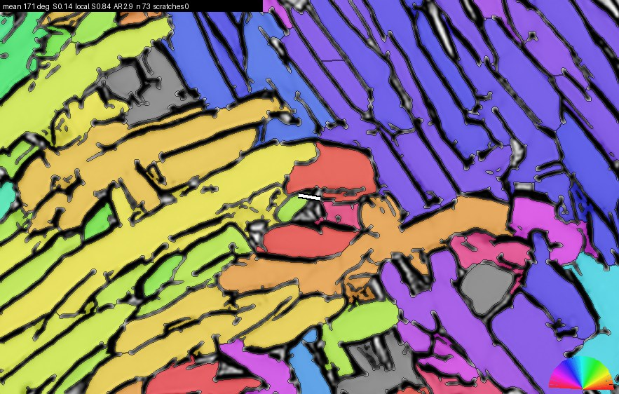
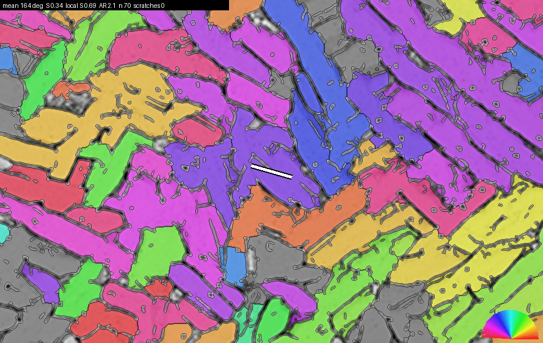
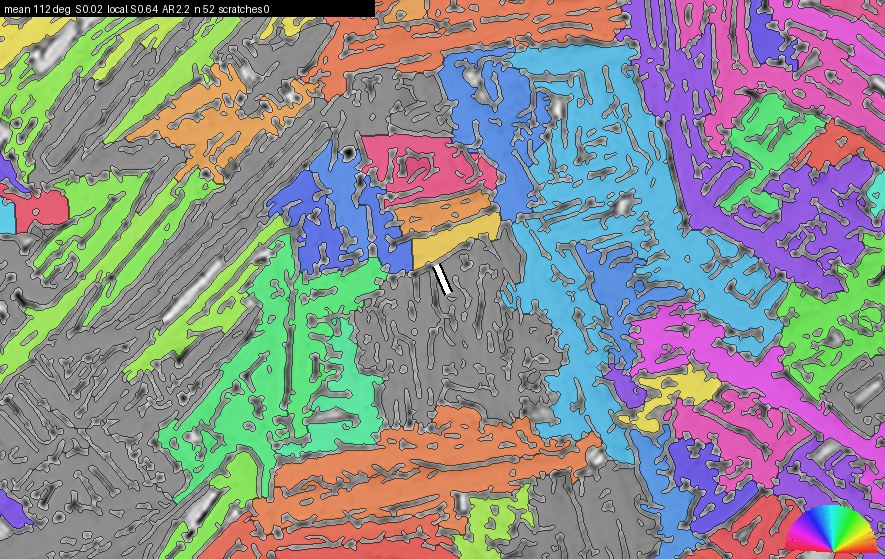
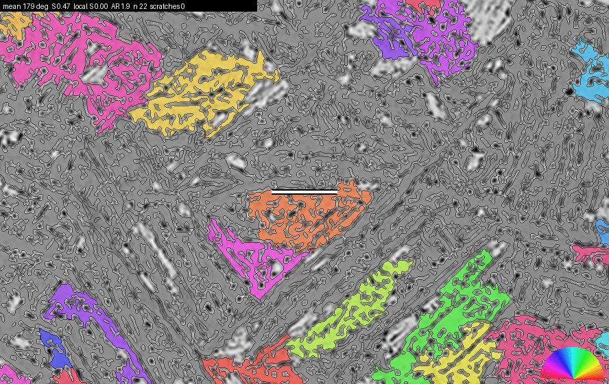
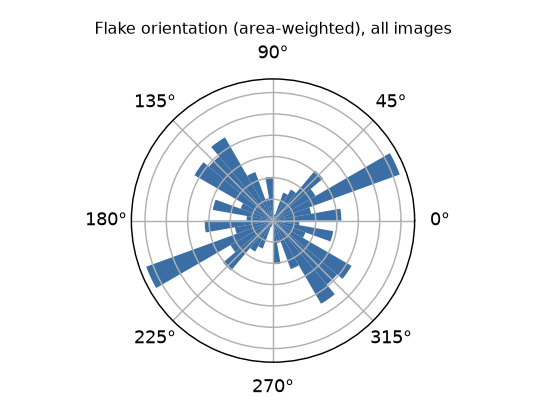
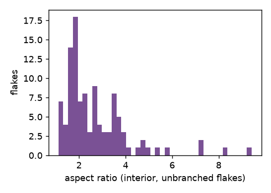

# Flake measurements: ti_basketweave_ma19010080

4 images; reading: **boundaries** (ambiguous profile; boundary reading by default (the agent review checks it)); flake width 15.22 px; code version 2d70afd967.

## Confidence

- Twin accuracy (held-out twin images, exact truth): worst family ratio 0.88, pooled 0.44 (<= 1 means within the tolerances of config.yaml); dev 0.94: a gap shows how much the search fitted the dev twin images.
- The twin resembles the real images (worst profile mismatch x1.25; flake aspect ratio and width as measured by the method differ by up to x1.14); the twin accuracy carries over only as far as that, and only for structures the generator draws (straight laths in colonies).
- Rotation check on the real images (central disk turned by 30 deg and measured again): worst ratio 3.9 (FAILS); S changes by 0.07, the direction by 11.69855 deg, the median aspect ratio by 0.11524999999999999 (relative); for comparison, the 95 % interval of S from the finite number of flakes is +/-0.171. At S below ~0.3 the mean direction is weakly defined and moves easily.
- The image profile was ambiguous between a boundary network and phase islands: check in the drawings that the outlined regions are the flakes you mean; rerun with --mode phase otherwise.
- Lengths are in pixels (no --um-per-px given).

## Set summary

| | median | min | max |
|---|---|---|---|
| order parameter S | 0.241 | 0.017 | 0.471 |
| local S (within colonies) | 0.686 | 0.644 | 0.84 |
| mean misalignment (deg) | 36.6 | 28.5 | 43.8 |
| median aspect ratio | 2.12 | 1.92 | 2.87 |
| median length (px) | 131 | 118 | 162 |
| median width (px) | 55.6 | 46 | 81.4 |
| flakes used per image | 61 | 22 | 73 |

Mean directions differ per image (axial; see the table): a set-level mean direction is only meaningful when the images were taken in the same specimen frame.

## Per image

| image | mean dir (deg) | S [95 % CI] | local S | misalignment (deg) | AR [95 % CI] | flakes | scratches |
|---|---|---|---|---|---|---|---|
| L08__10.3390_ma19010080_g003_p10 | 171 | 0.144 [0.0859, 0.397] | 0.84 | 40.3 | 2.87 [2.2, 3.56] | 73 | 0 |
| L20__10.3390_ma19010080_g003_p9 | 164 | 0.337 [0.211, 0.501] | 0.686 | 32.9 | 2.06 [1.8, 2.64] | 70 | 0 |
| L21__10.3390_ma19010080_g003_p7 | 112 | 0.017 [0.0373, 0.412] | 0.644 | 43.8 | 2.17 [1.83, 3.09] | 52 | 0 |
| L22__10.3390_ma19010080_g003_p5 | 179 | 0.471 [0.256, 0.694] | – | 28.5 | 1.92 [1.81, 2.54] | 22 | 0 |

## How accurate is it (twin images with exact truth)

Twin: 18 code-generated images fitted to this set (realism ok: True; worst profile mismatch x1.25).

| twin images | params | mean direction err (deg) | S err | misalignment err (deg) | AR err | flake orientation err (deg) | flakes found | worst family ratio |
|---|---|---|---|---|---|---|---|---|
| dev | start | 0.746 | 0.0328 | 1.94 | 0.0178 | 2.41 | 0.642 | 0.98 |
| holdout | start | 0.37 | 0.0203 | 1.44 | 0.0128 | 2.38 | 0.653 | 1.11 |
| dev | chosen | 0.363 | 0.0257 | 1.42 | 0.00706 | 2.17 | 0.642 | 0.936 |
| holdout | chosen | 0.342 | 0.0118 | 1.12 | 0.0155 | 2.22 | 0.655 | 0.881 |

Search: 20 new configurations evaluated (30 incl. cached); objective 1.144 at the start, 1.065 chosen.
Warm start: ti64_dev (distance 0.74), banded_islands_ma17081847 (distance 5.64).

## Real images: rotation check

Central disk measured as is and turned by 30 deg: direction off by 11.69855 deg, S by 0.07, aspect ratio by 0.11524999999999999 (worst ratio to tolerance 3.8995166666666665; <= 1 passes). Necessary, not sufficient.

## Drawings (left: original, right: flakes coloured by orientation; grey = not used)

## Files

- `flakes.csv`: every flake (orientation, length, width, aspect ratio, misalignment, flags)
- `image_summaries.csv`: one row per image, with bootstrap intervals
- `params.json`: the params used
- `adapt_log.json`: profile, twin, search trials, reviews
